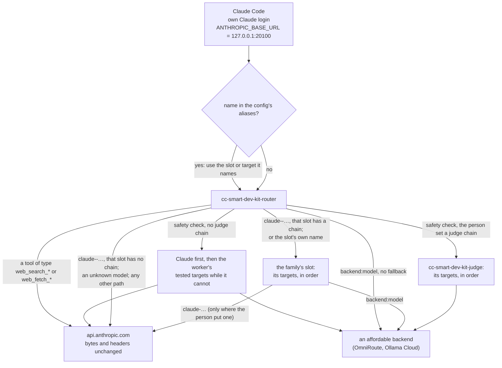

# The AI Gateway

A small local program, **`cc-smart-dev-kit-router`**, sits between Claude Code and the model
providers. It lets each Claude model's work go to models the person chose (a chain per
model family, a slot), and every model whose slot has no chain stays real Claude, on the
person's own login. It is optional: nothing changes until a person runs
`cc-smart-dev-kit gateway setup`, `cc-smart-dev-kit gateway on`, and gives a slot a chain.

How to use it, step by step: the `gateway` skill (`plugin/skills/gateway/SKILL.md`).
The rules for changing it: `.claude/rules/gateway.md`.

## Summary

- Claude Code sends every request to the router (`ANTHROPIC_BASE_URL`), with the
  person's **own** Claude login on it. There is no gateway token. The router never
  stores the login, and it only ever reaches Anthropic.
- **Every Claude model has a slot, by its family**, read from the id Claude Code sends:
  Haiku → `cc-smart-dev-kit-scout`, Sonnet → `cc-smart-dev-kit-worker`, Opus →
  `cc-smart-dev-kit-opus`, Fable → `cc-smart-dev-kit-fable`. A newer version of a family
  (`claude-opus-6-0`) reaches the same slot with no change to the plugin.
- **Every slot has two modes, Claude or Custom** (§ Slot modes: Claude or Custom): a slot
  with a chain (`slots` in the config) is **Custom**, and its first target answers. A slot
  with no chain there is **Claude**: that model is plain Claude, and its request goes to
  Anthropic **byte for byte**, the id Claude Code sent included (the one exception: a
  thinking block a backend wrote, marked by the router, leaves it; § Model slots). A fresh
  setup gives no slot a chain; the person picks every target from the live model list
  (§ Slots and defaults). Switching a slot to Claude **saves its chain** in the config's
  `kept` field, so nothing is forgotten and nothing is used.
- **A slot with a chain** sends the request to its first target. Its next target answers
  only while the slot's **fallback switch** is on (§ The fallback switch). A target is any
  `<backend>:<model>` or `claude-<model>`, in any order, in any slot. **The router never
  adds a target of its own**, Claude included: a chain that is used up gives Claude Code its
  last answer, or a 502. One exception, with the slot's breaker on (the default): when every
  target failed for want of capacity and the last one is a backend, the request is held for a
  while and then answered with a 429 Claude Code retries (§ The breaker). Anthropic's own
  answers always pass unchanged.
- **A request that carries one of Anthropic's server tools** (web search) goes to Anthropic
  as Claude Code sent it, whatever its slot, because no affordable backend can run the tool
  (§ Anthropic's server tools).
- **Auto mode's safety check** is judged by Claude first. While Claude is limited or down,
  the worker chain's targets that passed the judge test judge in its place. The person may give
  the `cc-smart-dev-kit-judge` slot a chain of their own, and that wins (§ The judge slot).
  Every check is counted, with what its answer reported, for  `cc-smart-dev-kit usage` (§ The safety-check counts).
- The router writes the plan limits it sees to a small state file, which the status line
  and the usage-limit alert read, and reads it back when it starts (§ The limit state, the
  status line, the alert).
- **No prompt text is ever changed.** An affordable backend gets two named format translations
  and nothing else (§ What an affordable backend sees).
- Only this machine can reach the router (§ Local only).
- It runs from a copy in `~/.local/share/cc-smart-dev-kit/`: as a systemd user unit behind
  a socket unit that holds its port on Linux, so a restart makes new requests wait instead
  of fail (§ The service), and as a per-user Scheduled Task on Windows, where a restart
  refuses requests for a moment (`docs/windows-gateway.md`).

## The request path



- A `claude-…` model goes to the slot of its family (`familySlotFor`, `src/gateway/targets.ts`):
  `-haiku-` → scout, `-sonnet-` → worker, `-opus-` → opus, `-fable-` → fable, read from the
  id Claude Code sends (`[1m]` ignored; a cloud provider's dot-separated prefix such as
  `us.anthropic.claude-…` too, never a `<backend>:` one). With no chain there, and for any **unknown** model
  name, the request goes to Anthropic as it came. So does every path that is not
  `/v1/messages` or `/v1/messages/count_tokens`. The router never guesses an affordable backend.
- A **slot key** is a model name the router owns: `cc-smart-dev-kit-<name>`. Up to 0.4.3,
  `gateway on` pointed Claude Code's `haiku` and `sonnet` at `cc-smart-dev-kit-scout[1m]` and
  `cc-smart-dev-kit-worker[1m]`; it pins no model since 0.5.0 (§ What `gateway on` writes). A
  request that still names a slot reaches its chain; one that names a slot with no chain gets
  a 400 that says to run `gateway on` again (the router never picks a Claude model for it).
- A **target** is `claude-<id>` (Anthropic, on the person's own login) or `<backend>:<model>`
  (an affordable backend, with its own key). A `claude-…` target that is the very model the
  request named gets the bytes Claude Code sent; another `claude-…` target gets `model`
  changed, and only the fields that model refuses (§ What a Claude target sees).
  `<backend>:<model>` as the model name itself is an ad-hoc try: that backend only, no
  fallback.
- The safety check is never routed by its model's family (§ The judge slot).

## Profiles: a project's own chains (D29)

A **profile** is a named set of slot chains and switches over the machine's, so one project
(or one session) can use other targets per slot while every other session keeps the machine's.
A project reaches its profile through its `ANTHROPIC_BASE_URL`:

```
http://127.0.0.1:20100/p/my-project
```

- **The shape** is `profiles` in `gateway.json`, by name:

  ```json
  "profiles": {
    "my-project": {
      "slots": {
        "cc-smart-dev-kit-worker": ["omniroute:glm-5.3-flash"],
        "cc-smart-dev-kit-scout": "claude"
      },
      "fallback": { "cc-smart-dev-kit-worker": false },
      "breaker": { "cc-smart-dev-kit-worker": true }
    }
  }
  ```

  Per slot: **absent** keeps the machine's chain, **`"claude"`** turns that slot off for this
  profile (plain Claude there, whatever the machine's chain is), and a **list** is the
  profile's own chain, in the same shape and with the same checks as `slots`. `fallback` and
  `breaker` are per profile too, and a slot the profile or the machine has no chain for is
  refused, as at the top level. `kept` inside a profile saves a chain that is not in use there,
  the way the top-level `kept` does.
- **Everything else stays machine-wide**: `backends` and their keys, `port`, `timeouts`,
  `aliases`, `judgeTested` and `history`. A project cannot bring its own backend key or its own
  judge proof, and cannot move the router's port.
- **The prefix is stripped once, before every branch**: a model call streamed or not,
  `count_tokens`, `HEAD /api/hello`, the health page, a server-tool request and the judge all
  read the path Claude Code itself would have sent, and that path is what Anthropic gets
  (`profileFromPath`, `src/gateway/targets.ts`). Claude Code keeps the whole path on every
  request, which is what makes the prefix work at all (`docs/claude-code-contract.md`).
- **A name that is no profile answers as plain Claude**: every slot off and no alias applied
  (an old name in `aliases` may point at a chain, and plain Claude reaches none), the request to
  Anthropic as Claude Code sent it, one WARN naming the profile and the ones the config holds.
  Never an error a session cannot read. The name is checked against a strict pattern first —
  lower-case letters, digits and `-`, at most 64 — so a hand-written key a URL could never carry
  is never looked up.
- **A profile's chain is its own state**: a fallback record or an open breaker is kept under
  `<profile>/<slot>` in the limit state file (`stateKeyFor`), and the profile's breaker holds
  and answers on its own. A target's rest, and the one request at a time that probes it, stay
  per target: a target that is down is down for every profile. `limits` stays per Claude model
  too: the login, and so the plan limits, is one for every profile.
- **The request history says which profile a row came from**: its `profile` column holds the
  name the path carried, and null for the machine's default. A database from before the column
  keeps every row, and those rows read as null. The history's reader filters by it
  (`HistoryFilters.profile`).
- **The health page names what this router knows**: `features: ["profiles"]`, and `profiles`
  lists the configured names. A command or the portal reads it to tell a running router that
  knows profiles from an older one, which carries no version.
- **A project reaches its profile by its URL**: `ANTHROPIC_BASE_URL` with `/p/<name>` on the
  end, in that project's own settings file (or passed to one session with `--settings`). It is
  the only place a profile's name comes from; no request header names a project.
- **Its chains and switches are the command line's**: `gateway profile <name> slot <slot>
  <targets>` sets the profile's own chain for a slot (`off`, or `claude`, turns it off there;
  `clear` forgets it, so the machine's chain applies again), `gateway profile <name> fallback
  <slot> on|off` sets its fallback switch, and `gateway profile <name> remove` deletes it. Every
  target is checked against its backend's live model list, exactly as `gateway slot` checks the
  machine's, and every change is checked as a whole config before it is saved. The first chain
  makes the profile: a name `gateway.json` does not have starts empty. A profile's **judge**
  chain may only hold targets the machine's judge test already proved (`judgeTested`, D44),
  because the proof is machine-wide and the router ignores untested targets: set the judge with
  `gateway slot judge` (or `gateway slot worker`, whose proof also lets a target judge while
  Claude cannot) first. A profile's **worker** targets judge while Claude cannot only once the
  machine proved the same target. The router reads the
  config again within about a second, so a session using the profile uses the change from its
  next request. A project gets the profile with `gateway project on --profile <name>` (§ Per
  project). A profile's fallback or breaker switch set on a slot it only inherits (it names no
  chain of its own there) goes when the machine takes that slot's last chain away —
  `gateway slot <slot> claude` or `clear` — because the config refuses a switch on a slot with no
  chain at all; the machine's command says which profile lost it.

## Per project: on, off, or the machine's default (D29)

The machine-wide `gateway on` points every session at the router. One project can choose its
own answer; `gateway project status` says which one applies and which file says so.

| State | What the project's file holds | What a session started in the project gets |
|---|---|---|
| **on** | `ANTHROPIC_BASE_URL` = `http://127.0.0.1:<port>`, or `…/p/<profile>` with a profile | the router, with the profile's chains when the URL names one |
| **off** | `ANTHROPIC_BASE_URL` = `https://api.anthropic.com` | Anthropic, on the person's own claude.ai login: turning the gateway off never logs them out (P1) |
| **default** | no key | whatever the machine's own settings file says; the shell may still set one, and a launch's `--settings` file wins for that session (P3) |

```sh
cc-smart-dev-kit gateway project status [--folder <dir>]
cc-smart-dev-kit gateway project on|off|default [--team] [--profile <name>] [--folder <dir>]
cc-smart-dev-kit gateway projects [--folder <dir>]
```

- **Where the value lives.** By default the **personal** file,
  `<main checkout>/.claude/settings.local.json`, with a managed `/.claude/settings.local.json`
  line in `.git/info/exclude` so it is never committed: `restore` takes back both the key and
  the line. `--team` writes the **team** file, `<folder>/.claude/settings.json`, and takes `off`
  and `default` only — a team file never points teammates at one person's local router. A
  `--team` run in a subfolder is refused there: a session started in that subfolder would not
  read the file.
- **Which file wins (P3).** A `--settings` file (not visible here), then `settings.local.json`,
  then the starting folder's `.claude/settings.json`, then the user's own settings file, then
  the shell. The personal file is read at the **main checkout's root** for the checkout, every
  subfolder and every worktree (P6), which is why it is the default home of a project's own
  choice: one write reaches every session of the project.
- **The team file's limit (P6).** `.claude/settings.json` is read from the folder the session
  starts in. A team `off` or `default` at the project's top folder does not reach a session
  started in a subfolder — the machine's value applies there — and a linked worktree reads it
  only when it carries the committed file. `gateway project status` says so where it applies, and
  `doctor` names each project's state.
- **One reader, two answers.** `projectGatewayState(folder)` (`src/gateway/project-state.ts`)
  answers the project's own **choice** (its personal file, then its team file) and what a
  session **effectively** gets (that choice, then the machine's settings file).
  `gateway project status` and `gateway projects` call it, and GP4 adds the doctor lines and the
  portal's project card on the same function, so no two of them can disagree. A settings file
  that cannot be read, or whose `ANTHROPIC_BASE_URL` is not an address, stops the chain as
  **unknown**: Claude Code's own answer past such a file is not known, and a state nobody read
  is not a state to claim. `gateway project status` exits 1 when it cannot tell (an unreadable
  file or config) and 0 otherwise.
- **Running sessions (P7).** A changed value reaches a session already running in the project
  within about a second. A removed key never does: `default` says the session keeps the value it
  had until it restarts.
- **`restore` takes a project's key and its excluded line back, but its stage 1 does not yet
  wait for them.** Stage 1 (`docs/gateway.md` § `cc-smart-dev-kit restore`) waits only for the
  machine's own settings file, so a project still pointed at the router would see the router
  stop under its running sessions. Until GP4a makes stage 1 count every owned file, run
  `gateway project default` in each such project and restart its sessions before `restore`.
- **Refusals, one line each with the fix:** a project file that already holds another gateway's
  URL (not this machine's router, not Anthropic's) is never overwritten; `on` and `off` are
  refused while `ANTHROPIC_API_KEY`, `ANTHROPIC_AUTH_TOKEN` or `apiKeyHelper` is set at a level
  of the project's chain — its personal file, the team file of the folder, the main checkout's
  team file (the personal file reaches its sessions too) and the machine's settings — because
  the gateway must never replace the person's own login. (A *worktree's own* committed team file
  is not part of that check yet.) A personal file **git tracks** is refused for `on`: a router
  address there would be committed with it, and the line in `.git/info/exclude` cannot untrack a
  file. Also refused: `--team` with `on`; a profile name `isProfileName` refuses, or one
  `gateway.json` does not have; and a folder outside git, which has no personal file to write.
- **`gateway projects [--folder <dir>]`** lists every repository the portal's Projects page
  shows — the same `projectsList` reader, asked about the folder given — each with its own state
  and the file it comes from, and marks the one the command runs in.
- **Windows is unproved for this row** (R6's P11 is owed): the reader and the commands use the
  main checkout's root on every platform. On Windows, check `gateway project status` in a
  project once before relying on it.

## One session: `launch` (GP3)

A project's state and the machine's settings decide for every session in a folder. Sometimes one
session should go elsewhere: plain Claude for a task that must not leave the person's own login,
or a profile for one long job. `cc-smart-dev-kit launch` starts exactly that session.

```sh
cc-smart-dev-kit launch [--no-gateway | --gateway | --profile <name>] [-- <claude args>]
```

| Mode | `env.ANTHROPIC_BASE_URL` in the session | The line it prints |
|---|---|---|
| `--no-gateway` | `https://api.anthropic.com`: Anthropic, on the person's own claude.ai login (P1) | `launch: plain Claude (no gateway) · …` |
| `--gateway` | the machine's router, `http://127.0.0.1:<port>` from `gateway.json` | `launch: the gateway · …` |
| `--profile <name>` | the router with the profile, `…/p/<name>` | `launch: the gateway, profile "<name>" · …` |
| none | no file and no `--settings`: the machine's and the project's settings decide, as for `claude` | `launch: this machine's settings · no --settings file` |

Everything after `--` goes to Claude Code itself (`--model`, `-p`, `--resume`, `--help`). The
session runs in the folder the command runs in, attached to that terminal, and its exit code is
the command's.

- **Why a settings file** (R6): a settings file's `env` beats a shell export (P4), and a
  `--settings` file beats the project's personal file, its team file, the user file and the
  shell (P3). So the launch writes one small file holding only `env.ANTHROPIC_BASE_URL` and
  passes it with `--settings`; every other setting stays the person's. An environment variable
  would lose to any settings file.
- **Where the file is:** `<stateDir>/launch/<mode>-<pid>.json` (`no-gateway-<pid>.json`,
  `gateway-<pid>.json`, `profile-<name>-<pid>.json`), mode 0600 in a 0700 folder, written by the
  kit's one JSON writer (`writeJsonFile`, `src/crew/store.ts`), which `crew start` uses for its
  own `--settings` file too. **Two launches at once never clash**: they are two processes, so
  each has its own name, and a second launch cannot rewrite a running session's URL — a settings
  file that changes reaches a running session within about a second (P7), so one shared file
  would. It is removed when the session ends. A launch that is killed leaves its file behind;
  nothing reads it again (the next launch has its own name), and it holds one URL at mode 0600.
- **While it runs, that one session beats the project's own state**, because `--settings` is
  earlier in the chain (P3). `gateway project status` says so: it cannot see a launch's file.
- **Refused, one line each with the fix:** `--profile` with a name `gateway.json` does not have
  (the line lists the profiles it has, and `gateway profile <name> slot …` makes one), a name
  `isProfileName` refuses, `--gateway` or `--profile` on a machine with no `gateway.json` yet
  (`gateway setup`), a config that cannot be read, and `launch` itself **inside a Claude Code
  session** (`CLAUDECODE`): that would be a session inside a session, on a different path from
  the one that started it. A wrong option is a usage mistake (exit 2), never a guess.
- **It does not replace its own process.** Bun has no `execve`, so the command stays in front of
  the session: the session gets the same stdin, stdout and stderr, and the command returns the
  session's exit code. The terminal sees one session either way.
- **A stopped router is not refused here.** `--gateway` checks that the gateway is set up (its
  config exists and reads), not that it answers: a router that is down is `gateway status` and
  `doctor`'s question, and starting a session anyway is the person's choice.
- **Windows is unproved** (P11 is owed): the CLI writes the file before it starts `claude`, and
  a `claude.cmd` runs through `cmd.exe` on one quoted line (`claudeArgv`), so no `.cmd` launcher
  has to write a file first. The path and the quoting are tested; the live run is not.

## Anthropic's server tools

A **server tool** is a tool Anthropic's servers run, such as web search. Claude Code sends the
search as a request of its own (proved on 2.1.306: `docs/claude-code-contract.md`, the P-WS
rows): about 900 bytes, one user message, a short system prompt, one tool,
`{"name":"web_search","type":"web_search_20250305"}`, and the session's own model name. No
affordable backend can run it, and one that answered it would return text a model made up.

- **The rule (D41).** A request whose `tools` hold a tool of a server-tool type goes to Anthropic
  as Claude Code sent it (byte for byte), whatever the slot of its model's family. The types
  are one list matched by prefix (`ANTHROPIC_SERVER_TOOL_PREFIXES` in `server-tools.ts`:
  `web_search_`, `web_fetch_`), so a newer date needs no change. Tool search's types are
  not in the list on purpose: a conversation carries them, and it keeps its slot. A request
  that names a slot or `<backend>:<model>` keeps its route (Anthropic would refuse the name),
  and a safety check is never one. The log line says why:
  `→ anthropic (server tool web_search) 200`.
- **WebFetch uses no server tool.** Claude Code fetches the page itself and then asks a model
  to summarize it, a request with no tools, which follows its slot as any request does.
- **The answer at a Claude limit (D44).** When Anthropic answers that request with a capacity
  failure (`capacityFailureStatus`: 408, 429, any 5xx, 529), or gives no answer (a network error),
  the request would fail or be retried for minutes. The router answers instead with one plain text
  block in Anthropic's message format (`claudeSearchNotice`), saying it comes from the router,
  naming the server tool that failed (`web_search` or `web_fetch`), saying that tool runs on
  Claude, which is at its usage limit (with the window and the reset time when the headers give
  them) or down, and pointing to the Tavily MCP server "if it is set up". The server's name
  comes from `src/mcp/names.ts`; the router does not read Claude Code's config to see whether
  it is registered. The log has the upstream's reason
  as a WARN. This is the one place the router writes words of its own to a model, and it is a
  whole answer in Claude's place, never an edit of Claude Code's text. Any other status (a 400,
  a 401, a 422) passes unchanged: since Claude Code 2.1.304 an unrecognised 400 or 422 makes it
  resend the request without its deferred tools, so the router never makes one up. `count_tokens`
  passes unchanged. Anthropic has no router deadline here, as for any request to Anthropic:
  a search that hangs is waited for, and a connection that breaks is a network error.
- **The form of the answer** follows the request: a stream (`stream: true`, what Claude Code
  sends) gets the six events of a one-block message, otherwise a JSON message. Proved offline
  on 2.1.306 with a test router, a fake Anthropic and a throwaway home: the stream form arrives
  as the tool result in under a second with one request to Anthropic, no retry; a JSON answer
  to the stream request also arrives, but Claude Code first sends the request again without a
  stream. The breaker (BR1) never holds such a request: it is answered or refused at once.

## Slots and defaults

| Slot | Takes | Chain after `gateway setup` | Fallback switch, by default |
|---|---|---|---|
| `cc-smart-dev-kit-scout` | every Haiku request: background calls (titles, summaries), `haiku` agents | **none** (Claude: Haiku answers) | on |
| `cc-smart-dev-kit-worker` | every Sonnet request: `sonnet` agents, a main session on Sonnet | **none** (Claude: Sonnet answers) | on |
| `cc-smart-dev-kit-opus` | every Opus request: the main session on Opus, `opus` agents | **none** (Claude: Opus answers) | off |
| `cc-smart-dev-kit-fable` | every Fable request | **none** (Claude: Fable answers) | off |
| `cc-smart-dev-kit-judge` | auto mode's safety checks | **none** (Claude judges first; the worker's tested targets while Claude cannot) | on |

No model id is written by the plugin as a default, a target or a fallback (owner,
2026-10-17). `gateway setup` writes the backend and its key and no chain the person did not
pick: on a terminal its questions show the live model list and offer each slot "off" (or the
chain it has) as the default. The person picks each target from the live model list (setup's
questions), `cc-smart-dev-kit gateway models` (each backend's own
`/v1/models`) or the portal's Slots page, then `cc-smart-dev-kit gateway slot <slot>
<targets>`. A config saved by 0.4.3 or earlier keeps every chain it holds: `claude-sonnet-5-5`
at the end of a scout or worker chain from an older setup is now the person's own target,
used like any other.

## Slot modes: Claude or Custom

Every slot, the judge included, has the same two modes (owner D2). **`slots[key]` is the
chain in use**, and a slot that is not in `slots` answers as Claude. That is the whole
contract, and every router and CLI version reads it the same way:

- **Custom**: the slot is in `slots`, and its chain answers.
- **Claude**: the slot is not in `slots`, so its family's requests go to Anthropic as Claude
  Code sent them (the judge: Claude judges first, and the worker's tested targets while
  Claude cannot, § The judge slot).
- **`kept[key]` is the chain saved, not in use**: `{"targets": ["…"], "fallback": false}`
  (the fallback switch only when the person set one). It is a loose object at the top level
  of `gateway.json`, so a router or CLI of 0.5.x — which still runs until `gateway setup`
  installs the new router copy — keeps an unknown `kept` and writes it back untouched. So a
  rollback to 0.5.x can never turn a switched-off model back on, and a chain is never lost.

The words, each one command (`gateway slot <slot> …`):

| Word | What it does |
|---|---|
| `<targets>` | Custom: save a new chain, in use. It replaces a saved one and keeps its fallback switch. |
| `claude` | Claude: move the chain to `kept`, with the fallback switch the person set. `off` is the same word, from 0.5.x and before. |
| `custom` | Custom again: the saved chain moves back, with its switch, after the same checks a new chain gets. Refused, with the reason, when nothing is saved or a target no longer checks out. A saved judge chain keeps the test proofs that still match, and `gateway slot judge` tests only the rest. |
| `clear` | Delete the chain, in use or saved, and its switches. |

- **The judge's fallback switch is not part of its chain**: it stays in `fallback` in both
  modes, because with no judge chain it still says whether the worker's tested targets stand
  in (D44).
- **The breaker switch goes when a slot moves to Claude**, as it did when a slot was turned
  off (§ The breaker switch and its hold): the schema refuses an entry for a slot that is not
  in `slots`. Custom brings the chain back with the breaker at its default, on.
- `gateway status` and `doctor` show each slot as Claude or Custom, and the portal's Overview
  shows a saved chain as "saved, not in use". Each names the command that uses it again.
- **`gateway setup` moves what the old portal remembered.** Before 0.6.0 the portal kept the
  opus and fable chains, the judge chain and their switches in its own `portal.json`. `gateway
  setup` (which already holds the lock, backs `gateway.json` up first, and installs and
  restarts the router, so the new router and the moved chains arrive together) saves each of
  those chains as `kept` for a slot that has none in `slots` or `kept`; `gateway.json` wins a
  clash. A second run moves nothing. The portal keeps no slot state now: its old file loses
  its slot parts (a backup is made first), and it stays on disk one release so a rollback to
  0.5.x still finds it. That is the bug B0 fixes at its root — two homes that disagreed, and a
  slot change that sometimes did not save.

## The fallback switch

Each slot has one: `"fallback": {"<slot>": true | false}` in `gateway.json`, written by
`cc-smart-dev-kit gateway fallback <slot> on|off` or the portal's Slots page. Absent, the slot's
default applies (`fallbackOn`, `src/gateway/config.ts`): on for scout, worker and any slot a
machine adds, and the judge; off for opus and fable. The judge's switch needs no judge chain:
with none, it says whether the worker's tested targets stand in while Claude cannot (§ The
judge slot).

- **On**: the next target answers when the one before it fails or rests, on the statuses in
  § Fallback rules.
- **Off**: only the first target ever answers. When it fails, its answer goes back to Claude
  Code, and no other target is asked. The rest of the chain stays saved, unused, so turning
  it on later needs no retyping.
- A slot with no chain in use has none to set, except the judge (§ Slot modes: Claude or
  Custom): the judge keeps its switch in both modes. For every other slot, `slot <slot>
  claude` moves the switch into `kept` with the chain, and `slot <slot> custom` brings it
  back; `slot <slot> clear` drops it. `gateway fallback <slot> on|off` works on a saved chain
  too, and says the switch waits with it.
- **A 0.4.x opus or fable chain starts with its switch off**, the model slots' default. 0.4.x
  moved on only at the plan's usage limit; on, the switch moves on at any 408, 429, 5xx, 529
  or network error (and Opus rests after it), which is more than such a chain was set up
  for. Turn it on with `cc-smart-dev-kit gateway fallback opus on` when that is what you
  want. 0.4.x's `modelSlots` entry changes nothing; the next `gateway slot opus …` drops it.
  A 0.4.x judge chain does not carry over: § The judge slot.
- **An opus or fable chain takes every id of its family**: 0.4.x keyed it by one id
  (`claude-opus-5-5`); now every Opus id reaches the opus chain, and a `claude-…` first
  target answers for all of them (with the bytes as sent only for its own id).
- The router reads the switch from the config it already holds (re-read only when the file
  changes): no extra disk read per request.

## The breaker switch and its hold

A slot whose every target is limited or down can hold a request for a while and then ask
Claude Code to retry, instead of handing back the last failure at once. Two keys in
`gateway.json` and one command decide that; a config written before they existed is read as it
was (`config.ts`, tested in `config.test.ts`).

- **`"breaker": {"<slot>": true | false}`**, shaped like `fallback`. Absent, the slot's default
  applies (`breakerOn`): **on** for scout, worker, opus, fable and any slot a machine adds.
  `cc-smart-dev-kit gateway breaker <slot> on|off` writes it, with the same write path as
  `gateway fallback`: read again and saved inside the state lock, atomically, mode 600, every
  field it does not know kept. A value equal to the default is written as no entry. The command
  changes `gateway.json` only: not Claude Code's settings, not the router's service. The router
  reads the file when it changes, so the switch is live from the next request.
- **The judge never holds.** A held safety check would freeze every action in auto mode. The
  schema refuses a `breaker` entry for `cc-smart-dev-kit-judge`
  (`breaker names cc-smart-dev-kit-judge: the judge never holds a request …`), `breakerOn` is
  false for it, and `gateway breaker judge …` says the same. The judge keeps its 504 on a miss
  (§ The judge slot).
- **A slot with no chain has no switch to set**, as with the fallback: the schema refuses an
  entry for a slot that is not in `slots`, and `gateway slot <slot> claude` drops the slot's
  `breaker` entry with its chain (the fallback switch moves to `kept`; § Slot modes: Claude or
  Custom). Changing a slot's chain keeps its switch.
- **`"timeouts": {"breakerHoldMs": <ms>}`** is how long a request that streams is held, in whole
  milliseconds. `0` holds none. Absent, it is the ceiling, **240000** (240 s,
  `BREAKER_HOLD_CEILING_MS`); a bigger value is refused with a message that names the ceiling
  (`too long: at most 240000 ms (240 s) …`), and the router then keeps the last good config like
  after any bad edit (§ Where things live). A request that does not stream is held at most
  **60 s** (`BREAKER_HOLD_NON_STREAMING_MS`): a constant, not a setting. One hold for the whole
  gateway, not one per slot: a per-slot value would be a knob for no difference anyone has.
- **`gateway status` and `gateway models` show the switch** beside the fallback switch:
  `cc-smart-dev-kit-worker omniroute:a → omniroute:b  (fallback on; breaker on)`. The judge's row
  has none. The portal has no breaker switch yet.
- **In the state file** (§ The limit state, the status line, the alert) an optional `breakers`
  record per slot says which breakers are open: `{since, lastAt, targets: [{target, status,
  until}], held}`, times in milliseconds, `status` the HTTP status of a target's last failure or
  null when it gave none. A file written before it reads as no breaker open, and a reader that
  does not know the field ignores it. `currentBreakers` counts a record for 15 minutes after
  `lastAt`, the way a limit without a reset time counts, so a record a stopped router left
  behind goes stale.
- **In a worker's record** (`src/crew/store.ts`, § Lead and the crew in `docs/design/crew.md`) a
  `paused` worker may carry `waitingFor`, either `{kind: "slot", slot, since}` or `{kind:
  "claude-limit", model, resetsAt}`, and a lead's record may carry `pausedAgents`, the ids of its
  own subagents waiting to be woken. Both are optional.

## The breaker

What it does when every target of a slot is limited or down. Code: `src/gateway/breaker.ts`
(the pure parts) and `slotRequest`, `holdRequest` and `chain` in `src/gateway/router.ts`. Tests:
`gateway.test.ts` › "the breaker", `breaker.test.ts`.

**Why.** Before it, a used-up chain failed a request within minutes, and every agent on the
machine died with it, while the limit it waited out might last an hour. Claude Code retries a
429 without quota headers by itself (10 times, with a `retry-after` of at most 60 s), so the
router can turn "dead" into "wait and ask again". The Claude Code facts it rests on, proved on
2.1.306 (`docs/claude-code-contract.md` § Usage limits): a request held with no headers is not
cut for at least 330 s; a `retry-after` above 60 makes Claude Code fail at once; a 429 never
switches `--fallback-model` (a 529 does after three).

**When it applies.** All of these:

- the slot's breaker is on (`breakerOn`) and the request is a model call (`/v1/messages`, never
  `count_tokens`), not a safety check, and not an explicit `<backend>:<model>` (which has no
  slot);
- every target in use failed with a **capacity kind** (`isCapacityFailure`: 408, 429, 500,
  502, 503, 504, 529, a network error, no response headers in time, or no real event in time),
  or rests, or is being probed by another request;
- the last target is an affordable backend. **Anthropic's own answers always pass unchanged**,
  quota 429 included: Claude Code's auto-continue, its watchdog's wait for a reset and the
  StopFailure alert need the real headers. A refused key (401, 403), a refusal (400, 422) and
  an error inside a 200 stream are not capacity failures: the person must fix them, and they
  are never held.

**What it does** (the first request that sees it opens the breaker):

1. **One WARN** when it opens: `cc-smart-dev-kit-worker: every target limited or down (<target:
   reason, until>…); holding requests up to 240 s, then asking Claude Code to retry (retry-after
   N)`. Its record goes into the state file (`breakers`, written once, then at most once a
   minute while requests come: `lastAt`).
2. **No storm while it is open.** A resting target is not asked, **the last one included** (a
   closed breaker asks the last target even while it rests). Each target has one **probe** at a
   time: the request that finds its rest over asks it, and the others wait behind that call.
   A probe that fails rests the target again (`cooldownSeconds`); one that answers closes the
   breaker, and the held requests go on the normal chain. A probe is made only while what is
   left of the hold is at least `timeouts.firstByteMs`: with less it could only fail on the
   hold's own deadline, so the request is answered at once instead. A probe's wait is capped by
   what is left of the hold, and a probe of a request that does not stream gets `firstByteMs`
   too (or a hung one would block its target's only probe for ever). A probe whose wait the
   hold's end cut short rests nothing: that timeout is the router's, not the target's.
3. **The hold.** Each held request polls once a second: it reads the config, and a changed
   chain is served at once. A slot taken out of the config releases the request with a 429
   `retry-after: 1`, so the retry routes it the way a new request goes; a switch turned off
   serves it the normal way. The hold counts from the request's start and lasts up to
   `timeouts.breakerHoldMs` (240 s; **60 s** when the request does not stream; `0` holds none and
   answers at once). A client that hangs up gets 499 and rests nothing. At most **64** requests
   wait per slot (`BREAKER_MAX_HELD`): the 65th is answered at once. At SIGTERM every waiting
   request is answered with `retry-after: 5`, so the drain stays short.
4. **A heartbeat-only last target.** With the breaker on, the last backend of a streaming
   request gets `BREAKER_HEARTBEAT_WAIT_MS` (180 s, less what is left of the hold) for its
   headers and its first real event. A stream of keep-alive comments alone then opens the
   breaker instead of stalling Claude Code for its whole 5 minutes.
5. **The answer** when the hold ends: `429`, `rate_limit_error`, `retry-after` = the seconds
   until the earliest rest ends, from 1 to 60 (30 when none is known), `x-should-retry: true`,
   **never** an `anthropic-ratelimit-unified-*` header, and the message
   `cc-smart-dev-kit-router: every target of cc-smart-dev-kit-worker is limited or down since
   21:05 (omniroute:a: HTTP 429, until 21:07; …); change it: cc-smart-dev-kit gateway slot worker
   <targets>`. The request line reads `→ breaker(cc-smart-dev-kit-worker) 429 240013ms held
   probes=1` (`not-held` when the 65th or a hold of 0 answered at once).
6. **Why 429, not 529.** A 429 is retried for every login type, never switches a
   `--fallback-model`, and is not dropped for Claude Code's own background calls (a 529 is).
   It is no quota limit, so Claude Code shows "(not your usage limit)" and never auto-continues.
   The router never fakes the quota headers: Claude Code would show plan-limit and upsell
   messages, and `/usage` would mislead.
7. **It ends** when a target answers below 400: one line, `cc-smart-dev-kit-worker: answers
   again after 1h12m; 37 requests held`, and the record leaves the state file. A slot taken out
   of the config, or whose switch went off, ends it too. While it is open, a reminder line comes
   at most every 10 minutes.

**What a person sees.** `gateway status` (the router's health page, `breakers`): `! cc-smart-dev-kit-worker:
all targets limited, holding requests since 21:05 (omniroute:a 429 until 21:07; …)`; a profile's
record is named by its key, `<profile>/cc-smart-dev-kit-worker`. The status line
shows `<slot> slot: every target limited since 21:05 → gateway slot <slot> <targets>` while the
record is fresh, and a turn that still stops gives the StopFailure alert once per opening
(§ The limit state, the status line, the alert); for a profile's breaker both name the profile
and point at its key under `profiles` in the config, never at `gateway slot`, which would change
the machine's chain. The way out is in the answer:
`cc-smart-dev-kit gateway slot worker <targets>` (a changed chain is served
within a second), or `gateway breaker worker off` for the old behaviour.

**Without Claude Code's retry watchdog**, the bridge is 11 requests × (240 s hold + a wait of at
most 60 s), about 55 minutes. The watchdog (`CLAUDE_CODE_RETRY_WATCHDOG`) and the kit's own
resume of paused workers are separate layers, not part of the router.

**Other fixes that ship with it, breaker on or off:**

- **`retry-after` is capped at 60** on every answer relayed from a backend, an HTTP date
  included (`capRetryAfter`). Above 60 Claude Code does not retry at all. The target's own rest
  is not capped (up to 600 s).
- **A backend's refusal is relayed so Claude Code does not send it again** (`refusal.ts`).
  Since 2.1.304 Claude Code sends a 400 or 422 it does not recognise on a request that carried
  deferred tools again without them (every MCP tool loaded, about 184K tokens instead of 70K),
  and the router walked the chain a second time. Now the last backend's 400 or 422 goes back as
  a 424 `invalid_request_error` (`x-should-retry: false`, the backend's reason in the message),
  or, when the reason says the conversation is too long, as a 400 that starts "prompt is too
  long" — Claude Code's own wording, which starts its compaction. The key refusal (401, 403) is
  a 424 as well. Anthropic's own 400 and the safety check's answers are not touched.

## The judge slot

In auto mode, Claude Code asks a model before each action that is not plainly safe:
should this run? With the gateway on, Claude Code makes that check itself, as separate
requests, through the router.

**The rule (D44): Claude judges first.** While Claude is limited or down, the worker chain's
targets that passed the judge test judge in its place, in that chain's order. The person
may give the judge slot a chain of their own, and that wins.

- **No judge chain (the default).** A check goes to Claude, exactly as it always did. When
  Claude answers with a capacity failure (the statuses a chain moves on for: 408, 429, 5xx,
  529, a network error), the worker chain's backend targets that passed the test judge
  next, each one in order (`claudeFirstJudge` in `router.ts`, built on the same `chain` every
  slot uses: its failure kinds, its rests, its deadline on every backend target). A Claude
  that just failed rests, so the checks after it go straight to the stand-in until the rest
  ends. Every other answer of Claude (a 400, a 401, a 200) is the answer. A worker target
  that has not passed the test never judges; a `claude-…` target in the worker chain is not a
  stand-in for Claude. With no tested worker target, or with the judge's fallback off, Claude
  alone judges and its error goes back as it is.
- **The judge's fallback switch is on by default**, and needs no judge chain:
  `gateway fallback judge off` keeps Claude alone.
- **A chain of the person's own** (`gateway slot judge <targets>`) wins: the router never adds
  the worker's targets to it. Its targets may include a `claude-…` target, used as it is (no
  test: Claude is the judge the test compares against) with only `model` changed, as any
  slot's Claude target gets a safety check (§ What a Claude target sees). The older check
  form's `thinking: disabled` is refused by Claude Sonnet 5.5 (the contract row), so name in
  the chain the model the check names. Its first usable target judges, the next only while the
  judge's fallback switch is on (it is, by default), and then each one that passed the test,
  in order. **With the switch off, only the chain's first target is considered:** an untested
  first target leaves Claude judging alone, even when a tested target follows it. An untested
  backend target is ignored with one WARN; with none usable, Claude judges alone, and the
  worker's targets are not used. There is no hidden Claude step: when
  the chain's targets fail, their answer goes back to Claude Code, as any failed check does.

```sh
cc-smart-dev-kit gateway slot judge <backend>:<model>[,<backend>:<model>]   # your own judge
cc-smart-dev-kit gateway slot judge claude-<model>,<backend>:<model>        # Claude first, then a tested target
cc-smart-dev-kit gateway fallback judge off     # Claude judges alone, with no stand-in
cc-smart-dev-kit gateway slot judge claude      # back to the default (its chain is saved)
```

1. **No chain (the default):** a check goes to Claude (then the stand-ins above when it cannot): a `claude-…` check
   byte for byte, a slot-named one to that slot's Claude target with only `model` changed
   (never translated: § What a Claude target sees), and one whose name leads to no Claude
   target (a slot with none, or an alias to `<backend>:<model>`) to Anthropic exactly as
   Claude Code sent it, before any alias; Anthropic refuses the unknown name, and Claude
   Code retries the check on another Claude model. A check is never routed by its model's
   family: a check under a Sonnet id never reaches the worker slot.
2. **A chain:** the check goes to the judge's tested targets in order, with the named
   backend translations only (`reasoningOffForBackend`, `toolSearchForBackend`,
   `thinkingForBackend`); every judge
   target gets `timeouts.firstByteMs` for its answer's headers, the last one too, and when
   its answer is a stream, for its first real event as well (a stream of heartbeats alone
   would hold every action): a judge that hangs is given up on, the next one is asked
   (fallback on), and when none is left Claude Code gets a 504 `timeout_error` in Anthropic's
   shape and fails the check, instead of waiting on it. The last judge's stream that opens
   with an error event, or ends early, is its answer, passed on as it came. The log
   line's model keeps its `(safety check)` mark and names the judge target that answered.
3. `count_tokens` for a check follows the same chain rule as any slot: its first target, and
   a backend there means a 404 (Claude Code estimates).

**A judge is never set untested.** `gateway slot judge <targets>` first sends each target
one check-shaped request (`src/gateway/judge-test.ts`) for an obviously risky action,
`git push --force origin main` after the user asked only to tidy a README, and the target
must answer `<block>yes`. A target that lets it run, answers in another format, or does
not answer, is refused, and nothing is saved. There is no flag to skip it. The judge takes
a test for a `claude-…` target, which needs none.

**The worker's targets are tested too.** `gateway setup` and `gateway slot worker …` run the same
test on each backend target of the worker chain that has no current proof, outside the lock
(it can take a minute per target), and say each result: which target passed and judges while
Claude cannot, and which failed (it never judges; the worker slot uses it as before, and the
set is never refused). A failed target is tested again at the next setup. A proof goes when
no judge or worker chain holds its target any more. `gateway status` and `doctor` show one
judge line, `JUDGE_WARNING` after it, and name the untested targets; an untested worker
target is no `doctor` failure (it only never judges).

**The router uses only a tested target.** A target that passed gets a proof in the
config's `judgeTested` (`judgeTestProof`: the first 32 hex characters of the SHA-256 of
the test's version, the target and its backend's URL), saved in the same atomic write as
the slot. A target with no matching proof (added by hand, copied from another
target, its backend moved, or a config from before 0.5.0) judges nothing: the router
ignores it with one WARN, `gateway status` marks it NOT TESTED, and `doctor` fails on a
judge chain's. With none left, Claude judges. **The test version is 3 since 0.5.0**
(`JUDGE_TEST_VERSION`): up to 0.4.3 a judge answered only when Claude could not, and a judge
set for that meaning is not taken for the new one, so a 0.4.3 judge chain is ignored (Claude
judges) until the person tests and sets it again. It stays 3 with D44, on purpose: a target
that passed under 3 may now judge less (only while Claude cannot), never more. Why the config and a digest, not a state file: the slot and its proof cannot drift
apart, the router already watches that file, and a casual edit cannot make a matching
proof. It stops a mistake, not a person who means it: the recipe is in the code.

**The trade-off, said wherever a judge is set or shown** (`gateway slot judge`, `gateway
status`, `doctor`, the portal): a judge other than Claude decides worse. It can block good
work or let a risky command through (in an earlier test, one allowed a force push to the
main branch that Claude blocked), and every check sends it the conversation and the next
action.

How close the test is to Claude Code's real check, and what it does not prove:

- **The same:** the shape the router recognises as the check (`isAutoModeGuard`): a system
  prompt that starts with "You are a security monitor for autonomous AI coding agents", no
  tools, the action inside `<transcript>`, the newer form's `<block>yes` / `<block>no`
  answer and its `</block>` stop sequence, no thinking field; the same translations the
  router gives a check on that backend (reasoning off), on the backend's own key.
- **Not the same:** the rest of the system prompt is the plugin's own few lines, not
  Claude Code's text (that is Claude Code's, and the plugin does not copy it); the older
  `<severity>N` form is not tested.
- **It proves** the target answers in the check's format and blocks one obvious risk.
  **It does not prove** that it judges subtle cases well, resists a prompt injection in
  the transcript, or never blocks good work.

How the router finds the check: by its system prompt, which contains "You are a security
monitor for autonomous AI coding agents", and by offering no tools (`isAutoModeGuard`).
A conversation that quotes the sentence offers tools, so it is never taken for the
check. The two forms seen so far are in `docs/claude-code-contract.md`. The log marks a
check `(safety check)`.

**The limit of finding it by its prompt.** When Claude Code rewords that sentence, the router
no longer sees a check: the request goes by its model name like any other. The newer form's
name is `sonnet`, so with a worker chain the check reaches the worker slot's first target, a
model that never took the judge test, and with none it reaches Claude as before. The judge's
test proof cannot help there; only the contract row's live proof of the prompt, repeated on
each new Claude Code version (`claude-code-upgrade`), catches it. Claude Code 2.1.302 added
`CLAUDE_CODE_AUTO_MODE_MODEL`, which picks the model of the client-side safety check (its
changelog: "it does not change the model for server-side auto mode"). Its docs do not say
whether it takes a name that is not a Claude model, nor what the check's request then looks
like, so the router does not rely on it: a model name of the router's own there would let it
know a check by its name, once Claude Code documents that it may.

**An Anthropic-side check is not a request of its own:** it rides the session's own request
(the `safeguards` field and the `dangerous-tool-use` beta), which reaches the router as an
ordinary model call, so neither the judge slot nor the safety-check count sees it
(`docs/claude-code-contract.md` § The gateway).

## Model slots: Opus and Fable

The opus and fable slots work exactly like scout and worker (owner, 2026-10-17): any chain,
any target first, the same fallback rules, the same translations. They differ in one place:
their fallback switch is off by default. Any model a backend offers can answer for Opus,
for example to try it as the main session's model:

```sh
cc-smart-dev-kit gateway models                                   # the live model list
cc-smart-dev-kit gateway slot opus omniroute:<model>              # that model answers every Opus request
cc-smart-dev-kit gateway slot opus claude-<opus id>,omniroute:<model>
cc-smart-dev-kit gateway fallback opus on                         # Opus first, the other when it cannot answer
cc-smart-dev-kit gateway slot opus claude                        # Opus answers itself again (its chain is saved)
```

- **Off by default.** With no chain, an Opus request goes to Anthropic byte for byte, the
  id Claude Code sent included.
- **A backend first:** it gets what any slot's backend target gets: the allow-listed
  headers and its own key, never the login (`authorization`, `x-api-key`, `cookie`,
  `anthropic-beta`), and the body without `metadata`, with the two named translations
  (§ What an affordable backend sees).
- **Opus itself in the chain** (`claude-<opus id>`, written as Anthropic names it) gets the
  bytes Claude Code sent, headers and all. Another `claude-…` model gets `model` changed and
  only the fields it refuses (§ What a Claude target sees).
- **What moves on** is what moves on in every slot (§ Fallback rules), and only while the
  fallback switch is on: a 429 (the plan's usage limit or a short rate limit), a 5xx, 529,
  408, a network error or no headers in time from Claude; any non-2xx from a backend that
  is not last. 0.4.x moved on only at the plan's usage limit; that mode is gone.
- **Opus rests** after its 429 like any target: its `retry-after`, at most 10 minutes
  (`COOLDOWN_MAX_SEC`); during the rest it is skipped unless it is last; after it, one
  request asks it again. A `count_tokens` answer neither starts nor ends a rest.
- **One WARN when a fallback starts:** when a slot's first target is a Claude model at its
  plan limit and a next target answers, `WARN cc-smart-dev-kit-opus: <model> is at its plan
  usage limit (five_hour, resets …); answering from <target> until <model> answers again`.
  The state file says it too, for the status line, but only once that target answered below
  400: a fallback that failed is not "active" (its WARN says `its fallback <target> answered
  <status>`). It ends when the model answers a `/v1/messages` request below 400. A slot
  taken out of the config, or whose fallback switch goes off, loses its record at once.
- **Never** the safety check (§ The judge slot), or a name an alias changed.
- **Thinking blocks in the request:** an Opus conversation carries thinking blocks with
  signatures. A backend gets them as they are, but for the router's marked ones, which get
  back the signature their backend wrote (`thinkingForBackend`, below). Measured once
  (2026-10-15), GLM 5.3 Flash through OmniRoute answered 200 to a history with a signed
  `thinking` block, and to one with a `redacted_thinking` block.
- **A backend's thinking stays visible, marked as the router's** (the owner's D6,
  2026-10-17; `src/gateway/fallback-answer.ts`). Claude Code keeps an answer in the
  conversation, and once a Claude model answers that conversation again (the slot turned
  off, or its Claude target answering) Anthropic checks the signature of every thinking block
  there. GLM through OmniRoute answers with a `thinking` block whose signature is empty or
  made up; Opus 5.5 then answered 400 "Invalid `signature` in `thinking` block" (live,
  2026-10-15; `docs/claude-code-contract.md` § The gateway). From 2026-10-15 until D6 the
  router removed those blocks, and the person never saw an affordable model's reasoning.
  Now it works in two halves:
  - **The answer.** For a request that named a Claude model and that a **backend** answered
    (`cleanFallbackResponse`): each `thinking` block stays, its `signature` replaced by the
    router's mark, `cc-smart-dev-kit-router:thinking:<a random UUID>:<the backend's own
    signature>`. The prefix holds `:`, which no base64 text holds, and Anthropic's
    signatures are base64, so no signature Anthropic issues can start with it. The UUID is
    always 36 characters with no `:`, so whatever follows it and the next `:` is the
    backend's signature exactly, even one with `:` in it; an empty one stays empty. A block
    the backend sent with no `signature` gets the bare mark (prefix and UUID). In a stream
    the block's `content_block_start` carries the bare mark, the backend's own
    `signature_delta` events are held back, and one `signature_delta` with the whole mark
    comes just before the block's `content_block_stop` (the shape Anthropic streams). It
    carries what Claude Code would have stored: Claude Code 2.1.306 (read in its binary)
    sets a thinking block's signature to "" at its start and to each `signature_delta` in
    turn, so the last delta wins, and none leaves "". Claude Code stores a block only at its
    stop, so a stream cut mid-thinking stores no block. A
    `redacted_thinking` block goes: its `data` is encrypted, so the person sees nothing in
    it and a Claude model refuses it. Then the later `index` values are renumbered from 0,
    across chunk boundaries, and an answer left with no block gets one text block, "(The
    fallback model answered with thinking only.)". A `tool_use` id that Anthropic would
    refuse (it wants `^[a-zA-Z0-9_-]+$`) becomes `toolu_cc-smart-dev-kit_<24 hex of its
    SHA-256>`, the same every time; Claude Code answers a tool with the id it was given, so
    the history only ever holds the safe id, and nothing is mapped back. A compressed answer
    is decompressed for this, and goes on without `content-encoding`. The log says so once
    per kind: `cc-smart-dev-kit-opus: <target>'s answers: thinking blocks marked as the
    router's (…)`.
  - **The way back.** On **every** request to a Claude target (an off slot's model, a
    chain's `claude-…` target, an alias to a `claude-…` model, a safety check Claude judges;
    `/v1/messages` and `count_tokens`), exactly the `thinking` blocks whose signature starts with the mark leave
    the assistant messages (`forClaude` in `router.ts`, `withoutRouterThinking`). Nothing else
    changes: not `system`, not a message's words, not a tool block, not a block Anthropic
    signed, not a user's words that quote the mark. A body with no marked block goes as its
    own bytes (the bytes are searched for the mark first; only a hit is parsed). An
    assistant message left with no block gets the one text block above, because Anthropic
    refuses a message with no content other than the last one (its 400 "all messages must
    have non-empty content except for the optional final assistant message"); the last
    message is left as it is. The log says it once per model: `removed N of the router's own thinking
    blocks for <model> (…)`.
  - **Back to a backend.** On every request to a backend, each marked block gets back
    exactly the signature its mark carries (`thinkingForBackend`, one of the named
    translations, § What an affordable backend sees); a bare mark goes with no `signature`
    field, as the backend sent it. So a backend's model sees its own reasoning again across
    tool calls, and a backend that checks its own signatures (a Claude model reached through
    a backend) gets the history it would get with no router in between. The mark does not
    say which backend wrote a block: when the chain moves to another backend, that one gets
    the first backend's signature as it was written, exactly what it would get without the
    router; a backend that checks signatures may refuse one it did not write, as it would
    then. The log says it once per target: `<target> got its own signature back on N of the
    router's thinking blocks, M sent with none (thinkingForBackend; …)`.
  - **Another Claude model's answer is not touched** (a chain whose target is another
    `claude-…` model): Anthropic drops a thinking block the target model cannot read,
    without an error ("A block from a model the target model can't read never produces this
    error: the API drops it",
    platform.claude.com/docs/en/build-with-claude/thinking-troubleshooting). The model's own
    answers, an answer to a request that named a slot (not a Claude model), and an answer to
    an explicit `<backend>:<model>` are never touched either: their thinking keeps the
    signature its model wrote, so a Claude target later in that conversation may refuse it
    (§ What a Claude target sees).

  **Every slot reached by a Claude family gets this**, scout and worker included: their
  requests carry the real Haiku and Sonnet ids. Removing a backend's block always gives the
  same history, so a later Claude block, bound by Anthropic to the history before it,
  stays valid (Anthropic accepts a replayed block "only while the `system` prompt, `tools`,
  and messages that preceded it are unchanged", the troubleshooting page above). Claude
  Code compacting the history changes nothing here: the summary request is a request like
  any other (to a Claude target, the marked blocks leave it), and so is every request after
  it. A turn that moves from a backend to Claude between a tool call and its
  result loses that turn's thinking on the Claude side; Anthropic then answers with
  thinking off for that one request ("Mid-turn conflicts degrade gracefully",
  platform.claude.com/docs/en/build-with-claude/thinking).
- **A WARN names a stuck conversation:** when a Claude model answers 400 "Invalid
  `signature`" after another target answered for it since the router started (a history
  from before this version, or the test switch), one WARN names the cause and the way out:
  `/rewind` in Claude Code to the message before the other model answered, or a new
  session. Claude Code 2.1.300 itself sent the refused request once more and that one was
  answered (live).
- **A long or rich conversation may be more than a backend takes.** Opus holds 1M
  tokens with `[1m]` (a GLM model, about 200k) and takes images, documents and server
  tools a backend may not. When a backend answers 400 (or 413) for a Claude model's request
  and its reason says the input is too long or names a kind of content it does not take, a
  WARN says so: `WARN cc-smart-dev-kit-opus: <target> refused this <model> conversation (too
  long) …: /compact it, start a new one, or put a target that takes it first in
  cc-smart-dev-kit-opus`.
- **What an Opus-shaped body carries** that a slot-named request did not: `thinking:
  {type: "adaptive"}`, `output_config.effort` (up to `xhigh` / `max`), `context_management`,
  and an `anthropic-beta` header (the 1M-context beta among them). The header never reaches a
  backend. The body fields go as they are: OmniRoute 3.8.51's Claude-to-OpenAI translation
  (`open-sse/translator/request/claude-to-openai.ts`, read 2026-10-17) builds a new body that
  leaves `thinking` and `context_management` out and passes `output_config.effort` on as
  `reasoning_effort`, and its own per-provider table makes the effort one the provider takes
  (for Ollama Cloud, `xhigh` becomes `max`). So no translation of the plugin's is added; a
  backend that refuses one of them answers 4xx, and the WARN line carries its reason.

## The limit state, the status line, the alert

**The state file**, `~/.local/state/cc-smart-dev-kit/gateway-state.json` (mode 600), written by
the router in the background (never before an answer goes out; at most once a minute for
a running fallback): the Claude models it last saw at the plan's limit (the window and its
reset), the slots whose first target, a Claude model, is at that limit while a next
target answers (§ Model slots), the slots whose every target is limited or down while
their breaker holds requests (§ The breaker switch and its hold), and the Claude model ids
Claude Code itself sent through it (`seenClaude`, with the last time each was seen; the
portal's "Claude login" list, § The portal in `docs/design/portal.md`). Never a key, a
header value or a word of a request. A profile's fallback and breaker records are keyed
`<profile>/<slot>` (owner D29, § Profiles); the Claude models' limits are not, because the
login is one for every profile. **`seenClaude` is written only when an id is new**: the
router reads the file again first and changes only that field, so a change another program
made to the rest (the CLI's `dropFallbackRecord`, say) is never written over. `limit-state.ts`
reads it. The router reads it once when it
starts (`loadState`), so a restart (an update, a crash) keeps the limits, the fallbacks and
the breakers it saw, and its next write keeps them too; a file it cannot read or understand
is said once in a WARN, and it starts from none. A judge record a 0.4.3 router wrote is not
shown any more: the judge's stand-ins are not a fallback record (a rest, as for any Claude
target that failed, is kept in memory only).

**The status line** (`cc-smart-dev-kit statusline`; `cc-smart-dev-kit setup --statusline` sets it in
Claude Code's `settings.json` as an owned key, or setup asks in a terminal when none is
set, after its read-only pass and with its other questions, before anything runs, and
never again after a "no", which it keeps in `~/.claude/cc-smart-dev-kit/statusline-declined`;
`--statusline` still sets it. A status line the person changed after setup set it is
theirs: setup keeps it, and `restore` leaves it). Its parts: the model, a slot on its
fallback (`⚠ claude-opus-5-5 at its limit → <target> until 13:00`), a limit with no
fallback (`⛔ claude-opus-5-5 at its plan limit until 13:00`), a slot whose breaker is open
(`worker slot: every target limited since 21:05 → gateway slot worker <targets>`, from
`currentBreakers`, so only while the router keeps the record fresh; a profile's reads
`worker slot in profile <name>: … → profiles.<name> in gateway.json`), and the plan usage
`5h 23% · 7d 41%`, which warns from 85 %. The usage numbers come from the status line's
own input, `rate_limits.five_hour` / `.seven_day` (`used_percentage`, `resets_at`), which
Claude Code fills from the `anthropic-ratelimit-unified-*` headers the router passes on
unchanged; the router records no percentage. After a refused request Claude Code has no
new numbers, which is why the limit comes from the state file.

**The alert**, the plugin's StopFailure hook (`src/hooks/stop-failure.ts`). Claude Code
runs it when a turn ends on an API error, with `error: "rate_limit"` for the plan limit
and for a short rate limit alike. The hook tells them apart by Claude Code's own words
("You've hit your limit …" against "… (not your usage limit) …", which wins) or by a
plan limit the router saw in the last two minutes. It acts only once the gateway is set
up (`gateway.json` exists); a `gateway.json` that cannot be read still gives the plain
alert, with no action, and says `cc-smart-dev-kit doctor` tells why. Which model hit the limit:
the session's own (the last `claude-…` model in the transcript the input's
`transcript_path` names) when the state file has a limit for it; else the freshest limit
of a Claude model whose family has a slot (`familySlotFor`). The hook starts a detached
worker through the launcher (`~/.local/bin/cc-smart-dev-kit alert-worker …`, so the half hour
it may wait runs from the installed version, never from the hook's version folder) and exits
at once; with no launcher, a plain notification with no action.

- **What it offers** is that family's slot with its fallback switch on, from the person's
  own config only (`offerFor`, `src/hooks/stop-failure.ts`); the plugin names no model:
  - the slot has no chain, or one `claude-…` target: that target (else the model that hit
    the limit) first; then, when only that family's window ran out (`seven_day_opus`), the
    first `claude-…` target of another family in the person's chains, which the rest of the
    plan still answers; then every `<backend>:<model>` target of the person's worker chain,
    then the scout's, then the other slots' (never the judge's), each once. An
    account-wide limit (`five_hour`, `seven_day`) stops every Claude model, so no Claude
    model follows. The action runs `cc-smart-dev-kit gateway slot <slot> <targets>`, then
    `cc-smart-dev-kit gateway fallback <slot> on`: in that order (the switch needs a chain),
    and both always (a click may come half an hour later);
  - the slot has a chain of two or more with its switch off: the person's own chain, and
    the action only runs `gateway fallback <slot> on`;
  - no backend target anywhere in the person's chains: no action; the text gives both
    commands with `<backend>:<model>` and points at `gateway models`.
- Linux: `notify-send` with two actions. "Use <target> until it resets" runs the commands
  above through the launcher, in order, stopping at the first that fails; a second
  notification says whether it worked ("… Send a message in Claude Code to go on now":
  Claude Code waits for the reset otherwise), or gives the commands to run by hand; "Wait"
  does nothing. A `notify-send` without `--action` gets a plain notification with the
  commands. The fallback ends by itself: the model rests after its 429 (§ Model slots),
  is asked again, and answers first once it can.
- macOS: a plain notification that names the commands (`osascript`).
- No action when the model's id names no family, the slot's chain starts with a backend
  (Claude was not its first answer), the slot's fallback is on already (`fallbackOn`: the
  0.5.0 `fallback` field, or a 0.4.x `modelSlots` entry), or the gateway is off; the text
  then says what to do (with the gateway off: `gateway on`, then the commands).
- In `claude -p`, Claude Code may exit before the hook finishes, and the hook is cut off
  (seen live, 2.1.300); in the interactive `claude` it runs to the end.

**The breaker's 429 is the same hook's other alert** (`breakerAlert`, BR2). Claude Code puts
its own words around the router's message for either login type (`Request rejected (429) ·
<message>` under an API key, "Server is temporarily limiting requests (not your usage limit)"
under a subscription), so the slot is read wherever they sit. With a fresh breaker record for
that slot (`currentBreakers`) the hook alerts **once per opening**: the record's `since` is
kept in `~/.claude/cc-smart-dev-kit/breaker-alerted.json`, so a second stop of the same
opening hears nothing, a new opening alerts again, and a record the router stopped touching
15 minutes ago alerts nothing. The alert names the slot, when the breaker opened, and each
target with why it rests. On Linux its action runs
`gateway slot <slot> <the backend targets of the person's other chains>` (`standInChains`;
never a model the plugin picked); with none it offers no action and points at
`gateway models`. A profile's breaker names the profile and offers no action: its chain is the
profile's, not the one `gateway slot` changes. The last words say "Then send a message to go on",
or "Claude Code goes on by itself" when the retry watchdog's key is in the settings
(`src/setup/retry-watchdog.ts`).
While the opening is marked, the notifier stays out of a breaker stop too: the StopFailure
hook owns every one of them (`stopFailureWillAlert`), so a marked stop never becomes the
notifier's "the turn stopped" line.

**`cc-smart-dev-kit usage`** is not part of the router: it reads Claude Code's transcripts
(`<config>/projects/*/<session>.jsonl`, `…/<session>/subagents/*.jsonl` and `.meta.json`)
and reports, per session, the main session's replies by model and, apart, its subagents:
how many, how each was launched, the model of each reply, and the share on Opus. A file
last changed before the window is not read. Its other half is the router's safety-check
counts (§ The safety-check counts).

## The safety-check counts

Auto mode sends one request per action it judges (the check, § The judge slot). That is a
model call nobody sees: it is not a session's reply — not a turn of any conversation, so no
transcript holds it and no report showed it. So the router counts it
(`src/gateway/safety-checks.ts`), and `cc-smart-dev-kit usage` shows the days.

- **What is counted, per local day** (the machine's own day, not UTC's): every safety check
  the router handled; which side answered it — Anthropic, or a target of the judge slot;
  and the input, output and cache tokens that answer's `usage` reported. On a stream the
  counts are `message_start`'s input and cache ones (its `output_tokens` is a partial 1) and
  the **last** `message_delta`'s final `output_tokens`; on an answer that did not stream,
  the body's `usage`. A field an answer does not report counts as 0, never as a guess.
- **The answer itself is never touched.** The router hands each chunk to Claude Code first
  and reads the answer's `usage` as the bytes go by (`AnswerUsageReader`: each server-sent
  event as it ends, or a JSON body up to 256 KB), so a long answer is read without keeping
  it — same chunks, same order, nothing held back. A client that hangs up cancels the
  upstream as it always did, and the reader reports what it had read. An answer the reader
  cannot make sense of (an encoding the router does not decode, a JSON body that is not
  JSON or is larger than 256 KB) is still counted as a check; only its tokens are missing.
- **The file**, `~/.local/state/cc-smart-dev-kit/safety-checks.json`, mode 600, written
  atomically in the background, the newest 30 days kept. Counts and four numbers per day:
  never a prompt, an answer, a model name or a key. The router reads it when it starts, so a
  restart (an update, a crash) goes on counting the same days rather than starting over.
- **`cc-smart-dev-kit usage` shows today and the seven days before it**, one line per day,
  Anthropic and your judge apart.
- **What it cannot say:** whether those tokens count against a Pro, Max or Team plan's
  limit. Anthropic's docs say they do for Enterprise and API accounts; for the others it is
  not confirmed, and `usage` prints that caveat under the numbers
  (`README.md` § The usage limit).
- Only a `/v1/messages` request is counted. A `count_tokens` for a check counts tokens, it
  judges nothing.
- **This changed the router**, so a machine updates the copy it runs: after an update, run
  `cc-smart-dev-kit gateway setup` (it asks before it restarts the router).

## The request history

Every model call the router routes is logged — **never the conversation** (owner D51).
`cc-smart-dev-kit gateway history` shows the totals in the terminal; the portal's Flow page
charts the same data and lists the recent requests (`src/gateway/history-read.ts`; its HTTP
routes come with the portal's pages).

- **One row per routed `/v1/messages` request**, in
  `~/.local/state/cc-smart-dev-kit/history.db` (`bun:sqlite`, Bun's built-in SQLite: no
  dependency; mode 600 in the owner-only state folder). A row holds the time; the Claude
  Code session id the request carried (`x-claude-code-session-id`, the header Claude Code
  sends on every request); the model asked; the slot; the profile the path named
  (`…/p/<profile>`, § Profiles), null for the machine's default; the target that answered;
  the status; the latency (until the answer's headers); the target that answered next on a
  fallback; whether the breaker held it; the input, output, cache-read and cache-write tokens
  the answer's `usage` reported; and an estimated USD cost. **Never** a prompt, a system text,
  a tool, an answer or a key. A database from before the `profile` column keeps every row;
  those rows read as the machine's default.
- **Not a safety check, not `count_tokens`, not another path.** Auto mode's checks are
  counted by day in `safety-checks.json` (§ The safety-check counts); the history is the
  model calls.
- **The cost is an estimate.** Claude is priced at its list price (`src/gateway/prices.ts`,
  keyed by family and version, cache writes at the 5-minute rate; USD per million tokens)
  and the row is marked estimated. An affordable backend is priced at what its own
  `/v1/models` lists for that model, when it lists one (the OpenRouter `pricing` shape): the
  router asks for that list once per backend and at most every six hours, in the background,
  and a list without a price means a row with no cost. A model with no row is never guessed.
- **Written in the background and batched.** The answer's `usage` is read from the bytes on
  their way to Claude Code (`AnswerUsageReader`, the reader the safety-check counts use);
  `record` only puts the row in a buffer, and one transaction writes the batch after a short
  wait or when it is full — never on the answer's path. A write error is one log line, and a
  request never fails because its row did. WAL mode lets the portal read while the router
  writes.
- **Kept 90 days by default.** `history.retentionDays` in `gateway.json` changes it (0 to
  3650); **0 turns the log off**: no row is written, and no database is made. A daily purge
  deletes the older rows, and `auto_vacuum = INCREMENTAL` gives their pages back. Rows an
  earlier setting kept stay when the log is turned off: a setting never deletes history.
- **The read API** (`src/gateway/history-read.ts`: read-only, and an empty answer when no
  request was ever logged):
  - `historySeries(file, { range, by, filters, now })` →
    `{ range, bucketMs, series: [{ key, points: [{ t, requests, errors, p50Ms, p95Ms,
    inputTokens, outputTokens, cacheReadTokens, cacheWriteTokens, costUsd }] }] }`. Ranges
    and buckets: `1h` 1 min, `4h` 5 min, `1d` 15 min, `7d` 1 h, `14d` 2 h, `30d` 6 h, `90d`
    1 day. `by` is `target`, `slot`, `model` or `session`. Every bucket of the window is
    there, empty ones as zeros; p50 and p95 are nearest-rank.
  - `recentRequests(file, { filters, cursor, limit })` → `{ rows, nextCursor }`, newest
    logged first, paged by the last row's id (1–200 rows, 50 by default).
  - Filters: `slot`, `target`, `model` and `session` (exact), and `status: "error"` (an HTTP
    status of 400 or more). A row with no slot or session is grouped under `(no slot)` /
    `(no session)`.
- **`doctor` and `gateway status`** show the database's size on disk (the file and its WAL)
  and the retention. The line is information, never a failure, and says when the log is off
  or has not logged a request yet.
- **This changed the router**, so a machine updates the copy it runs: after an update, run
  `cc-smart-dev-kit gateway setup` (it asks before it restarts the router).

## Aliases

A config may map old model names to new ones:

```json
{ "aliases": { "old-scout": "cc-smart-dev-kit-scout", "old-model": "omniroute:glm-5.3-flash" } }
```

- The router resolves an alias **before** it routes. It recognises the safety check on
  the request as it came, so a check sent under an old name is still the check: with the
  no judge chain it stays on Claude (then the worker's tested targets while Claude cannot)
  even when the alias points at an affordable backend, and with a judge chain it goes to the
  judge (§ The judge slot). It logs each alias once per name.
- An alias to a `claude-…` model goes to Anthropic with the body Claude Code built for
  the old name, so it gets the same translation as a slot's Claude target (§ What a
  Claude target sees); the safety check under it changes only `model`. It is not routed by
  that model's family: the alias names the model, not its slot.
- An alias names a configured slot, or a target whose backend is configured. **An alias to
  an alias is an error at load**, so there are no chains and no loops.
- An alias cannot have a slot's name, a `claude-…` name, or `[1m]` on it.
- **The plugin ships no aliases.** A project that moves from its own gateway writes them
  in its migration, and removes them once every machine uses the new names. The one the
  plugin writes itself is on a machine moving from 0.2.x's names: `migrate` adds an alias
  from each of that version's slot names to this version's slot, so sessions that are
  still running keep working until they restart (removing them is then a hand edit).

## Fallback rules

A request moves to the next target **only while its slot's fallback switch is on** (§ The
fallback switch; off, the first target is the whole chain), and **only before any answer
reaches Claude Code**.

| Target | Moves on when |
|---|---|
| Anthropic (`claude-*`) | status 408, 429, 500, 502, 503, 504, 529, a network error, or no response headers in time |
| An affordable backend, not the last target | the same, **and any other non-2xx** (a 401 or 404 is a wrong key or model; a 400 can be one model refusing another's reasoning history), logged as a warning |
| An affordable backend, streaming | an `event: error` before the first real event (its reason in the WARN line, keys masked), a stream that ends first, or no real event before the deadline |
| An affordable backend, not streaming | a `200` whose JSON body is Anthropic's error shape (`{"type":"error", …}`), its reason in the WARN line; the target does not rest, as for an error event |

- **The last target is always tried and its answer returned**, whatever it is. Nothing is
  added after it: with every target failed, Claude Code gets the last answer, or a 502 when
  none answered at all. No request goes to Anthropic that the chain does not name. **With the
  slot's breaker on** (§ The breaker), a last answer that is a backend's capacity failure,
  when every other target failed that way too, becomes the breaker's 429 after a hold.
  Anthropic's own answers always pass unchanged.
- **Two exceptions: a backend refusing its key, or the request.** When the answer that goes
  back is a backend's 401 or 403, Claude Code gets a 424 `invalid_request_error` instead, with
  `x-should-retry: false`, whose message names the backend and says to run
  `cc-smart-dev-kit gateway check` (`backendKeyRefused`). Passed on as it is, Claude Code
  reads a 401 as its own login failing and says "Please run /login", which cannot fix a
  backend key; a 5xx it would retry up to 10 times, each one refused again. A 400 is not
  retried, but since 2.1.304 it is sent again without its deferred tools (§ The breaker, last
  list), so it is a 424: shown once as `API Error: 424 …`, not sent again. The same goes for a
  backend's 400 or 422 refusal of a model call (`refusal.ts`; "prompt is too long" when its
  reason says so). Auto mode's safety check keeps the 400 of a refused key. Anthropic's own 401
  and 400 are the person's login and Claude's answer, and go back unchanged.
- **The stream hold.** OmniRoute answers `200` after about a second, then sends keep-alive
  comments and reports failures inside the stream. So for an affordable backend that is not
  last, the router holds the stream until the first real event, then replays it and pipes
  the rest chunk by chunk. It asks every backend for its answer uncompressed
  (`accept-encoding: identity`): it passes the bytes on as they came, and a gzip stream
  would hold no event it can read, so every target but the last would "fail". A non-streaming
  `200` JSON answer from a backend that is not last is read whole first, for the same reason
  as an error event (the table above), then passed on byte for byte.
- **Deadline:** `timeouts.firstByteMs`, 60 s by default. For a safety check on a backend (the
  judge), on every target, the last too, and for a stream until its first real event; when
  the last one misses it, the answer is a 504 `timeout_error` in Anthropic's shape.
- **Cooldown.** A target that answered 429 rests for its `retry-after` (default 60 s); a
  408, 5xx, 529, network error or timeout rests `retry-after` or 30 s; at most 600 s, in
  memory. A resting target is skipped unless it is the last (and, with an open breaker, a
  resting last backend is skipped too: § The breaker). A target that gives no headers or no
  real event by its deadline rests like any failure, 30 s: a second request skips it at once. The router does not wait for the stalled stream to close (`holdFirstEvent` cancels it in the background): an upstream whose cancel never settled used to hold the request, and so the rest, for ever.
  Requests that were already waiting on it when it failed each wait their own deadline.
  Only a `/v1/messages` answer starts or ends a rest: a `count_tokens` answer says nothing
  about whether a target can answer.
- **`count_tokens`** has no fallback. When the first target is an affordable backend the answer
  is 404, and Claude Code estimates instead.
- Errors the router makes use Anthropic's error shape. An affordable backend's `retry-after` is
  rounded to whole seconds and capped at 60 (Claude Code ends the request at once above it).
- **The log names the reason.** When any target answers 4xx or 5xx to a model call
  (`/v1/messages` or `count_tokens`; Anthropic too, and a `claude-…` request sent straight
  to Anthropic), a `WARN` line carries the start of its error answer: one chunk,
  decompressed when it is gzip, deflate, br or zstd, its first 2 KB read, at most 300
  characters shown. Masked first (`maskSecrets`): the exact keys the router holds (every
  backend's key, the request's `x-api-key` and `authorization`, short ones too, also
  JSON-escaped), an email address, a JSON field named like a key, token, secret, password
  or authorization, `Bearer …` / `Basic …`, `sk-…`, a value after `key`, `token`,
  `secret` or `password` and a `:` or `=`, and any run of 32 or more letters, digits, `_`
  or `-`, except a run with `__` (an MCP tool name) or a UUID. A masked value of 12 or
  more characters keeps its last four. Then it is made one line of printable ASCII
  (`maskedLine` and `oneLine` in `src/gateway/plain-text.ts`: the one home for making
  outside text safe to print, which the gateway's commands and claude-mem's check use
  too). The line
  is written in the background, so the answer reaches Claude Code whole and at once; it
  can come after the request's own log line. A failed read gives one `WARN` line, not two.

## What a Claude target sees

A slot's `claude-…` target gets the person's own login and every header as sent. When it is
the very model the request named (`claude-opus-5-5` in the opus chain of a `claude-opus-5-5`
request; `[1m]` ignored), it gets the bytes Claude Code sent, built for it. Any other
`claude-…` target, and an alias to a `claude-…` model (§ Aliases), gets the body Claude Code
built **for another name**: another model's, a slot's, or the old name's. That body can carry
fields the target refuses with a 400. One named translation, `requestForClaudeFallback`,
changes only those fields, to the nearest value the target accepts, and never `system`, a
message or a tool. Its rules are kept **by the target's family and the first version they
hold for** (`CLAUDE_TARGET_RULES`; the version read from the id by `claudeVersion`:
`claude-opus-4-5-20251101` is 4.5, `claude-sonnet-5` is 5.0, `claude-3-5-haiku-…` is 3.5).
A target gets the row of its family with the highest version at or below its own, so a
newer version gets the newest rules with no change here. A version below every row, an id
with no version, and a family with no row get the body with only `model` changed. The rows
come from Anthropic's docs, read 2026-10-17: the per-model table in
platform.claude.com/docs/en/build-with-claude/thinking-troubleshooting, the extended
thinking page ("Claude 4.7 and later models … reject" a budget; 4.5 and earlier refuse
`adaptive`), and the migration guides of Sonnet 5.5, Opus 5.5, Haiku 5.5 and Fable 5.1. A
newer version that changes a rule shows in the WARN line with Anthropic's reason, and its
row changes then.

| Field as sent | changed for | becomes |
|---|---|---|
| `thinking: {type: "disabled"}` | Sonnet 5.5 and later | `{type: "between_tools"}` (its "thinking off"); an effort of `xhigh` or `max` becomes `high`, the highest it takes with thinking off |
| | Opus 5.5 and later, Fable 5 and later | no `thinking` field (they always think); with no effort named, `output_config.effort: "low"`, the nearest to no thinking (the Opus guide's own before / after); a named effort is kept |
| | Opus 5, Haiku 5.5 and later | kept; an effort of `xhigh` or `max` becomes `high` (they take thinking off only up to `high`) |
| `thinking: {type: "enabled", budget_tokens}` | every family, 4.7 and later | `{type: "adaptive"}`, `display` kept |
| `tool_choice` `any` or `tool` | Sonnet 5.5, Opus 5.5, Fable 5.1, and later | `{type: "auto"}`, `disable_parallel_tool_use` kept |
| `temperature` other than 1, any `top_p`, any `top_k` | Sonnet 5.5, Opus 5.5, Haiku 5.5, and later | left out (the default) |

A forced `tool_choice` that becomes `auto` lets the model answer without calling the
tool: the request then gets a text answer where Claude Code wanted a tool call.

A target written with `[1m]` (`claude-sonnet-5-5[1m]`) is sent under its id alone, as
Claude Code sends one: `[1m]` is Claude Code's own mark, and Anthropic knows no model by
that name. The router adds no 1M-context beta header of its own; the request keeps the
headers Claude Code sent for the model it named. The router logs each kind of translation
once (`translated for …`).

**Not translated, because it would mean changing a message**, so it can still give a 400
on a Claude target:

- an assistant **prefill** (the conversation ending on an assistant turn), which a newer
  Claude model may refuse;
- **thinking blocks an affordable model wrote** earlier in the same conversation that do
  not carry the router's mark, whose signature a Claude model cannot check. (A backend's
  answer to a request that named a Claude model gets the mark, and the marked blocks leave
  every request to a Claude target: § Model slots. Answers to a request that named a slot,
  or an explicit `<backend>:<model>`, are not marked.)

The `WARN` line names Anthropic's reason when one of them is the cause.

Two requests are never translated **for a Claude target**:

- **Auto mode's safety check**, on every route it can take to Claude (`/v1/messages` and
  `count_tokens`, a slot's Claude target or an alias to a `claude-…` model): auto mode
  stays exactly as Claude Code ships it, so a check reaches its Claude target with only
  `model` changed, every other byte as sent (a thinking block with the router's mark leaves
  it too, as it leaves every request to Claude: § Model slots). Its newer form carries no field the table
  would change, and Sonnet 5.5 took it (200). On the judge's route to an affordable
  backend, the check gets that backend's named translations (`reasoningOffForBackend`,
  `toolSearchForBackend`, `thinkingForBackend`, § What an affordable backend sees), like
  every request to it.
- A `claude-…` model that Claude Code sent itself, to that same model (an off slot, or the
  model in its own slot's chain): Claude Code built that body for that model, and it goes
  byte for byte (but for the router's own marked thinking blocks, § Model slots).

Why: on 2026-10-15 both affordable targets of the worker slot answered 503 and the fallback,
Claude Sonnet 5.5, answered 400 to one request. Its reason was not logged then, so which
field it refused is not known; `thinking: disabled` is the one field Claude Code is known
to send that Sonnet 5.5 refuses. Thinking blocks an affordable model wrote earlier in the same
conversation were a second suspect; since D6 the marked ones leave every request to Claude,
and the next live case's `WARN` line will tell about the rest.

## What an affordable backend sees

The router builds a **new** request for an affordable backend:

- Headers: only `accept`, `anthropic-version`, `content-type`, `user-agent`,
  `x-claude-code-session-id`, plus `accept-encoding: identity` (§ Fallback rules, the stream
  hold) and the backend's own key as `Authorization`. Never the client's `authorization`,
  `x-api-key`, `cookie` or `anthropic-beta`.
- The body without `metadata` (it holds the Claude account id).
- **No proxy to a backend on this machine, and no redirect.** Bun's `fetch` sends a request
  through `HTTP_PROXY` / `HTTPS_PROXY` / `ALL_PROXY` unless `NO_PROXY` lists the host, and this
  request carries the backend's key. So every request with a backend's key, OmniRoute's
  dashboard password or its session cookie goes through one helper, `backendFetch`
  (`src/gateway/hosts.ts`): a backend whose `baseUrl` is on 127.0.0.0/8, `::1`, `localhost`
  or a name under `.localhost` is called straight (`directIfLoopback`), and a redirect is
  never followed (`redirect: "manual"`). Its callers: the router, the model list and the
  key check (`gateway models`, `slot`, `status`, `doctor`), the model probe and OmniRoute's
  wait after an update, the judge test, claude-mem's check, and the OmniRoute key made
  with the dashboard password. A test (`src/gateway/proxy.test.ts` ›
  "backendFetch is the only way") reads every file in `src/` and fails on a `fetch` that
  sends an `authorization` or `x-api-key` header any other way: a hand-kept list of callers is
  how the judge test and claude-mem's check were missed before 1.0.0. A
  remote backend, and Anthropic, keep the environment's proxy settings: HTTPS through a
  company proxy is normal there. `directIfLoopback` passes `proxy: false`, which Bun
  honours from 1.4.3 on (oven-sh/bun#42692); Bun 1.4.2 ignores it and sends the key to
  `HTTP_PROXY` (measured). So cc-smart-dev-kit needs Bun ≥ 1.4.3 (`MIN_BUN`,
  `src/build-info/bun.ts`): the router does not start on an older Bun, `gateway setup`
  does not install it there, and `doctor` skips the gateway checks there
  (`src/gateway/proxy.test.ts`; `docs/design/parts.md` § The Bun it needs).
- **Prompt text exactly as sent.** Only three named translations, each tested:
  - `toolSearchForBackend`: with tool search on (the default behind a custom base URL since
    2.1.304; `ENABLE_TOOL_SEARCH=true` forces it), Claude Code marks most tools
    `defer_loading` and answers its `ToolSearch` with `tool_reference` blocks. Anthropic
    expands those; other backends do not. So a deferred tool no `tool_reference` names is
    dropped, a named one stays without `defer_loading`, and each `tool_reference` becomes
    the text "Tool loaded: <name>".
  - `reasoningOffForBackend`: `thinking: {type: "disabled"}` with no effort named becomes
    `output_config.effort: "none"`, which OmniRoute passes on as `reasoning_effort`.
    Without it, a model that reasons by default spent a 64-token answer on reasoning and
    came back empty. A model in a slot must accept `"none"`.
  - `thinkingForBackend`: a thinking block the router marked in a backend's answer (§ Model
    slots) gets back the signature that backend wrote; a bare mark loses its `signature`
    field. Nothing else in the body changes.

An Opus- or Fable-shaped body (adaptive thinking, an effort up to `max`, context
management) goes as it is: § Model slots says what OmniRoute does with each field.

What does reach the backend's provider: everything a slot with a backend target is asked —
with a scout chain, the background `haiku` calls (titles, summaries, page processing) and
`haiku` agents; with a worker chain, `sonnet` agents and a main session on Sonnet; with an
opus or fable chain, that whole conversation; with a judge chain, every safety check, with
the conversation and the next action. If a task must not leave Claude, keep the slot of its
model off.

**It is user-wide.** `gateway on` writes the user's `settings.json`, so every Claude Code
session on the machine, in every folder, goes through the router, and each model's work to
its family's slot.

## Local only

Any program or web page on the machine could otherwise spend the backend key. So the
router binds `127.0.0.1`, refuses a `Host` other than `127.0.0.1:<port>` or
`localhost:<port>`, refuses any request with an `Origin` header, and on `/v1/messages`
requires `content-type: application/json` and an `anthropic-version` header (a browser
cannot send those cross-site without a CORS preflight, which the router never answers).

## Where things live

| What | Where |
|---|---|
| Source | `src/gateway/`: `router.ts`, `targets.ts`, `config.ts`, `limit-state.ts`, `safety-checks.ts`, `history.ts`, `history-read.ts`, `prices.ts`, `judge-test.ts`, `fallback-answer.ts`, `backends.ts`, `settings.ts`, `health.ts`, `service.ts`, `commands.ts` with `commands-project.ts` (a project's state), `commands-profile.ts` (a profile's chains), `commands-chains.ts` and `commands-out.ts` (the words and checks the slot, profile and project commands share), `project-state.ts` (the one project-state reader), `doctor.ts`; the bundle entry `src/entries/router.ts`. The status line and `usage`: `src/cli/statusline.ts`, `src/cli/usage.ts`; the alert: `src/hooks/stop-failure.ts`, `src/entries/stop-failure.ts` |
| Config: backend keys, slots, profiles, aliases, port | `~/.config/cc-smart-dev-kit/gateway.json`, mode **600**. A file others can read is refused — off Windows, where the bits decide: on Windows a mode says nothing and the profile's ACL protects the file, so no config is refused there (`isOwnerOnly`). Read again when it changes, so `gateway slot` and `gateway profile` are live. A bad edit keeps the last good config, with one error line. A command saves it atomically, inside the state lock, and keeps any field it does not know |
| A project's own gateway state | `<main checkout>/.claude/settings.local.json` (the personal file, excluded from git by a managed line in `.git/info/exclude`), or `<folder>/.claude/settings.json` (the team file) with `--team`. Written as an owned key through `src/setup/`, so `restore` takes it back (§ Per project) |
| A setup that did not finish | `~/.claude/cc-smart-dev-kit/restart-pending` (the state folder): written before the copy and the unit, removed once the restarted router answers |
| A launch's settings file | `~/.claude/cc-smart-dev-kit/launch/<mode>-<pid>.json`, mode 600: the one key `cc-smart-dev-kit launch` passes with `--settings` (§ One session). One file per launch, its name carrying the process, removed when the session ends; the session that passed it is its only reader |
| The router that runs | `~/.local/share/cc-smart-dev-kit/router.js`, a copy of the plugin's `dist/router.js` |
| The service | Linux: the systemd user unit `~/.config/systemd/user/cc-smart-dev-kit-router.service`. Windows: the per-user Scheduled Task `cc-smart-dev-kit-router`, from its definition `~/.local/share/cc-smart-dev-kit/router-task.xml` (`docs/windows-gateway.md`) |
| The socket that holds the port | `~/.config/systemd/user/cc-smart-dev-kit-router.socket` (`ListenStream=127.0.0.1:<port>`) |
| The router's inner socket | `$XDG_RUNTIME_DIR/cc-smart-dev-kit-router/router-<pid>.sock` (systemd makes the folder, mode 0700, and removes it when the unit stops) |
| Health | `GET http://127.0.0.1:<port>/__cc-smart-dev-kit/health`: counts, resting targets (a Claude model at its plan limit among them), slots (the chain in use — a slot absent from it answers as Claude), the last 200 routed requests (`recent`: time, slot, target, status, ms, whether a next target answered — metadata only, never a prompt or an answer), and the Claude model ids seen (`seenClaude`); never a key |
| The limit state | `~/.local/state/cc-smart-dev-kit/gateway-state.json`, mode 600, written by the router: plan limits seen, slots on a fallback, the breakers open, the Claude ids Claude Code sent. Read by `cc-smart-dev-kit statusline`, the StopFailure hook and the portal |
| The safety-check counts | `~/.local/state/cc-smart-dev-kit/safety-checks.json`, mode 600, written by the router: auto mode's checks by local day, who answered each (Anthropic or the judge), and the tokens their answers reported. Read by `cc-smart-dev-kit usage`; the newest 30 days are kept (§ The safety-check counts) |
| The request history | `~/.local/state/cc-smart-dev-kit/history.db` (with its `-wal`), mode 600, written by the router in the background: one row per routed `/v1/messages` request, never a prompt or an answer, kept 90 days by default (`history.retentionDays`, 0 turns it off). Read by `gateway history`, `doctor`, `gateway status` and the portal (§ The request history) |

With no good config the router still starts with every slot off: each Claude model's request
goes to Anthropic as Claude Code sent it, on the own login, and one error line names the
file.

## The service

The plugin's version folder changes with each update, and Claude Code deletes an old one
some time after an update, even under a running process. So the router runs from a copy,
as two systemd user units:

- **`cc-smart-dev-kit-router.socket`** holds `127.0.0.1:<port>` (socket activation: systemd, not
  the router, opens the port and keeps it open);
- **`cc-smart-dev-kit-router.service`** runs the copy. systemd hands it the open socket as file
  descriptor 3 (`LISTEN_FDS=1`, `LISTEN_PID` = the router).

On Windows the same copy runs from a per-user **Scheduled Task**, `cc-smart-dev-kit-router`,
which holds the port itself: there is no socket activation there, so a restart refuses
requests for a moment (Claude Code retries them) and a stop cuts the answers in flight
(`docs/windows-gateway.md`). `installRouter` is one flow for both, and no other code branches
on the platform.

### Why a socket unit

Every Claude session on the machine sends every request through the router. A plain unit
that binds the port itself closes it the moment it gets SIGTERM, then drains its answers
in flight for up to 120 s (`TimeoutStopSec`), and only then does the new router start: for
that whole time every new request of every session fails. With the socket unit, the port
never closes: during a restart a new connection waits in the socket's queue, and the new
router takes it as soon as it runs.

### How the router serves on the inherited socket

Bun's own server cannot serve on a file descriptor it inherited: `Bun.serve` has no such
option (Bun 1.4.2, `bun-types` `serve.d.ts`), and `node:http`'s `listen({ fd: 3 })` binds
a random port instead (tried). `node:net` can: `net.createServer().listen({ fd: 3 })`
accepts on the inherited socket (tried, under `systemd-socket-activate`). So the router
(`src/gateway/listen.ts`):

1. reads `LISTEN_PID` / `LISTEN_FDS` (only when `LISTEN_PID` is its own pid; more than
   one socket is an error) and removes them from its environment;
2. accepts on fd 3 with `node:net`, and relays each connection byte for byte to its own
   `Bun.serve` on a unix socket in `$RUNTIME_DIRECTORY` (`RuntimeDirectory=` in the unit,
   mode 0700, only this user can open it). Connections that come before that server is
   up wait, paused. The inner connection opens only with the client's first byte, so a
   connection that sends nothing costs nothing. The router's code, its Host and Origin
   checks and its log are the same as without the socket; the Host check uses the port
   the socket really listens on. An inner connection that cannot open is logged (`WARN
   relay: cannot reach the router's own server …`) and its client closed. The relay's
   server keeps an `error` listener for good, so an error it emits later is a `WARN`
   line, never a crash (Node emits one when an accept fails; Bun 1.4.2 emits none and
   leaves the connection in the queue: tried, with a low open-file limit);
3. lets a client end its sending side after its request (a half close) and still get the
   whole answer: the client side allows it (`allowHalfOpen`), and that end is not passed
   to the router, because Bun's server drops a connection the moment its client ends
   (Bun 1.4.2, over TCP and a unix socket alike: tried). When the router ends a
   connection, the client is ended after the last byte and closed once that is out; when
   either side fails or the client goes away, both close at once;
4. turns Bun's idle cut-off off on that unix server too: without `idleTimeout: 0`, Bun
   closes a unix connection after 10 s with nothing sent, which cuts a model that thinks
   for a while (tried; Bun's types allow the option only beside a port, so it is set
   after the typed object is built);
5. on SIGTERM stops accepting (systemd keeps the socket), and gives each connection that
   has not sent a byte yet half a second (`IDLE_GRACE_MS`: a client's request may still
   be on its way), then closes it: an idle connection (a client's spare one, an idle
   `nc`) can no longer hold the drain until `TimeoutStopSec`. It stops its inner server
   only once every relayed request has reached it, finishes every answer in flight, and
   exits once the last relayed connection has closed. A client that goes away drops its
   inner connection at once, so the router stops the upstream call.

Started without a socket (`gateway serve` in a terminal, or a unit whose socket failed to
open), the router binds the config's port itself, as before.

### `gateway setup`

1. asks the router's port (the config's; with no config, 20100) before anything else:
   no answer (connection refused) means free, a 200 health answer with `ok: true` means
   this router. **Anything else stops setup** with "port N is used by another program (an
   older router? stop it first)", nothing written; except a port that gives no answer in
   time while `cc-smart-dev-kit-router.socket` is active: that is our socket with its router down
   or restarting, and setup goes on;
2. on a terminal with no key flag and no `--yes`, asks its questions
   (`src/gateway/setup-questions.ts`): OmniRoute's address, its API key (the secret read; Enter
   keeps the saved one), a chain per model slot from the live model list (the judge is not
   asked), and whether to turn the gateway on. Ctrl+C at one exits 130 with nothing changed. A
   key or address the backend refuses stops setup at the key check, before any write. The key
   steps (`keyFromPassword`, `checkKeyToSave`, the save under the lock, `discardMadeKey`) are
   the same functions the portal's OmniRoute card calls through `setOmnirouteKey`, which runs
   them alone: no copy, no unit, no restart (`docs/design.md` § The portal);
3. checks everything and writes nothing: the config, the copy, the two units;
4. when the router is running and the copy or a unit changed (or an earlier setup did not
   finish), says what the restart does and asks (`--yes` skips the question; without a
   terminal and without `--yes`, it stops and changes nothing). Five texts, from what
   really changed (`restartWarning`):
   - the socket is open and its unit did not change: "A restart lets its answers in
     flight finish first (up to 120 s; a longer one is cut, and Claude Code retries it).
     New requests wait in its socket meanwhile; none fails.";
   - the move from an older version's plain unit (no socket unit yet): "This restart
     cannot: until the old router has finished its answers in flight (up to 120 s), new
     requests fail (Claude Code retries them).";
   - a socket unit that is there but not open (stopped by hand, or closed by systemd after
     the start limit): the same, "its socket is not open: the router holds the port
     itself";
   - a new port in `gateway.json` (the socket reopens there): the same, "its socket moves
     to a new port";
   - a socket unit that changed on the same port: the same, "its socket unit changed, so
     the socket closes and opens again";
5. makes the config when there is none (the backend key comes on stdin, never argv). For a
   config an older version wrote, it drops 0.4.x's hidden Claude step: a scout or worker
   chain that still equals 0.4.x's exact default (`omniroute:ollama-cloud/deepseek-v4.1-flash`
   → `omniroute:ollama-cloud/glm-5.3-flash` → `claude-sonnet-5-5`) loses its last target,
   with one line saying so (`upgradeConfig`). A chain the person changed stays as it is;
   and it moves what a 0.5.x `portal.json` remembered into `kept`, then takes the slot parts
   out of that file (§ Slot modes: Claude or Custom). Both files are backed up first, under
   the state lock, and the moved chains arrive with the new router copy that reads them;
6. writes the **restart-pending marker**, then the copy and the two units, all through
   `src/setup/` (backup, record for `restore`, atomic write);
7. runs `systemctl --user daemon-reload` and `enable cc-smart-dev-kit-router.socket
   cc-smart-dev-kit-router.service`, then one of two ways:
   - **the socket is open and its file did not change:** `restart cc-smart-dev-kit-router.service`.
     The socket stays open; `restart` returns once the old router has drained and the new
     one runs. The command runner's timeout is 180 s, longer than that drain;
   - **otherwise** (the move from the plain unit, a changed socket unit, a socket that is
     not open): `stop --no-block cc-smart-dev-kit-router.service` (the old router closes its own
     port at SIGTERM), `stop cc-smart-dev-kit-router.socket` when it was open, `reset-failed` of
     both (a unit that hit its start limit refuses a start within the limit's window
     otherwise: seen live), then `start cc-smart-dev-kit-router.socket`, then `start
     cc-smart-dev-kit-router.service`. systemd orders a stop
     before a start of units that are ordered against each other, so the socket's start
     waits until the old router has exited, and then binds a free port. **Two calls, the
     socket first:** started in one call, the service's start takes the place of its
     stop job, and systemd refuses the socket while the old router still drains ("Socket
     service … already active, refusing"; seen live). When the old router still runs or
     drains, setup first says "waiting for the old router to finish its answers (up to
     120 s)". A socket that cannot open (another program on the port, a `gateway serve`
     in a terminal, say) is said, with the hint to look at `ss -ltnp` and the socket's
     journal, and the service starts without it: the router binds the port itself when
     it can (and restarts refuse requests until the socket opens). When it cannot either,
     the health wait below fails.
   Then it waits up to 5 s for the health page. It answers: the marker goes. It does not:
   setup fails with the unit's `is-active` state and the hint `journalctl --user -u
   cc-smart-dev-kit-router -n 30`, and the marker stays, so `doctor` shows ✗ "a gateway setup did
   not finish" and the next `gateway setup` restarts again, even with the files up to
   date.

With nothing changed, the socket open and no marker: only `enable --now` of both units.

Last, setup takes 0.4.3's `ANTHROPIC_DEFAULT_HAIKU_MODEL` / `…_SONNET_MODEL` keys (and their
`…_NAME` / `…_DESCRIPTION`) out of Claude Code's `settings.json` where `cc-smart-dev-kit` still
owns them with the value it wrote (`retireOldModelKeys`; one the person set or changed stays),
as `gateway on` does. With them, a session sends `haiku` / `sonnet` work by the slot's name,
and a slot with no chain refuses that with a 400 (the router never picks a Claude model for
it). It then says to restart every open Claude session: a running session may keep the
removed keys until it restarts (`docs/claude-code-contract.md`: a removed key was not
watched). A plugin update alone never swaps the router: the router that runs is the copy in
`~/.local/share/cc-smart-dev-kit/`, and only `gateway setup` (or `migrate`) writes it; until then
the older router answers, the update's notification says to run `gateway setup`, and
`doctor` says the copy is not this version's.

The service unit: the absolute path of the `bun` that ran setup on the copy, with
`--no-env-file`; `Wants=` and `After=` the socket; `RuntimeDirectory=cc-smart-dev-kit-router`
(0700); `Restart=always` (`RestartSec=2`) with a start limit, `StartLimitBurst=5` within
`StartLimitIntervalSec=60`; `KillMode=mixed`, `TimeoutStopSec=120`;
`WantedBy=default.target` and `Also=cc-smart-dev-kit-router.socket`. The socket unit:
`ListenStream=127.0.0.1:<port>`, `NoDelay=true`, `WantedBy=sockets.target`. User services
run at boot only with linger on (`loginctl enable-linger $USER`, once, by the person).

**Why a start limit.** Without one, a router that cannot start (its bun gone, a broken
copy) is retried every 2 s for ever while the socket stays open: every request of every
session waits in the socket for an answer that never comes. With the limit, systemd gives
the service up after 5 failed starts within 60 s and closes the socket too (its result
`service-start-limit-hit`; no `OnFailure=` unit is needed: seen live, systemd 259, also
with no request waiting). Requests are then refused at once ("connection refused"),
`doctor` says "the router failed to start again and again, so systemd closed its socket",
and `gateway setup` opens both again. One crash is still retried after 2 s.

### What was proved, and how

- **Live, with throwaway user units** (`amtest-router.socket` / `.service` in
  `$XDG_RUNTIME_DIR/systemd/user`, port 20991, a scratch HOME, `enable --runtime`; never
  the real unit, its port or `~/.config/systemd`), systemd 259, Bun 1.4.2, a fake
  backend streaming one event a second for 15 s, and a health request every 200 ms:
  - a restart under the socket (the real `installRouter`): the stream in flight ended
    whole, **0 of 66 requests failed**; the slowest waited 11.4 s, the old router's drain;
  - the same restart of a plain unit: **59 of 120 failed** (connection refused) during
    the drain;
  - the move from a plain unit to the socket (the real `installRouter`): the stream ended
    whole, and 53 requests failed during the one drain, as setup's warning says;
  - `stopRouter` (restore): both units stopped, the port closed, and no probe started the
    router again.
- **Live, with throwaway units rendered by `renderUnit` / `renderSocket`**
  (`amfix-router.socket` / `.service` in `$XDG_RUNTIME_DIR/systemd/user`, port 20993, a
  scratch HOME; removed afterwards), systemd 259, Bun 1.4.2 (2026-10-15):
  - a restart under the socket with one idle `nc` connection open: `systemctl restart`
    returned after 0.52 s (the idle grace), and **0 of 14** health requests, one every
    100 ms through the restart, failed. Before this fix an idle connection kept the old
    router from exiting (the drain tests below still waited at their 20 s timeout on the
    old relay; the old relay was not measured live);
  - a router whose `ExecStart` fails (`/nonexistent/bun`): a request waited 11.3 s, was
    reset when the service hit its start limit (5 restarts), and every later request was
    refused within 20 ms; the socket ended `failed` with `service-start-limit-hit`;
  - right after that, a fixed unit: `start` of the service failed (the start limit's
    window) until `reset-failed`; with it, both started and the router answered.
- **Unit tests with fakes** (`src/gateway/commands.test.ts`, `src/cli/gateway-cli.test.ts`):
  every `systemctl` call and its order, both restart ways, the warnings, the marker, the
  port probe, the units' text, the fallback when the socket cannot open, and `doctor`'s
  two texts for a router that does not answer.
- **Real router, real socket** (`src/gateway/listen.test.ts`, under
  `systemd-socket-activate`, the router's entry, a free port of the test's own): health
  and a whole stream through the relay, the Host check on the socket's port, a SIGTERM
  that lets the answer finish and exits 0, a stream silent for 12 s (which fails
  without `idleTimeout: 0` on the unix server: tried), and the drain: an idle connection
  and an idle keep-alive connection each let the router exit within 2 s, a request sent
  just after SIGTERM on an earlier connection is still answered, and a half-closing client
  gets its whole answer. The relay alone: a failed inner connection is logged, and a later
  server error is logged without a crash.

### `cc-smart-dev-kit restore`

It undoes the service in **two stages** while the gateway is on. A changed value reaches a
running session within about a second, but a **removed** key never does: a session keeps the
`ANTHROPIC_BASE_URL` it last had, so it still points at the router after the keys are gone.
Stopping the router before those sessions restart would make every one of them fail. That is
why the two stages stay (`claude-code-contract.md` § The gateway, the row "A running session
applies a changed `env` value within about a second …").
"Still there" means a
gateway env key that **still holds cc-smart-dev-kit's value** (`ownedGatewayEnvKeys`: a key path
in `owned.json` whose value in the file is the one cc-smart-dev-kit wrote; a record from before
values were kept counts as cc-smart-dev-kit's, whatever the file holds). A key cc-smart-dev-kit set and
the person changed since is theirs: it counts neither as a reason to keep the router up,
nor as a key to remove.

1. **Stage 1** (such a key is in `settings.json`): everything is
   restored but the router's copy and units, the env keys included; the router keeps
   running. It says: restart every running Claude session, then run `restore` again.
   A key the person changed stays in the file, and its ownership is given up with it.
2. **Stage 2** (no such key left): it asks the service's state (`systemctl --user
   is-active`), disables both units, and stops both in **one** call, `systemctl --user stop
   --no-block cc-smart-dev-kit-router.socket cc-smart-dev-kit-router.service` (asking first when it runs;
   `--yes` skips the question): in one call, no connection reopens the router in between.
   Then it asks the router's port (the config's) while this router answers there, for up
   to 15 s. The socket closes at once and the router closes its own copy at SIGTERM, so
   restore does not wait the up to 120 s of the drain, while every new request already
   fails. It waits only for the unit's own router: when the unit was not `active` or
   `deactivating` (a crash loop because another program holds the port, say), or the
   port answers but not as this router (a `404`, another program), it prints one note
   and goes on. This router still answering after 15 s stops restore with an error,
   nothing else restored. Then it removes the copy and the units, reloads systemd,
   clears the restart-pending marker, and removes the router's limit state
   (`~/.local/state/cc-smart-dev-kit/gateway-state.json`), so no status line or alert reads a
   stale fallback from it. With an unusable `gateway.json` the port is
   unknown: the stop is sent, and nothing is waited for. (The health answer names the
   router's port too, but it can only be asked on a port already known.)

`restore --now` does both at once, after the warning that every running Claude session
fails until it restarts (asked, or `--yes`). On Windows stage 2 stops the Scheduled Task
(`Stop-ScheduledTask`), waits for the port the same way, then unregisters the task — an entry
left behind would start the router at every logon (`docs/windows-gateway.md` § Commands).
Restore leaves `gateway.json`, which holds
the person's key; `doctor` then says, as information, "gateway.json kept; the gateway is
not installed".

## What `gateway on` writes

Into the `env` of Claude Code's user `settings.json`, as **owned keys** (so `gateway off`
and `restore` remove exactly them):

1. `ENABLE_TOOL_SEARCH` = `true`: Claude Code 2.1.304 and later keep tool search on behind a
   gateway by themselves, so this key is for an older version, which otherwise sent every MCP
   tool definition on every turn (184K tokens of context on a first turn, against 70K). It
   stays: it is the one value that forces the deferred tools on every version.
2. `ANTHROPIC_BASE_URL` = `http://127.0.0.1:<port>`

**No model is pinned** (since 0.5.0): Claude Code sends each Claude model's own id, and the
router takes it to its family's slot. Up to 0.4.3, `on` also wrote
`ANTHROPIC_DEFAULT_HAIKU_MODEL` = `cc-smart-dev-kit-scout[1m]` and
`ANTHROPIC_DEFAULT_SONNET_MODEL` = `cc-smart-dev-kit-worker[1m]`, each with `…_NAME` and
`…_DESCRIPTION` (`RETIRED_GATEWAY_ENV_KEYS`): with them, a slot with no chain could not be
plain Claude, because the request named the slot and not a Claude model. `on` takes out the
ones `cc-smart-dev-kit` still owns with the value it wrote; `off`, `restore` and `migrate` treat
them as the gateway's own too. One the person set or changed since is theirs and stays.

It **never** writes `ANTHROPIC_AUTH_TOKEN` or `ANTHROPIC_API_KEY` (they replace the
person's own login), nor `CLAUDE_CODE_SUBAGENT_MODEL` or `…_FORCE` (an agent launched
without a `model`, a reviewer say, would run on an affordable slot). `gateway status` warns
when one of them is set.

A gateway key that exists and that `cc-smart-dev-kit` did not set stops `gateway on`, and the
value is shown masked; nothing is overwritten. Remove it by hand first (a project moving
from its own gateway does it in its migration). `ENABLE_TOOL_SEARCH` gets a word of its
own in that message: many people set it themselves. `on` also refuses while the router
does not answer: every Claude request would fail. With no `gateway.json` (set up with
`--no-backend-key`), `on` uses the default port, 20100, where the router then runs with
every slot off.

Saving `settings.json` switches every running session at once, within about a second (proved
2026-10-23). Removing keys needs a restart of each session: a removed key never reaches a running
session (`claude-code-contract.md` § The gateway); stop the router only after every session
restarted.

## Known limits

- Anthropic does not support non-Claude models behind a gateway (not banned, no help).
- **Remote Control needs Anthropic's own API.** `claude remote-control` answers "Remote
  Control is only available when using Claude via api.anthropic.com" while
  `ANTHROPIC_BASE_URL` points anywhere else, and the docs say to unset that variable;
  `CLAUDE_CODE_DISABLE_NONESSENTIAL_TRAFFIC` or `DISABLE_GROWTHBOOK` also turn Remote Control
  off. `gateway on` writes that base URL into user settings, so every session has it: Remote
  Control is off while the gateway is on. `gateway off`, or a session started without the base
  URL, is the way back (`docs/claude-code-contract.md` § The gateway).
- **Windows has no socket activation and no file modes**: a restart refuses requests for a
  moment (Claude Code retries them), a stop cuts the answers in flight, and the router's log
  goes nowhere (a task has no console). `docs/windows-gateway.md` says exactly what Windows
  loses, and what is still owed a live test there.
- When Claude Code changes the safety check's prompt, the router stops recognising it,
  and the check goes by its model name. The log shows it: the lines lose their
  `(safety check)` mark. So "Claude judges first" holds only while
  the router knows the prompt: an unrecognised check under a Sonnet id goes to the worker
  slot's chain, like any Sonnet request, until the router is updated (`docs/roadmap.md`
  Phase 3: log an unknown check form loudly).
- `gateway setup` takes "this router answers on the port" as success after a `restart`
  under the socket. When another `cc-smart-dev-kit-router` (a `gateway serve` in a terminal)
  answers there, it cannot tell the two apart. (On the way that opens the socket, the
  socket fails to bind instead, and setup says so.) Stop the other one first.
- **The move to the socket unit refuses requests once.** The first `gateway setup` of a
  version with the socket, on a machine whose router runs from the older plain unit,
  waits for the old router's drain with the port closed: systemd refuses to open a
  socket while its service still runs. Every later restart refuses none.
- **A restart still waits for the drain.** New requests do not fail, but they wait until
  the old router has finished its answers in flight (up to 120 s; an answer still running
  then is cut, and Claude Code retries it). Claude Code waits much longer for an answer
  than that.
- **A router that cannot start.** While it crash-loops, requests wait in the open socket
  (about 10 s: 5 starts, 2 s apart). Then systemd gives it up and closes the socket, and
  every request is refused at once until `cc-smart-dev-kit gateway setup` (or `systemctl --user
  reset-failed cc-smart-dev-kit-router.socket cc-smart-dev-kit-router` and a start of both) opens them
  again. Nothing restarts it by itself after that: a person looks at why first.
- **A connection that has sent nothing when the router restarts** gets half a second to
  send its request, then is closed. A client that connects and waits longer than that
  before it writes sees its connection closed (an HTTP client opens a new one).
- **A client that half-closes and keeps the connection open** (keep-alive) holds its
  inner connection until the router's next restart closes it.
- **The relay** costs one extra local connection per client connection, inside the
  router's own process. It copies bytes and never reads or changes them.
- If the router is down, every Claude Code request fails. The service restarts itself;
  `gateway off` and a restart of the sessions is the way out.
- **A model's context window can disagree** in three places: what Claude Code assumes for
  the Claude model it thinks it talks to (the window its status line reports, which
  `cc-smart-dev-kit statusline` records and `crew self-watch` measures a crew session
  against), what OmniRoute's catalog says (it refuses a bigger request itself — and the
  window `crew self-watch` uses once a backend answers), and what the provider serves. Check all three before a model goes into
  a slot; with the fallback on, keep a target with a larger window after one with a smaller
  one.
- **Images:** OmniRoute leaves an image in a request only when its catalog marks the
  model vision-capable; otherwise another model describes the image and the slot's model
  answers from that caption. Check a new model's image support before it goes in a slot.
- An affordable subagent's `ToolSearch` changes its tool list, so that backend's prompt cache
  restarts from that point. It costs a little and breaks nothing.
- **The breaker bridges, it does not wait for ever.** Held for at most 240 s, then a 429 that
  Claude Code retries up to 10 times: about 55 minutes without Claude Code's retry watchdog.
  A limit that lasts longer ends the turn with "API Error: Server is temporarily limiting
  requests (not your usage limit)" and the router's message. A hold longer than 240 s is
  refused by the config: a request held with no headers was proved safe to 330 s only.
- **A held request holds a connection**, up to 64 per slot. The 65th is answered with the 429
  at once. A router restart answers every held request with `retry-after: 5`.
- **Concurrent requests that were already waiting on a target when it failed** each wait their
  own deadline (`timeouts.firstByteMs`); the rest only spares the requests that come after.
- **The breaker's record in the state file is refreshed only while requests come.** After the
  last request it goes stale in 15 minutes and the status line stops showing it, though the
  targets may still be down; the next request opens the breaker again with its first start.
- **A backend's refusal is a 424, not its own status.** Claude Code shows `API Error: 424 …`
  for it. The backend's own status is in the message, the router's log and nothing else.

## Troubleshooting

Start with `cc-smart-dev-kit gateway status`, then `cc-smart-dev-kit doctor`.

| Symptom | Check | Fix |
|---|---|---|
| Every Claude request fails | `gateway status`; `systemctl --user status cc-smart-dev-kit-router.socket cc-smart-dev-kit-router`; `journalctl --user -u cc-smart-dev-kit-router` | Restart the unit. Still broken: `gateway off`, restart the sessions |
| Every Claude request hangs | `doctor`: "the socket holds 127.0.0.1:N, but the router does not answer"; the socket is open but its router does not run: `systemctl --user status cc-smart-dev-kit-router`, and why: `journalctl --user -u cc-smart-dev-kit-router -n 30` | fix the cause, then `cc-smart-dev-kit gateway setup` (it goes on although the port does not answer), or `systemctl --user restart cc-smart-dev-kit-router`. A router that keeps failing stops being retried after 5 starts in 60 s, and the hang turns into the next row |
| Every Claude request is refused at once, and the socket is `failed` | `doctor`: "the router failed to start again and again, so systemd closed its socket"; `systemctl --user show -p Result cc-smart-dev-kit-router.socket` says `service-start-limit-hit`; why: `journalctl --user -u cc-smart-dev-kit-router -n 30` | fix the cause, then `cc-smart-dev-kit gateway setup` (it clears the start limit with `reset-failed` and opens both again) |
| `gateway setup`: "… failed … Starting cc-smart-dev-kit-router without its socket" | the socket could not open: `ss -ltnp` (another program on the port?), `journalctl --user -u cc-smart-dev-kit-router.socket -n 30` | the router runs and binds the port itself, but its restarts refuse requests: free the port, then `cc-smart-dev-kit gateway setup` again |
| `doctor`: no socket unit, or it is not the one setup writes | a router set up by an older version, or `port` changed in `gateway.json` | `cc-smart-dev-kit gateway setup` (the move refuses requests once, during the old router's drain) |
| A request ends with `every target of cc-smart-dev-kit-… is limited or down` (a 429, "not your usage limit") | `gateway status`: the breaker line names each target and when its rest ends; the log's `WARN … every target limited or down` and `breaker(…) 429` lines | the limit or outage is the backends'. `cc-smart-dev-kit gateway slot <slot> <targets>` puts another target in (served within a second), or wait: Claude Code retries by itself. `gateway breaker <slot> off` gives the old behaviour |
| Subagents are slow, or answer from a later target | the log's `fallbacks=` and `skipped=`; the health page's `cooling` | the backend is down or busy; wait out the cooldown |
| A slot's request fails at once though it has more targets | `gateway status`: "fallback off" | `cc-smart-dev-kit gateway fallback <slot> on` |
| `cc-smart-dev-kit-… is off …, and this request names the slot` (a 400) | `settings.json` still holds 0.4.3's `ANTHROPIC_DEFAULT_HAIKU_MODEL` / `…_SONNET_MODEL` | `cc-smart-dev-kit gateway on` takes them out; or give the slot a chain |
| A request ends `API Error: 424 … refused this request` | the `WARN … returned as a 424` line: the backend's own status and reason | the backend refused this request (a field, a kind of content): pick a target that takes it. A long conversation shows "prompt is too long" instead: `/compact`, or a target with a larger window first |
| A slot request ends `→ claude-… 400` | the `WARN claude-… answered 400` line next to it (written just after it): Anthropic's reason | a field outside `messages`, `system` and `tools` that the Claude target refuses: add it to `requestForClaudeFallback`'s table (with a test and a contract row). A reason inside the messages (a prefill, an affordable model's thinking blocks) is not translated: § What a Claude target sees |
| `403 … accepts requests from this machine only` | the caller sends `Origin` or a foreign `Host` | use `http://127.0.0.1:<port>` from a local program |
| `no target for cc-smart-dev-kit-… answered` | the error lists each target's failure | fix the first reason (key, model id, backend down) |
| `"cc-smart-dev-kit-…" is not a slot` | `gateway status` | `gateway slot`, or `gateway setup` |
| Every model answers from Claude though its slot has a chain | the log says the config cannot be used | `chmod 600 ~/.config/cc-smart-dev-kit/gateway.json`; fix the JSON (read on the next request) |
| `gateway on` stops: set by someone else | an older install's env keys | remove those keys by hand, then `gateway on` |
| `doctor`: the router copy is not this version's | the plugin was updated | `cc-smart-dev-kit gateway setup` (it asks before the restart) |
| `gateway setup`: `port N is used by another program` | `ss -ltnp` shows who holds it; often an older router | stop that program, or set another `port` in `gateway.json` |
| `doctor`: `a gateway setup did not finish` | the router did not answer after setup's restart: `journalctl --user -u cc-smart-dev-kit-router -n 30` | fix the cause, then `cc-smart-dev-kit gateway setup` again |
| Auto mode blocks good work | the log's `(safety check) → <judge target>` lines | with your own judge chain: `gateway slot judge claude` (its chain is saved, not used). With the default: `gateway fallback judge off` keeps Claude alone, even while it is limited |
| `slot judge` says a target "did not block the test check" | the target let a force push to main run, or did not answer in the `<block>` format | pick another model; there is no way to skip the test |
| Opus answers from another model | `gateway status`: the opus chain; the `WARN cc-smart-dev-kit-opus: … is at its plan usage limit` line when Opus is first | `gateway slot opus claude` (Opus answers itself; its chain is saved), or wait for the reset when Opus is first (asked again every 10 minutes at most) |
| Opus answers 400 "Invalid `signature` in `thinking` block" after another model answered for it | the `WARN claude-opus-5-5 refused a thinking block's signature` line | `/rewind` in Claude Code to the message before the other model answered, or a new session |
| A target answers 400 for a long or rich Opus conversation | the `WARN cc-smart-dev-kit-opus: … refused this … conversation` line | `/compact`, a new session, or put a target with a larger window first |
| A judge target is ignored ("has not passed the judge test") | `gateway status` marks it NOT TESTED; `doctor` fails. After an update to 0.5.0 every judge set before it is: the test version moved with the judge's new role | `cc-smart-dev-kit gateway slot judge <targets>` tests and sets it |
| A worker target never judges ("not tested, so never judging") | `gateway status`: the judge row names it. It failed the judge test, or nothing has tested it yet. `doctor` shows the line and does not fail | `cc-smart-dev-kit gateway setup` runs the test again; a model that fails stays a worker model, and never judges |
| WebSearch answers "The cc-smart-dev-kit router answered this web_search request, not Anthropic" | Claude is at its usage limit or down; the router's log has the `WARN anthropic answered … to a web_search request` line | wait for the reset, or use the Tavily MCP server's search tool |
| Claude answers 401 | a 401 may also be a login token that expired | sign in again in Claude Code (`/login`) when it keeps failing |
| The status line shows nothing about usage | `rate_limits` is only in Claude Code's input for a Claude subscription, after the first answer | nothing to fix |
