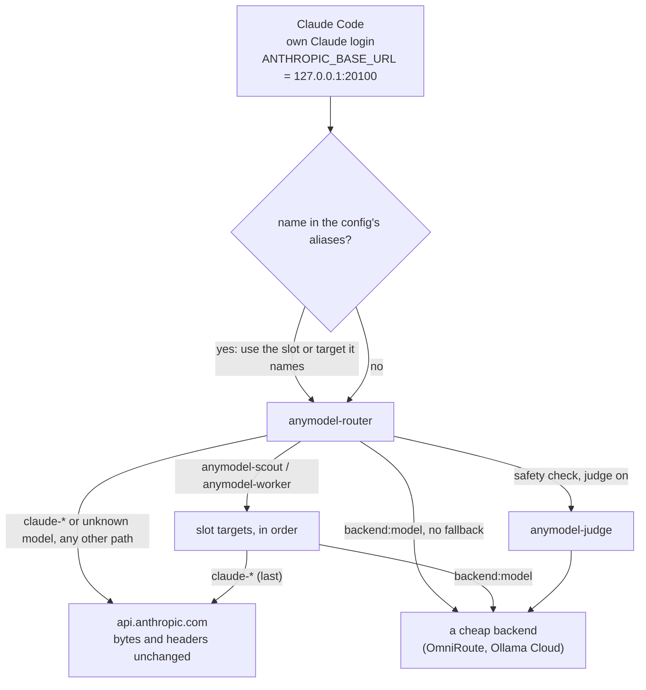

# The AI Gateway

A small local program, **`anymodel-router`**, sits between Claude Code and the model
providers. It lets routine subagents run on cheaper models while Claude models stay real
Claude, on the person's own login. It is optional: nothing changes until a person runs
`anymodel gateway setup` and then `anymodel gateway on`.

How to use it, step by step: the `gateway` skill (`plugin/skills/gateway/SKILL.md`).
The rules for changing it: `.claude/rules/gateway.md`.

## Summary

- Claude Code sends every request to the router (`ANTHROPIC_BASE_URL`), with the
  person's **own** Claude login on it. There is no gateway token. The router never
  stores the login, and it only ever reaches Anthropic.
- **Claude models** (`opus`, `fable`, any `claude-…` name, the main session) go to
  Anthropic **byte for byte**.
- **The `haiku` and `sonnet` names** point at two **slots**, `anymodel-scout` and
  `anymodel-worker`. A slot is a list of targets, tried in order; the last one is Claude,
  so work does not stop when a cheap model fails.
- **Auto mode's safety check** stays on Claude by default. The `anymodel-judge` slot moves
  it to a cheaper model only when the person turns it on (§ The judge slot).
- **No prompt text is ever changed.** A cheap backend gets two named format translations
  and nothing else (§ What a cheap backend sees).
- Only this machine can reach the router (§ Local only).
- It runs as a systemd user unit from a copy in `~/.local/share/anymodel/`. **Linux only
  for now.**

## The request path



- `claude-*` and any **unknown** model name go to Anthropic as they came. So does every
  path that is not `/v1/messages` or `/v1/messages/count_tokens`. The router never
  guesses a cheap backend.
- A **slot key** is a model name the router owns: `anymodel-<name>`. `gateway on` points
  Claude Code's `haiku` at `anymodel-scout[1m]` and `sonnet` at `anymodel-worker[1m]`
  (`[1m]`: Claude Code then assumes a 1M-token context; the router ignores the suffix).
- A **target** is `claude-<id>` (Anthropic; `model` changes, and only the fields that
  model refuses: § What a Claude target sees) or `<backend>:<model>`
  (a cheap backend, with its own key). `<backend>:<model>` as the model name itself is an
  ad-hoc try: that backend only, no fallback.
- `opus` and `fable` are not remapped, so they stay real Claude.

## Slots and defaults

`gateway setup --backend-key-stdin omniroute` makes this config:

| Slot | Claude Code name | Targets, in order |
|---|---|---|
| `anymodel-scout` | `haiku` | `omniroute:ollama-cloud/deepseek-v4.1-flash` → `omniroute:ollama-cloud/glm-5.3-flash` → `claude-sonnet-5-5` |
| `anymodel-worker` | `sonnet` | the same three |
| `anymodel-judge` | none: auto mode's safety check | **off** (no slot) |

The last target is Claude Sonnet 5.5, not Haiku, because the slots announce a 1M-token
context and Haiku has 200K. DeepSeek is first because almost every subagent token is a
cached re-read, and its cached input is the cheapest (ollama.com/pricing). The live
table is the config file; `gateway slot` changes it, `gateway models` lists what each
backend offers.

## The judge slot: opt-in

In auto mode, Claude Code asks a model before each action that is not plainly safe:
should this run? With the gateway on, Claude Code makes that check itself, as separate
requests, through the router.

**By default the router sends every check to Anthropic untouched.** A person who wants to
save Claude usage on the checks turns the judge on:

```sh
anymodel gateway slot judge omniroute:ollama-cloud/deepseek-v4.1-flash,omniroute:ollama-cloud/glm-5.3-flash
anymodel gateway slot judge off      # back to Claude
```

The trade-off, which the person accepts by turning it on:

- **A cheaper judge decides worse.** It can block good work by mistake, and a weak one
  can let a risky command through (in testing, one allowed a force push to the main
  branch that Claude blocked).
- Every check sends the person's messages and the agent's next action to the judge's
  provider.
- When no judge answers, auto mode approves nothing until one does.

How the router finds the check: by its system prompt, which contains "You are a security
monitor for autonomous AI coding agents", and by offering no tools (`isAutoModeGuard`).
A conversation that quotes the sentence offers tools, so it is never taken for the
check. The two forms seen so far are in `docs/claude-code-contract.md`. The log marks a
check `(safety check)`, and `[judge]` when the judge slot takes it.

- **Judge off:** a `claude-…` check goes to Anthropic byte for byte. A check sent under a
  slot name goes to that slot's `claude-…` target only, with only `model` changed (never
  translated: § What a Claude target sees), never to a cheap model. A check whose name leads to no Claude target (a slot with none, or an
  alias to `<backend>:<model>`) goes to Anthropic exactly as Claude Code sent it, before
  any alias; Anthropic refuses the unknown name, and Claude Code retries the check on
  another Claude model.
- **Judge on:** the check goes to the judge's targets, with reasoning off
  (`reasoningOffForBackend`); a judge that hangs gets `timeouts.firstByteMs` before the
  next one is asked. `count_tokens` for a check answers 404 (nothing reaches Claude).
- The judge slot takes no `claude-…` target: Claude Code builds each check for the model
  it names, and a Claude model refused the older form's `thinking: disabled` with a 400.
  `slot judge off` is the way back to Claude.

## Aliases

A config may map old model names to new ones:

```json
{ "aliases": { "old-scout": "anymodel-scout", "old-model": "omniroute:glm-5.3-flash" } }
```

- The router resolves an alias **before** it routes. It recognises the safety check on
  the request as it came, so a check sent under an old name is still the check: with the
  judge off it stays on Claude even when the alias points at a cheap backend (§ The judge
  slot). It logs each alias once per name.
- An alias to a `claude-…` model goes to Anthropic with the body Claude Code built for
  the old name, so it gets the same translation as a slot's Claude target (§ What a
  Claude target sees); the safety check under it changes only `model`.
- An alias names a configured slot, or a target whose backend is configured. **An alias to
  an alias is an error at load**, so there are no chains and no loops.
- An alias cannot have a slot's name, a `claude-…` name, or `[1m]` on it.
- **The plugin ships no aliases.** A project that moves from its own gateway writes them
  in its migration, and removes them once every machine uses the new names.

## Fallback rules

A request moves to the next target **only before any answer reaches Claude Code**.

| Target | Moves on when |
|---|---|
| Anthropic (`claude-*`) | status 408, 429, 500, 502, 503, 504, 529, a network error, or no response headers in time |
| A cheap backend, not the last target | the same, **and any other non-2xx** (a 401 or 404 is a wrong key or model; a 400 can be one model refusing another's reasoning history), logged as a warning |
| A cheap backend, streaming | an `event: error` before the first real event, a stream that ends first, or no real event before the deadline |

- **The last target is always tried and its answer returned**, whatever it is.
- **The stream hold.** OmniRoute answers `200` after about a second, then sends keep-alive
  comments and reports failures inside the stream. So for a cheap backend that is not
  last, the router holds the stream until the first real event, then replays it and pipes
  the rest chunk by chunk.
- **Deadline:** `timeouts.firstByteMs`, 60 s by default.
- **Cooldown.** A target that answered 429 rests for its `retry-after` (default 60 s); a
  408, 5xx, 529, network error or timeout rests `retry-after` or 30 s; at most 600 s, in
  memory. A resting target is skipped unless it is the last.
- **`count_tokens`** has no fallback. When the first target is a cheap backend the answer
  is 404, and Claude Code estimates instead.
- Errors the router makes use Anthropic's error shape. A cheap backend's `retry-after` is
  rounded to whole seconds.
- **The log names the reason.** When any target answers 4xx or 5xx to a model call
  (`/v1/messages` or `count_tokens`; Anthropic too, and a `claude-…` request sent straight
  to Anthropic), a `WARN` line carries the start of its error answer: one chunk,
  decompressed when it is gzip, deflate, br or zstd, its first 2 KB read, at most 300
  characters shown. Masked first (`maskSecrets`): the exact keys the router holds (every
  backend's key, the request's `x-api-key` and `authorization`, short ones too, also
  JSON-escaped), an email address, a JSON field named like a key, token, secret, password
  or authorization, `Bearer …` / `Basic …`, `sk-…`, a value after `key`, `token`,
  `secret` or `password` and a `:` or `=`, and any run of 32 or more letters, digits, `_`
  or `-`, except a run with `__` (an MCP tool name) or a UUID. A masked value of 12 or
  more characters keeps its last four. Then it is made one line of printable ASCII
  (`maskedLine` in `router.ts`, and `oneLine` in `src/gateway/plain-text.ts`: the one
  home for making outside text safe to print, which `anymodel search` uses too). The line
  is written in the background, so the answer reaches Claude Code whole and at once; it
  can come after the request's own log line. A failed read gives one `WARN` line, not two.

## What a Claude target sees

A slot's `claude-…` target (usually its last, the fallback), and an alias to a `claude-…`
model (§ Aliases), gets the person's own login, every header as sent, and the body Claude
Code built **for another name**: the slot's, or the old name's. Claude Code knows nothing
of the model behind `anymodel-worker`, so that body can carry fields the Claude model
refuses with a 400. One named translation, `requestForClaudeFallback`, changes only those
fields, to the nearest value the target accepts, and never `system`, a message or a
tool. The rules come from Anthropic's migration guides
(platform.claude.com/docs/en/models/sonnet-5-5/migration-guide and
…/opus-5-5/migration-guide, read 2026-10-15). A target written with `[1m]` gets its
model's rules.

| Field as sent | `claude-sonnet-5-5` gets | `claude-opus-5-5` gets |
|---|---|---|
| `thinking: {type: "disabled"}` | `{type: "between_tools"}` (its "thinking off"); an effort of `xhigh` or `max` becomes `high`, the highest it takes with thinking off | no `thinking` field (it always thinks); with no effort named, `output_config.effort: "low"`, the nearest to no thinking (the guide's own before / after); a named effort is kept |
| `thinking: {type: "enabled", budget_tokens}` | `{type: "adaptive"}`, `display` kept | the same |
| `tool_choice` `any` or `tool` | `{type: "auto"}`, `disable_parallel_tool_use` kept | the same |
| `temperature` other than 1, any `top_p`, any `top_k` | left out (the default) | the same |

A forced `tool_choice` that becomes `auto` lets the model answer without calling the
tool: the request then gets a text answer where Claude Code wanted a tool call.

Any other `claude-…` target gets the body with only `model` changed: add its row when
it needs one. The router logs each kind of translation once (`translated for …`).

**Not translated, because it would mean changing a message**, so it can still give a 400
on a Claude target:

- an assistant **prefill** (the conversation ending on an assistant turn), which a newer
  Claude model may refuse;
- **thinking blocks a cheap model wrote** earlier in the same conversation, whose
  signature a Claude model cannot check.

The `WARN` line names Anthropic's reason when one of them is the cause.

Two requests are never translated **for a Claude target**:

- **Auto mode's safety check**, on every route it can take to Claude (`/v1/messages` and
  `count_tokens`, a slot's Claude target or an alias to a `claude-…` model): auto mode
  stays exactly as Claude Code ships it, so a check reaches its Claude target with only
  `model` changed, every other byte as sent. Its newer form carries no field the table
  would change, and Sonnet 5.5 took it (200). On the opt-in judge route to a cheap
  backend, the check gets that backend's named translations (`reasoningOffForBackend`,
  `toolSearchForBackend`, § What a cheap backend sees), like every request to it.
- A `claude-…` model that Claude Code sent itself: Claude Code built that body for that
  model, and it goes byte for byte.

Why: on 2026-10-15 both cheap targets of the worker slot answered 503 and the fallback,
Claude Sonnet 5.5, answered 400 to one request. Its reason was not logged then, so which
field it refused is not known; `thinking: disabled` is the one field Claude Code is known
to send that Sonnet 5.5 refuses. Thinking blocks a cheap model wrote earlier in the same
conversation are a second suspect the translation does not touch (it never changes a
message); the next live case's `WARN` line will tell.

## What a cheap backend sees

The router builds a **new** request for a cheap backend:

- Headers: only `accept`, `anthropic-version`, `content-type`, `user-agent`,
  `x-claude-code-session-id`, plus the backend's own key as `Authorization`. Never
  `authorization`, `x-api-key`, `cookie` or `anthropic-beta`.
- The body without `metadata` (it holds the Claude account id).
- **No proxy to a backend on this machine.** Bun's `fetch` sends a request through
  `HTTP_PROXY` / `HTTPS_PROXY` / `ALL_PROXY` unless `NO_PROXY` lists the host, and this
  request carries the backend's key. So a backend whose `baseUrl` is on 127.0.0.0/8,
  `::1` or `localhost` is called straight (`directIfLoopback`, `src/gateway/hosts.ts`),
  by the router and by the model list (`gateway models`, `slot`, `status`, `doctor`). A
  remote backend, and Anthropic, keep the environment's proxy settings: HTTPS through a
  company proxy is normal there. `directIfLoopback` passes `proxy: false`, which Bun
  honours from 1.4.3 on (oven-sh/bun#42692); Bun 1.4.2 ignores it and sends the key to
  `HTTP_PROXY` (measured). So anymodel needs Bun ≥ 1.4.3 (`MIN_BUN`,
  `src/build-info/bun.ts`): the router does not start on an older Bun, `gateway setup`
  does not install it there, and `doctor` skips the gateway checks there
  (`src/gateway/proxy.test.ts`; `docs/design.md` § The Bun it needs).
- **Prompt text exactly as sent.** Only two named translations, each tested:
  - `toolSearchForBackend`: with `ENABLE_TOOL_SEARCH=true`, Claude Code marks most tools
    `defer_loading` and answers its `ToolSearch` with `tool_reference` blocks. Anthropic
    expands those; other backends do not. So a deferred tool no `tool_reference` names is
    dropped, a named one stays without `defer_loading`, and each `tool_reference` becomes
    the text "Tool loaded: <name>".
  - `reasoningOffForBackend`: `thinking: {type: "disabled"}` with no effort named becomes
    `output_config.effort: "none"`, which OmniRoute passes on as `reasoning_effort`.
    Without it, a model that reasons by default spent a 64-token answer on reasoning and
    came back empty. A model in a slot must accept `"none"`.

What does reach the backend's provider: subagent prompts and the files they read, the
main session's background `haiku` calls (titles, summaries, page processing), and, with
the judge on, every safety check. If a task must not leave Claude, use `opus`, and keep
the judge off.

**It is user-wide.** `gateway on` writes the user's `settings.json`, so every Claude Code
session on the machine, in every folder, sends its `haiku` / `sonnet` work to the slots.

## Local only

Any program or web page on the machine could otherwise spend the backend key. So the
router binds `127.0.0.1`, refuses a `Host` other than `127.0.0.1:<port>` or
`localhost:<port>`, refuses any request with an `Origin` header, and on `/v1/messages`
requires `content-type: application/json` and an `anthropic-version` header (a browser
cannot send those cross-site without a CORS preflight, which the router never answers).

## Where things live

| What | Where |
|---|---|
| Source | `src/gateway/`: `router.ts`, `targets.ts`, `config.ts`, `backends.ts`, `settings.ts`, `health.ts`, `service.ts`, `commands.ts`, `doctor.ts`; the bundle entry `src/entries/router.ts` |
| Config: backend keys, slots, aliases, port | `~/.config/anymodel/gateway.json`, mode **600**. A file others can read is refused. Read again when it changes, so `gateway slot` is live. A bad edit keeps the last good config, with one error line. A command saves it atomically, inside the state lock, and keeps any field it does not know |
| A setup that did not finish | `~/.claude/anymodel/restart-pending` (the state folder): written before the copy and the unit, removed once the restarted router answers |
| The router that runs | `~/.local/share/anymodel/router.js`, a copy of the plugin's `dist/router.js` |
| The service | `~/.config/systemd/user/anymodel-router.service` |
| Health | `GET http://127.0.0.1:<port>/__anymodel/health`: counts, resting targets, slots; never a key |

With no good config the router still starts: both slots answer from `claude-sonnet-5-5`
on the own login, and one error line names the file.

## The service

The plugin's version folder changes with each update, and Claude Code deletes an old one
some time after an update, even under a running process. So `gateway setup`:

1. asks the router's port (the config's; with no config, 20100) before anything else:
   no answer (connection refused) means free, a 200 health answer with `ok: true` means
   this router, and **anything else, a timeout included, stops setup** with "port N is
   used by another program (an older router? stop it first)", nothing written;
2. checks everything and writes nothing: the config, the copy, the unit;
3. when the router is running and the copy or the unit changed (or an earlier setup did
   not finish), says that **a restart cuts the answers in flight** in every running
   session, and asks (`--yes` skips the question; without a terminal and without
   `--yes`, it stops and changes nothing);
4. makes the config when there is none (the backend key comes on stdin, never argv);
5. writes the **restart-pending marker**, then copies `dist/router.js` to
   `~/.local/share/anymodel/router.js` and writes the unit, both through `src/setup/`
   (backup, record for `restore`, atomic write);
6. runs `systemctl --user daemon-reload`, `enable`, and `restart` (which starts it when it
   was stopped). Right after `restore`, the old router may still drain its answers
   (`is-active` says `deactivating`): `restart` then waits for that, so setup first says
   "waiting for the old router to finish its answers (up to 120 s)". Then it waits up to
   5 s for the health page. It answers: the marker goes.
   It does not: setup fails with the unit's `is-active` state and the hint
   `journalctl --user -u anymodel-router -n 30`, and the marker stays, so `doctor` shows
   ✗ "a gateway setup did not finish" and the next `gateway setup` restarts again, even
   with the files up to date.

With nothing changed and no marker, only `enable --now`.

The unit runs the absolute path of the `bun` that ran setup on the copy, with
`--no-env-file`. It restarts itself (`Restart=always`, no start limit). On SIGTERM the
router stops taking requests and exits once the answers in flight are done (up to 120 s).
User services run at boot only with linger on (`loginctl enable-linger $USER`, once, by
the person).

`anymodel restore` undoes it, in **two stages** while the gateway is on. It assumes a
running session keeps the `ANTHROPIC_BASE_URL` it started with, so that stopping the
router while the env keys are there would make every running session fail. (One live
look saw sessions pick up changed env keys at once: `claude-code-contract.md`. Until
that is repeated, for removed keys too, the two stages stay.)

1. **Stage 1** (anymodel's gateway env keys are in `settings.json`): everything is
   restored but the router's copy and unit, the env keys included; the router keeps
   running. It says: restart every running Claude session, then run `restore` again.
2. **Stage 2** (no such key left): it asks the unit's state (`systemctl --user
   is-active`), disables the unit and stops it with `systemctl --user stop --no-block`
   (asking first when it runs; `--yes` skips the question), then asks the router's port
   (the config's) while this router answers there, for up to 15 s. The router closes its
   port at once on SIGTERM and finishes its answers in flight in the background, so
   restore does not wait the up to 120 s of that drain, while every new request already
   fails. It waits only for the unit's own router: when the unit was not `active` or
   `deactivating` (a crash loop because another program holds the port, say), or the
   port answers but not as this router (a `404`, another program), it prints one note
   and goes on. This router still answering after 15 s stops restore with an error,
   nothing else restored. Then it removes the copy and the unit, reloads systemd, and
   clears the restart-pending marker. With an unusable `gateway.json` the port is
   unknown: the stop is sent, and nothing is waited for. (The health answer names the
   router's port too, but it can only be asked on a port already known.)

`restore --now` does both at once, after the warning that every running Claude session
fails until it restarts (asked, or `--yes`). Restore leaves `gateway.json`, which holds
the person's key; `doctor` then says, as information, "gateway.json kept; the gateway is
not installed".

## What `gateway on` writes

Into the `env` of Claude Code's user `settings.json`, as **owned keys** (so `gateway off`
and `restore` remove exactly them):

1. `ENABLE_TOOL_SEARCH` = `true`: behind a gateway, Claude Code otherwise sends every MCP
   tool definition on every turn (184K tokens of context on a first turn, against 70K).
2. `ANTHROPIC_BASE_URL` = `http://127.0.0.1:<port>`
3. `ANTHROPIC_DEFAULT_HAIKU_MODEL` = `anymodel-scout[1m]`, with `…_NAME` and `…_DESCRIPTION`
4. `ANTHROPIC_DEFAULT_SONNET_MODEL` = `anymodel-worker[1m]`, with `…_NAME` and `…_DESCRIPTION`

It **never** writes `ANTHROPIC_AUTH_TOKEN` or `ANTHROPIC_API_KEY` (they replace the
person's own login), nor `CLAUDE_CODE_SUBAGENT_MODEL` or `…_FORCE` (an agent launched
without a `model`, a reviewer say, would run on a cheap slot). `gateway status` warns
when one of them is set.

A gateway key that exists and that `anymodel` did not set stops `gateway on`, and the
value is shown masked; nothing is overwritten. Remove it by hand first (a project moving
from its own gateway does it in its migration). `ENABLE_TOOL_SEARCH` gets a word of its
own in that message: many people set it themselves. `on` also refuses while the router
does not answer: every Claude request would fail. With no `gateway.json` (set up with
`--no-backend-key`), `on` uses the default port, 20100, where the router then runs with
every slot on Claude.

Saving `settings.json` switches every running session at once. Removing keys is taken to
need a restart of each session (not yet proved either way: `claude-code-contract.md`);
stop the router only after every session restarted.

## Known limits

- Anthropic does not support non-Claude models behind a gateway (not banned, no help).
- **Linux only** for now: systemd user units and file modes.
- When Claude Code changes the safety check's prompt, the router stops recognising it,
  and the check goes by its model name. The log shows it: the lines lose their
  `(safety check)` mark. So "the judge is off by default" holds only while the router
  knows the prompt: under a cheap slot's name, an unrecognised check goes to that slot's
  targets until the router is updated (`docs/roadmap.md` Phase 3: log an unknown check
  form loudly).
- `gateway setup` takes "this router answers on the port" as success after a restart.
  When another `anymodel-router` (a `gateway serve` in a terminal) holds the port, the
  unit's own router cannot bind, yet setup sees an answer and succeeds. Stop the other
  one first.
- If the router is down, every Claude Code request fails. The service restarts itself;
  `gateway off` and a restart of the sessions is the way out.
- **A model's context window can disagree** in three places: what Claude Code assumes
  (`[1m]` → 1M), what OmniRoute's catalog says (it refuses a bigger request itself), and
  what the provider serves. Check all three before a model goes into a slot; keep a
  1M-or-larger target after one with a smaller window.
- **Images:** OmniRoute leaves an image in a request only when its catalog marks the
  model vision-capable; otherwise another model describes the image and the slot's model
  answers from that caption. Check a new model's image support before it goes in a slot.
- A cheap subagent's `ToolSearch` changes its tool list, so that backend's prompt cache
  restarts from that point. It costs a little and breaks nothing.

## Troubleshooting

Start with `anymodel gateway status`, then `anymodel doctor`.

| Symptom | Check | Fix |
|---|---|---|
| Every Claude request fails | `gateway status`; `systemctl --user status anymodel-router`; `journalctl --user -u anymodel-router` | Restart the unit. Still broken: `gateway off`, restart the sessions |
| Subagents are slow or answer from Claude | the log's `fallbacks=` and `skipped=`; the health page's `cooling` | the backend is down or busy; wait out the cooldown |
| A slot request ends `→ claude-… 400` | the `WARN claude-… answered 400` line next to it (written just after it): Anthropic's reason | a field outside `messages`, `system` and `tools` that the Claude target refuses: add it to `requestForClaudeFallback`'s table (with a test and a contract row). A reason inside the messages (a prefill, a cheap model's thinking blocks) is not translated: § What a Claude target sees |
| `403 … accepts requests from this machine only` | the caller sends `Origin` or a foreign `Host` | use `http://127.0.0.1:<port>` from a local program |
| `no target for anymodel-… answered` | the error lists each target's failure | fix the first reason (key, model id, backend down) |
| `"anymodel-…" is not a slot` | `gateway status` | `gateway slot`, or `gateway setup` |
| Every `haiku` / `sonnet` call answers from Claude Sonnet | the log says the config cannot be used | `chmod 600 ~/.config/anymodel/gateway.json`; fix the JSON (read on the next request) |
| `gateway on` stops: set by someone else | an older install's env keys | remove those keys by hand, then `gateway on` |
| `doctor`: the router copy is not this version's | the plugin was updated | `anymodel gateway setup` (it asks before the restart) |
| `gateway setup`: `port N is used by another program` | `ss -ltnp` shows who holds it; often an older router | stop that program, or set another `port` in `gateway.json` |
| `doctor`: `a gateway setup did not finish` | the router did not answer after setup's restart: `journalctl --user -u anymodel-router -n 30` | fix the cause, then `anymodel gateway setup` again |
| Auto mode blocks good work, or says its classifier is unavailable | the log's `(safety check) [judge]` lines | `gateway slot judge off` |
