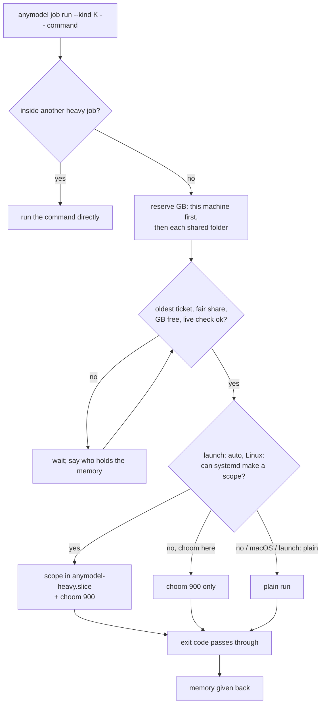

# Heavy jobs: one queue for the whole machine

`anymodel job` makes heavy jobs wait for free memory instead of freezing the machine.

A **heavy job** is a command that can use many gigabytes: a TypeScript type check, a
type-aware lint, a test run, a production build, a container image build. When many
Claude sessions and their agents run on one machine, they start these at the same time.
The machine runs out of memory, and the kernel kills what it picks: often the desktop,
and every session with it. A rule like "one heavy job at a time" in each session does
not help: nothing limits heavy jobs **across** sessions, agents and people.

So each heavy job runs through `anymodel job run`. It reserves the gigabytes the job
needs, waits while they are not free, runs the job, and gives them back when the job ends.

```sh
anymodel job run --kind tsc -- bunx tsc --noEmit
anymodel job status
anymodel job kinds
```

## How a job runs



1. **Nesting.** A heavy job may start another one (a script that runs the type check,
   then the build). The inner one must not wait for memory its parent holds. So `job run`
   walks its parent processes (`/proc/<pid>/stat`) and, when one of them holds a lease on
   this machine, runs its command directly. Linux only.
2. **Reserve.** The job reserves its kind's size (below), or `--gb <n>`. It waits until
   the memory is free (§ Waiting). A run that only prints (`tsc --version`) reserves 0 and
   never waits.
3. **Launch.** With `launch: auto` (the default) on Linux, the job runs in its own memory
   group (§ The launch). Elsewhere it runs as it is.
4. **End.** `job run` ends with the job's exit code: the code itself, 128 + n for a job
   killed by signal n, 127 when the command cannot start, 2 for a wrong `job run` command
   line. Its stdin, stdout and stderr are the job's. SIGTERM and SIGHUP are sent on to the
   job. SIGINT is not: a terminal's Ctrl+C already reaches the job, and a test runner reads
   a second one as "force quit". The lease is given back however the job ends.

## Kinds

| Kind | Finds | Reserves |
|---|---|---|
| `tsc` | `tsc`, `tsgo`, `vue-tsc` | 8 GB. 0 with `--version`, `--help`, `--listFilesOnly`, `--showConfig`, `-v`, `-h`. |
| `lint:typed` | `eslint` with a typed config (an argument holds `typed.` or `type-checked`), `oxlint --type-aware` | 6 GB when every file argument is an existing file; else 12 GB. The values of `--config`, `-c`, `--max-warnings` are not files. |
| `test:run` | `vitest`, `jest` | 2 GB for 1 to 3 existing files; else 8 GB. The runner's own `run` is not a file. |
| `test:coverage` | `vitest` / `jest` with `--coverage` | 12 GB. |
| `build` | `next build` | 14 GB. |
| `image:build` | `docker build`, `docker image build`, `docker builder build`, `docker buildx build` / `b` / `bake`, `docker compose build`, `compose up` / `run` / `create --build`, `docker-compose …`, `podman build`, `buildah build` | 14 GB. |

**Where the numbers come from.** They were measured on a large TypeScript web app:
a type check peaked at 7.7 to 8 GB, a framework production build at 9 + 3 GB, a typed lint
of the whole repo at 8.4 GB, a full test run at about 0.43 GB per worker. Coverage was not
measured; 12 GB is a guess on the safe side. A wrong guess on the wide side only makes a
job wait longer; it never overruns the machine. Small runs still reserve 2 GB, so many
agents looping on one test file each still meet the queue.

**Test workers.** For the two test kinds, `job run` adds `--maxWorkers=<n>` unless the
command already has it (or `--max-workers`): one worker per 0.5 GB reserved, at least
one, at most `cores - 1` (the runners' own default). It is added before a `--`, where a
runner would read it as a filter, and never to a shell line (`sh -c "…"`).

**A project's own kinds.** `.claude/anymodel.json` can replace a kind or add one:

```json
{
  "requires": ">=0.3",
  "jobs": {
    "kinds": {
      "tsc": { "gb": 6, "printOnly": ["--version", "--help"], "match": [{ "tool": "tsc" }] },
      "e2e": { "gb": 4, "about": "Browser tests.", "match": [{ "script": "test:e2e" }] }
    }
  }
}
```

A project kind with a default's name replaces that kind **whole**: what it says is all
there is. The fields:

| Field | Meaning |
|---|---|
| `gb` | What a full run reserves, in whole GB. |
| `filesGb`, `maxFiles` | What a run given only existing files reserves, and at most how many files count as small. |
| `printOnly` | Options that only print and stop: a run with any of them reserves 0. |
| `skipWords` | Leading words that are the tool's own command, not files (`run`). |
| `valuedFlags` | Options whose value is the next word, so it is not read as a file. |
| `workers` | `{ "flag": "--maxWorkers", "aliases": [...], "gbEach": 0.5 }`: add a worker count. |
| `match` | How the classifier finds the kind (below): `{ "tool", "sub", "flags", "argIncludes", "valued" }` or `{ "script" }`. |
| `about` | One line for `job kinds`. |

## Waiting

The queue has **budgets**, and a job must fit each one.

- **This machine's budget** is its memory in whole GB less 22 GB, and never less than
  14 GB (the largest default job), so that job can always run alone. The 22 GB are kept
  for what never queues: the desktop, the Claude sessions, MCP servers, dev servers, a
  local database. On a 64 GB machine that is 42 GB; on a 16 GB laptop, 14 GB, so two type
  checks never run together there. `jobs.json` can set `reserveGb`, or `budgetGb` itself.
- **Each shared folder's budget** (§ The shared view), when the machine has one.

A job takes this machine's budget first, then each shared one, and gives them back in
reverse. It joins a shared line only once it holds its own share, so two budgets can never
wait on each other in a circle.

How a waiting job decides, every half second:

- **Oldest first.** A waiting job holds a ticket with its start time. Only the oldest live
  ticket may take memory, so a 14 GB build is never starved by a stream of 2 GB test runs.
- **Fair share** (shared folders only). A person (a machine's host name) who already
  holds half the budget or more steps aside while another person has a job in the line.
  Alone, a person may use all of it, and a running job is never stopped.
- **Bigger than the budget.** A job that needs more than a whole budget waits until
  nothing else holds any of it, then runs alone.
- **The live check** (where free memory can be read). The budget is a guess about what
  never queues. So a job also waits while the real free memory, less what admitted jobs
  reserved but have not used yet, is below what it needs. It never stops a job when no
  other heavy job runs here: waiting would then never end.
- **No give-up timeout.** Running anyway after a while is the crash again. A waiting job
  says so at once, then every minute: what it needs, the free GB in each budget, why it
  waits, and who holds the rest (person, kind, command, folder, since when, pid).

```text
[anymodel job] Heavy job waits for memory: bunx tsc --noEmit needs 8 GB. this machine: 2 of 32 GB free. Why: only 2 GB of this machine's budget is free.
[anymodel job]   this machine: 28 GB held by host-a: build, bun run build in /home/user/app, since 11:44 (pid 4242)
```

## Memory, in containers too

- **Linux:** `MemTotal` and `MemAvailable` from `/proc/meminfo`.
- **A container or a limited group:** the process's cgroup (`/proc/self/cgroup`), or one
  above it, may have a ceiling: `memory.max` (cgroup v2) or `memory.limit_in_bytes` (v1).
  The tightest one counts. Then the total is that ceiling, and the free memory is the
  ceiling less what the group uses (`memory.current`), not counting the file cache the
  kernel can drop (`inactive_file`). The smaller of the two views wins. A ceiling no lower
  than `MemTotal` changes nothing (some container systems already show it there).
- **macOS:** `os.totalmem()` for the budget, and no live check.

## Where the state lives

Each budget is a folder of small files:

```text
<folder>/leases/<token>.json    a job holds this many GB
<folder>/tickets/<token>.json   a job waits for its turn
<folder>/lock                   held for a moment while a job takes memory
```

- **This machine's folder** is per user: `~/.local/share/anymodel/jobs/` (mode 700), or
  `stateDir` in `jobs.json`.
- **Each file names its writer:** the pid, that process's start time, the host name and
  the pid namespace. The record inside (who, what, where, since) is data for the waiting
  lines, read as untrusted text; one that does not parse is "unknown".
- **Stale files clean themselves up.** A file is stale when its writer is gone: its pid
  is dead, or alive with another start time (the pid was reused). This is the same judge
  as setup's lock (`holderIsGone` in `src/setup/lock.ts`). A stale file counts for
  nothing, and the next look removes it. So a `job run` killed with SIGKILL frees its
  memory at the next look, with no clean-up step.
- **A writer this machine cannot see** (another host, another pid namespace) cannot be
  judged by its pid. It touches its files every 30 seconds (the heartbeat); a file not
  touched for 2 minutes is stale. A writer that finds its file removed writes it again.
- **Taking memory** happens under the folder's lock (the same `withLock` as setup), so
  two jobs never both take the last free GB. Every file is written whole (a temp file,
  then a rename).

## The shared view: containers and users on one host

By default each user, and each container, has its own queue. Several containers on one
host (or several users) share the host's memory, so they can share a budget too:

```json
{ "sharedDirs": ["/srv/heavy-jobs"] }
```

in each one's `~/.config/anymodel/jobs.json`. The machine's own setup prepares the
folder; the plugin never creates one:

- the same folder in every container (a bind mount at the same path);
- a `budget` file with a whole number of GB, for all of them together (for example the
  host's memory less what the host and each container keep for themselves);
- every user may create **and remove** files in it and in its `leases/` and `tickets/`
  (a group-writable folder without the sticky bit), because stale files of any user are
  removed by the next reader.

Before using the folder, `job run` writes and removes a probe file in each subfolder.
A missing folder, a missing or wrong `budget`, or a folder it cannot write is left out
with one note; a store that fails later is left out for that job, with a note. A shared
folder never makes a job wait for ever.

What crosses the folder is reservation records: who runs what, where, since when. A
person could hold reservations to make others wait. Every waiting line names the holder.
This suits a trusted team on one host.

## The launch

With `launch: auto` (the default), on Linux:

| Mode | When | What |
|---|---|---|
| scope | a systemd user manager answers | `systemd-run --user --scope --slice=anymodel-heavy.slice -p OOMPolicy=kill -- choom -n 900 -- <command>` |
| choom | no user manager (cron, a container, CI), or no scope can be made | `choom -n 900 -- <command>` |
| plain | no `choom`, macOS, `launch: plain`, or a 0 GB run | the command as it is |

- **Probe first, never retry.** A scope that cannot be made makes `systemd-run` exit 1,
  the same code as a failed type check. So an empty scope (`-- true`) is tried first, and
  the real job starts exactly once. A systemd that refuses `OOMPolicy` on a scope gets a
  scope without it.
- **The slice's ceiling.** Before each launch, `systemctl --user set-property --runtime
  anymodel-heavy.slice MemoryMax=<budget>G MemorySwapMax=0`: all heavy jobs together can
  never take the memory kept for everything else, and past it the kernel kills inside the
  slice only. No swap for the slice: with swap, jobs over the ceiling would crawl through
  it instead of dying.
- **The kill mark.** `choom -n 900` raises the job's `oom_score_adj`: if memory runs out
  anywhere, a heavy job dies before the desktop, Claude and the dev servers. A heavy job
  is the one thing that can simply run again.
- **"killed for memory".** An out-of-memory kill does not always show as exit 137 (a
  killed worker makes its parent exit 1). So `job run` reads `oom_kill` in the slice's
  `memory.events` before and after, and when the job failed and the count rose, it says
  so.
- A dash in a slice name means nesting: `anymodel-heavy.slice` sits inside
  `anymodel.slice`. `jobs.json` can name another slice.

## The environment

The job gets exactly the environment `job run` was given. Bun loads the `.env` files of
the working folder into a script's environment by itself, so the launchers start the CLI
with `bun --no-env-file`. A `job run` started without it, in a folder with `.env` files,
refuses (exit 2) and says to run `anymodel setup` (an older launcher).

## The machine config: `~/.config/anymodel/jobs.json`

Optional. Unknown fields are an error that names the file and the field.

| Field | Default | Meaning |
|---|---|---|
| `stateDir` | `~/.local/share/anymodel/jobs` | This user's folder (an absolute path). |
| `budgetGb` | memory − `reserveGb` | This machine's budget in GB. |
| `reserveGb` | 22 | GB kept for what never queues. |
| `sharedDirs` | none | Shared folders (§ The shared view). |
| `launch` | `auto` | `auto` or `plain` (§ The launch). |
| `slice` | `anymodel-heavy.slice` | The systemd slice for `auto`. |

## Commands

| Command | What it does |
|---|---|
| `anymodel job run --kind <kind> [--gb <n>] -- <command…>` | Waits, runs, passes the job's stdio, exit code and signals through. |
| `anymodel job status` | The memory, this machine's budget, who holds and who waits here and on each shared folder. Stale files it finds are removed. |
| `anymodel job kinds` | Every kind (the project's own marked), its sizes and what it finds. |

## The classifier

`classifyHeavyCommand(bashCommand, kinds)` (`src/jobs/classify.ts`) says which kind a
Bash command runs, or null. A later hook uses it to send heavy commands through `job run`.
It reads the line with the shell lexer (`src/shell/command.ts`): a tool inside quotes,
an `echo`, a here-doc, a comment or a commit message is text, not a run. It finds the
tool behind `bunx`, `bun x`, `bun run`, `bun <name>`, `npx`, `npm exec`, `npm run`,
`pnpm`, `yarn`, `node_modules/.bin/` paths, `node <script path>`, and the wrappers `time`,
`timeout`, `nice`, `env`, `sudo`, `bash -c`. When a line runs several heavy steps, it
names the one that reserves the most. It reads no file: a `package.json` script is found
only through a kind's `{ "script": "<name>" }` rule.

## Limits

- **A `job run` killed with SIGKILL** frees its lease at the next look, but its job keeps
  running, unaccounted. A scope's name shows it: `systemctl --user list-units
  'anymodel-heavy-*'`.
- **A hung job holds its memory for ever:** there is no timeout. Every waiting line names
  it.
- **Nesting is found on Linux only.** On macOS, a heavy job must not start another one
  through `job run`.
- **macOS:** no live check, no memory group, no kill mark: the queue only.
- **A paused writer on a shared folder** (stopped, or a machine asleep) longer than 2
  minutes looks gone to the others until its next heartbeat writes its file again.
- **The folder's lock** is held for milliseconds. A writer on another host that dies
  inside it blocks takes for up to 30 seconds.
- **Separate users** on one machine do not see each other's jobs unless they share a
  folder.
- **Coverage's 12 GB is a guess**, and the classifier's `typed.` rule for ESLint can
  match a file whose name holds that text.
- **An early-OOM daemon's kill** (SIGTERM or SIGKILL from user space) does not count in
  `oom_kill`: no "killed for memory" line.
