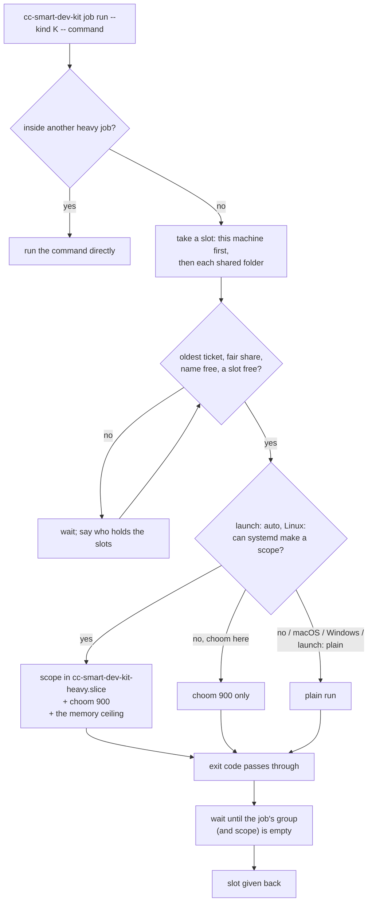

# Heavy jobs: one queue for the whole machine

`cc-smart-dev-kit job` makes heavy jobs take turns: up to a few run at once on a machine (three
by default), and the next one waits for a free slot. A job has no size. One job alone may use
all the memory and every core, at the machine's normal CPU and disk priority. On Linux all the
heavy jobs together also run under one memory ceiling, so they can never take the memory kept
for the desktop and the sessions. The same queue runs on native Windows, where three things are
different — the memory reading, a lease's start time and how a job's tree is ended:
`windows-jobs.md`.

A **heavy job** is a command that can use many gigabytes: a TypeScript type check, a
type-aware lint, a test run, a production build, a container image build. When many
Claude sessions and their agents run on one machine, they start these at the same time.
The machine runs out of memory, and the kernel kills what it picks: often the desktop,
and every session with it. A rule like "one heavy job at a time" in each session does
not help: nothing limits heavy jobs **across** sessions, agents and people.

So each heavy job runs through `cc-smart-dev-kit job run`. It takes one slot, waits while every
slot is taken, runs the job, and gives the slot back when the job ends.

```sh
cc-smart-dev-kit job run --kind tsc -- bunx tsc --noEmit
cc-smart-dev-kit job run --kind image:build --exclusive image -- docker buildx build .
cc-smart-dev-kit job status
cc-smart-dev-kit job kinds
cc-smart-dev-kit job set max-jobs 2
```

**Why slots, not gigabytes.** An older version gave each job a fixed size (a type check 8 GB,
a build 14 GB) and let a job start only when that many gigabytes were free. On a 32 GB machine
that meant one type check at a time across every session and agent, a live free-memory check
added more waiting, heavy jobs ran at a fifth of the normal CPU and disk weight, and test runs
got a worker count cut down to their reserved memory. All of that made work slow. The queue now
counts jobs, which is what people can reason about, and keeps the memory safe another way: the
ceiling below.

## How a job runs



1. **Nesting.** A heavy job may start another one (a script that runs the type check,
   then the build). The inner one must not wait for a slot its parent holds. So `job run`
   walks its parent processes (`/proc/<pid>/stat`) and, when one of them holds a lease on
   this machine, runs its command directly. Linux only. An inner job with `--exclusive`
   still takes its name, unless an ancestor holds that name already (§ One job per name).
2. **Take a slot.** A job with a kind takes one slot, and waits until one is free (§ Waiting).
   A run that only prints (`tsc --version`) takes no slot and never waits (unless it has
   `--exclusive`). A job with a name only (`--exclusive` without `--kind`) takes no slot either.
3. **Launch.** With `launch: auto` (the default) on Linux, the job runs in its own memory
   group (§ The launch). Elsewhere it runs as it is. Always in a process group of its own.
4. **End.** `job run` ends with the job's exit code: the code itself, 128 + n for a job
   killed by signal n, 127 when the command cannot start, 2 for a wrong `job run` command
   line or a config it cannot use (`jobs.json`, `cc-smart-dev-kit.json`, a state folder it cannot
   make): then the job never starts. Its stdin, stdout and stderr are the job's. SIGINT,
   SIGTERM and SIGHUP are sent on to the job's whole process group, each once (§ The
   launch). The slot is given back however the job ends, once no process of the job is
   left.

`--gb <n>` is still accepted, so an old script keeps working. It changes nothing, and `job run`
says so once on stderr: `--gb is ignored: the queue counts jobs now, not gigabytes`.

## What a job prints

The job's output is the job's: stdout and stderr are passed through untouched, so anything
`job run` itself has to say goes to stderr, each line prefixed `[cc-smart-dev-kit job]`. A
job that never waits prints none of the three lines below: a free machine gets no noise.

A job that waited says three things, around its own output:

```text
[cc-smart-dev-kit job] Heavy job waits for a free slot: bunx tsc --noEmit. this machine: 0 of 3 slots free. Why: all 3 of this machine's slots are taken.
[cc-smart-dev-kit job] A pipe (| tail) hides this job's exit status: the "Heavy job ended" line carries it.
[cc-smart-dev-kit job]   this machine: a heavy slot is held by host-a: build, bun run build in /home/user/app, since 11:44 (pid 4242)
[cc-smart-dev-kit job]   this machine: a heavy slot is held by host-a: test:run, bunx vitest run in /home/user/app, since 11:51 (pid 4301)
[cc-smart-dev-kit job]   this machine: a heavy slot is held by host-b: tsc, bunx tsc --noEmit in /home/user/web, since 11:52 (pid 4377)
   … 18 minutes of waiting, a line a minute …
[cc-smart-dev-kit job] Heavy job starts after 18 min: bunx tsc --noEmit
   … the job's own output, on stdout and stderr, while it runs …
[cc-smart-dev-kit job] Heavy job ended: bunx tsc --noEmit, exit 0 after 3 min
```

- **The waiting line**, once when the wait starts and then every minute (§ Waiting).
  **The first one carries the pipe hint**, once per job: a job whose output goes down a
  pipe (`| tail`) reports the pipe's own status, so the hint points at the end line, which
  holds the job's own. A job that never waited gets no hint and no end line.
- **The start line** says the wait is over, and what waited: `Heavy job starts after 18
  min:` and what the job is.
- **The end line** says how the job ended, and how long it ran. It is said last: after
  "killed for memory" (§ The launch) when the kernel stopped the job. A job a signal stops
  **while it waits** never starts, so it gets neither this line nor the start line: the
  wait's own lines are all it prints.
  - `exit 0` is the job's own exit code — the one a pipe hides. A job a signal ended says
    `stopped by SIGTERM` instead, and `job run` itself exits with 128 + that signal's
    number, as a shell would (step 4 above).
  - `stopped by SIGTERM (sent on by job run)`: the signal `job run` caught (a Ctrl+C at it,
    or a `kill` at it) is also the one that ended the job, so the line names the sender. A
    signal from somewhere else — the kernel's OOM killer, another process's `kill` — is
    named without a sender.
  - `(its leftover processes were stopped)`: the job's own process was gone, but the
    processes it left behind had to be stopped (§ The launch), so its slot was freed by
    force. One line can carry both notes: a job that died of the signal `job run` sent on
    and left a process behind says both.

## Kinds

A kind only says **which commands the queue counts**, and whether a run of it is light
(§ Waiting, the lanes). It has no size.

| Kind | Finds | Takes no slot with |
|---|---|---|
| `tsc` | `tsc`, `tsgo`, `vue-tsc` | `--version`, `--help`, `--listFilesOnly`, `--showConfig`, `-v`, `-h`. |
| `lint:typed` | `eslint` with a typed config (an argument holds `typed.` or `type-checked`), `oxlint --type-aware` | `--help`, `--version`, `-h`, `-v`. |
| `test:coverage` | `vitest` / `jest` with `--coverage` | `--help`, `--version`, `-h`, `-v`. |
| `test:run` | `vitest`, `jest` | `--help`, `--version`, `-h`, `-v`. |
| `build` | `next build` | none. |
| `install` | `bun install` / `i` / `add`, `npm install` / `i` / `add` / `ci`, `pnpm install` / `i` / `add`, `yarn install` / `add` and a bare `yarn`, whatever their options. A light kind: every run takes a light slot. A script with a similar name (`bun run install-hooks`) is not one. | `--help`, `--version`, `-h`, `-v`. |
| `image:build` | `docker build`, `docker image build`, `docker builder build`, `docker buildx build` / `b` / `bake`, `docker compose build`, `compose up` / `run` / `create --build`, `docker-compose …`, `podman build`, `buildah build` | none. |

When one command matches two kinds (`vitest --coverage` is a coverage run and a test run), the
**first kind listed wins**: the table is the order, with the specific kind before the general
one, and a project's own kinds come after the defaults. Several heavy commands in one line are
named by the **first** one the line runs (a kind has no size, so none is "the largest").

**No worker option.** `job run` adds nothing to a command. A test runner gets no
`--maxWorkers`: its own default applies, and with one job alone on the machine it uses what
it would use outside the queue.

**A project's own kinds.** `.claude/cc-smart-dev-kit.json` can replace a kind or add one:

```json
{
  "requires": ">=0.3",
  "jobs": {
    "kinds": {
      "tsc": { "printOnly": ["--version", "--help"], "match": [{ "tool": "tsc" }] },
      "e2e": { "about": "Browser tests.", "match": [{ "script": "test:e2e" }] }
    }
  }
}
```

A project kind with a default's name replaces that kind **whole**: what it says is all
there is. The fields:

| Field | Meaning |
|---|---|
| `printOnly` | Options that only print and stop: a run with any of them takes no slot. |
| `match` | How the classifier finds the kind (below): `{ "tool", "sub", "flags", "argIncludes", "valued" }` or `{ "script" }`. |
| `about` | One line for `job kinds`. |
| `light` | `true`: every run that does not only print takes a light slot, never a heavy one (the `install` kind). Came with 1.8.0: a project that sets it raises `requires` to `>=1.8`. |
| `noSlotForFiles` | `true`: a run whose operands are all existing files, at most 10 of them (`vitest run src/a.test.ts`), takes a light slot. Until 1.8.0 it took no slot at all. More than 10 files take a heavy slot. A run with no operand, or with one that is not a file (a folder, a pattern, a name filter), is a full run and waits for a slot. So does a run with an option the reader does not know, written without `=`: its next word may be its value, a file or not. A named file is still a filter to the runner: vitest reads each word as a part of a path and jest as a regular expression, so `vitest run a.test.ts` also runs `data.test.ts`. A full path (`src/a.test.ts`) keeps the run narrow. Came with 1.5.0: a project that sets it raises `requires` to `>=1.5`. |
| `skipWords` | With `noSlotForFiles`: the words after the tool that are a subcommand, not an operand (`run` in `vitest run`). |
| `valuedFlags` | With `noSlotForFiles`: the options whose value is the next word (`--config x.ts`, `-t name`), over vitest's and jest's own list, so that value is not read as an operand. |

**A test run on named files.** The default `test:run` kind sets `noSlotForFiles`, with `run`
as its skip word and vitest's and jest's options that take a value. Up to 10 named files
use a light slot and never wait behind a build; larger file lists use a heavy slot. `test:coverage`
does not: a coverage run instruments and reports on the whole project whatever files it
names. For a `script` kind, the operands are the words after the script's name
(`bun run test src/a.test.ts`). Each operand is checked against the folder the job runs in.

**Old size fields.** A project file written for an older plugin may still set `gb`, `filesGb`,
`maxFiles` or `workers` on a kind. They still parse, so the file keeps working, and the queue
ignores every one of them. `doctor` says once, in the project's lines, that they can go.

The project's file cannot set how many jobs run at once: the slots are the machine's
(§ The machine config).

## The route: `job-route`

A heavy command typed by hand runs raw. It can be sent through the queue instead, and that is
the `switches.jobRoute` switch. Where it is set, and which one wins:

1. **The project**, when its `.claude/cc-smart-dev-kit.json` has `"jobs": { "route": true }`
   (or `false`: the project turns it off for itself). The project's value wins, as every
   other workflow setting does.
2. **The person's machine-wide default**, in their own `~/.config/cc-smart-dev-kit/workflow.json`
   as `"switches": { "jobRoute": true }`. Set it with
   `cc-smart-dev-kit workflow set switches.jobRoute true` (or `false`), without `--project`.
   Every project that does not set `jobs.route` follows it.
3. **Off.** Until someone says on.

`cc-smart-dev-kit workflow show` prints the value and where it came from, for the folder it
runs in: `switches.jobRoute = true (personal)`, `… (project)` or `… (default)`. The project's
own setting is made with `workflow set switches.jobRoute true --project`. The hook reads the
value through the one resolver (`resolveJobRoute`, `src/workflow/resolve.ts`), never a reader
of its own; a personal file that cannot be read leaves the project's value and the default
standing, so the hook never fails on it.

When it is on, the plugin's `job-route` hook (PreToolUse on Bash; `src/hooks/job-route.ts`)
rewrites the call to

    "$HOME/.local/bin/cc-smart-dev-kit" job run --kind <kind> -- <command>

through the hook's `updatedInput` — byte for byte the same command, in the same folder —
so the slot, the waiting line and the ceiling come out the same as a person's own
`job run`. One plain command goes in as its own argv words (`bunx vitest run src/a.test.ts`);
anything else (a pipe, `&&`, a glob, an expansion) through the **person's own shell**
(`<shell> -c '<the line>'`: `$SHELL` when it is bash or zsh, else `bash` where the machine has
it, else `sh` — never `/bin/sh`, which is dash on Debian and Ubuntu, and cannot read bash
syntax), so the shell reads exactly what was written, the way the person's terminal would
have. A command already inside `cc-smart-dev-kit job run` is left alone. Off unless someone
says so, because it changes the call. Outside git there is no project, so a heavy command
there runs raw.

**The hook is the kit's one Bash judge, and it is machine-wide.** It runs outside git, and with
no `cc-smart-dev-kit.json` or a broken one, because its other part judges what a Bash line does
besides running — a raw `claude --bg` (an ask, showing the `crew start` line; a denial in
`claude -p`), `claude -p` (the launch policy every Agent launch meets), a crew session's
`crew start` (denied), and a polling loop over `crew list|status` or `claude agents --json`
(denied: the news arrives by itself). `ownHooks` cannot switch it off (`alwaysOn`): a session
must not be able to switch off the limits on its own launches by editing a file it owns. A
project file that still lists `"job-route"` keeps parsing and silences nothing; `doctor` says
the name can go. The whole rule is `docs/design/hooks.md` § The Bash judge and the job route.

**In a lead, the hook also moves waits to the background.** In a session recorded as a lead
(`crew lead`), a CI watch (`gh pr checks --watch`, `gh run watch`), a routed heavy job and the
project's full check (`bun run check`, `npm run check`, … its package manager's `check` script)
answer with `run_in_background: true` added to `updatedInput`, so the lead starts the work and
goes on to what its crew's news unblocks (D22).

**Only a line whose every command is heavy, a `cd` or an assignment is queued**
(`classifyRoutableLine` in `src/jobs/classify.ts`); any other line runs raw. Claude Code
matches a person's own Bash rules (`deny`, `ask`) against the words of the command it is
about to run and does not look inside `bash -c '…'`, so a rewritten `tsc && rm -f x` would
hide its `rm` from a `Bash(rm:*)` rule: the line would run what the person denied (proved on
2.1.308, `claude-code-contract.md`). So a line that runs anything besides heavy commands, a
`cd` and assignments (`echo`, `rm`, a shell keyword with a non-heavy body, a substitution, or a
runner — `find`, `watch`, `su`, `parallel`, which do work of their own beside the command they
run: `find -delete`, a user switch, an endless repeat, remote hosts)
stays as written, and the person's rules see it. The route never rewrites a runner's line;
`classifyHeavyCommand` still reads through a runner, so with a project file that cannot be read
the job-route hook asks about `watch tsc` as it does about any heavy command, and `job run
--kind <kind> -- watch …` takes a slot by its `--kind`. A line of heavy commands only — `cd app
&& bunx tsc --noEmit && bunx vitest run`, `FOO=1 bunx tsc --noEmit` — is still queued, as one
job under the first kind it runs that is not light: one slot for the whole line. A line that
installs and then builds (`bun install && bunx next build`) takes a heavy slot, as its build
needs; only a line of light kinds alone (`bun install && bun add zod`) takes a light one.

**One heavy command piped into read-only filters is queued too** (`routableLine`): `bunx tsc
--noEmit 2>&1 | tail -20` becomes `… job run --kind tsc -- <shell> -c 'bunx tsc --noEmit 2>&1'
| tail -20`. The filters stay **outside** the wrapper, as plain words of the line, so the
person's own Bash rules still see every one of them. A filter is one of `tail`, `head`,
`grep` (`egrep`, `fgrep`), `rg`, `wc`, `cut`, `tr`, `uniq`, `sort`, `cat` (with no file),
`tee` (with no file but `/dev/null`), and `sed` or `awk` with a script that only prints
(`sed` with no `-i` and no `w`, `e`, `r` or label; `awk` with no `-f`, no `system`, and no
`>` or `|` in its program). Anything else after the pipe — a
filter with an option that writes, a second heavy command, a filter **before** the heavy one
(`cat x | tsc`), `|&`, a group in parentheses — keeps the whole line raw. The exit code is
the pipeline's own, exactly as without the queue: the last filter's, unless the person's
shell has `pipefail` on. The queue's own lines go to stderr, so a filter never sees them.

**A heavy PowerShell line is refused while the route is on.** The queue takes Bash lines only:
the rewritten line is a `sh` line the PowerShell tool cannot run, so a heavy command run there
would not wait for a slot. The hook (PreToolUse on PowerShell too) denies it, says it is
heavy and why it must wait, and names the Bash tool with the exact Bash line to run when the
line is one plain command (`bunx tsc --noEmit`); for anything longer it says to write it for
Bash. It does so only where the Bash tool can exist — always off Windows, and on Windows only
when Git Bash is found (the same finder setup uses, `src/cli/git-bash.ts`) — so a machine
without Git Bash keeps PowerShell as it is. A crew session gets the same refusal. A light
PowerShell line, a print-only one (`tsc --version`), and every PowerShell line with the route
off are left as written; the hook's launch judge reads PowerShell lines either way.

**The folder.** The rewritten command runs in the Bash tool's own shell, so it starts in the
folder that shell is in. A `cd` **inside** the command lives only for that command: it does
not move the Bash tool's folder for the next call. Run `cd <folder>` as a call of its own
when the calls after it should start there.

## One job per name: `--exclusive`

Some jobs must not run twice at once, whatever the slots: two container image builds
that share one build cache, a deploy. `--exclusive <name>` keeps a name to one job:

```sh
cc-smart-dev-kit job run --kind image:build --exclusive image -- docker buildx build .
cc-smart-dev-kit job run --exclusive deploy -- ./deploy.sh
```

- **With a kind, or alone.** `--kind` and `--exclusive` combine: the job needs a slot and the
  name. `--exclusive` alone takes no slot and runs plain. One of the two is required.
- **Where.** On this machine, always. In a shared folder, only when its `exclusive` file
  lists the name (one a line; `#` starts a comment): so containers on one host can share
  "one image build at a time" for all of them.
- **In order.** The name is held by a lease, like a slot. Waiting jobs with the same name
  go oldest first. A job that waits for a name someone holds does not hold up jobs that
  need only a slot; a name-only job never waits behind jobs that wait for a slot.
- **Nested.** A job inside a heavy job that holds the name runs directly. One inside a
  heavy job that does not hold it takes the name as soon as nobody holds it, without a
  place in the line: in the line, it could wait behind a job that waits for a slot its own
  parent holds, and neither would move.
- A name is a word: letters, digits, `.`, `_`, `:`, `-`, at most 64 characters.

## Waiting

The queue counts **slots**, and a job must find one in each store it uses.

- **This machine's slots** are `maxJobs` in `jobs.json`: 3 by default, any whole number from 1
  (`cc-smart-dev-kit job set max-jobs <n>`). One slot means one heavy job at a time; a
  big machine can have more. It is the person's setting and machine-wide only: a project
  cannot set it, because the slots are the machine's.
- **Each shared folder's slots** (§ The shared view), when the machine has one: the number in its
  `max-jobs` file, for all its users together.

A job takes this machine's slot first, then one in each shared folder (sorted by path, so every
user takes them in one order), and gives them back in reverse. It joins a shared line only
once it holds its own slot, so two counts can never wait on each other in a circle.

How a waiting job decides, every half second:

- **Oldest first.** A waiting job holds a ticket with its start time. Only the oldest live
  ticket may take a slot, so no job is starved by a stream of newer ones.
- **Fair share** (shared folders only). A person who already holds half the folder's slots or
  more (two of three, two of four) steps aside while another person has a job in the line.
  Alone, a person may use all of them, and a running job is never stopped. A "person" is a
  host name: users of one host (one container) share one fair-share slot.
- **Two lanes.** A light run (the `install` kind, a test run on at most 10 named files) takes one
  of `lightJobs` slots (2 by default), never a heavy one, and a heavy run never takes a light
  one. Oldest first holds within a lane: an older heavy ticket never holds a light run up.
  Light slots are this machine's only: in a shared folder a light run takes no slot, only its
  `--exclusive` name if the folder keeps it.
- **Free memory.** A heavy or light run waits while this machine has less than `startFreeGb`
  free (4 GB by default), read through `machineMemory` on every look — but only while another
  job of the queue holds a slot here, whose end frees memory. With none running, the run
  starts: the memory belongs to what never queues, and waiting could last for ever. Its line
  says why: `this machine has 3.1 GB of memory free, and a job starts at 4 GB while another one
  runs`. Where there is no free-memory reading (macOS, § Memory) it holds nothing, and a
  print-only or name-only run never waits for memory. The check is a look, not a reservation:
  two jobs that look at once may both start.
- **A store it cannot read** while it reports a wait is named "cannot be read" in the
  line; the wait on the other stores goes on.
- **No give-up timeout.** Running anyway after a while is the crash again. A waiting job
  says so at once, then every minute: what it needs, the free slots in each store, why it
  waits, and who holds them (person, kind, command, folder, since when, pid).

```text
[cc-smart-dev-kit job] Heavy job waits for a free slot: bunx tsc --noEmit. this machine: 0 of 3 slots free; /srv/heavy-jobs: 1 of 4 slots free. Why: all 3 of this machine's slots are taken.
[cc-smart-dev-kit job] A pipe (| tail) hides this job's exit status: the "Heavy job ended" line carries it.
[cc-smart-dev-kit job]   this machine: a heavy slot is held by host-a: build, bun run build in /home/user/app, since 11:44 (pid 4242)
```

A holder that holds only a name (`--exclusive` without a kind) is listed as `a name is held by`
and uses no slot.

## Mixed versions during an update

During an update an older `job run` may still hold a lease that reserved gigabytes, while the
new one starts. Both read the same files, so:

- **The new `job run` counts every live lease as one slot**, whatever the record says it
  reserved: a lease of an older run that held 14 GB takes one slot of the three. A lease that
  holds a name alone (a record number of 0) takes none.
- **The new `job run` writes `1` in the old `gb` field for a job that holds a slot, and `0` for a
  name alone**, and from 1.8.0 the job's `lane` (heavy, light or none), which an older `job run`
  does not read. So it counts a light run as a heavy slot: it waits more, never less. A record
  without a lane (an older run's) is read from its number: a heavy slot or a name. An older
  `job run` that reads our records sees a 1 GB
  holder, or a 0 GB name, and goes on counting its own budget. So while both are running, an
  older run's budget is not full of the new runs' jobs: it may start a job on a machine that the
  new runs already fill. The mix lasts until the older runs end.
- **A shared folder** prepared for an older plugin has a `budget` file (GB) and no `max-jobs`.
  The new `job run` leaves such a folder out, with one note that says to write the number of
  heavy jobs at once into `max-jobs`. A folder with both files is read by `max-jobs` by the new
  run and by `budget` by an older one, so it can be moved over without stopping anyone. An
  older run that finds a folder with only `max-jobs` leaves it out with its own note (its
  `budget` file is missing), so write both files until every run is the new one.
- **The state files keep their names and shapes** (`leases/`, `tickets/`, `lock`), so nothing
  needs moving.

## Memory

Memory is read for two things in the queue: the ceiling (§ The launch) and the free memory a
job needs to start (§ Waiting). The crew's start gate reads the free memory of the same reading
(`docs/design/crew.md`).

- **Linux:** `MemTotal` and `MemAvailable` from `/proc/meminfo`.
- **A container or a limited group:** the process's cgroup (`/proc/self/cgroup`), or one
  above it, may have a ceiling: `memory.max` (cgroup v2) or `memory.limit_in_bytes` (v1).
  The tightest one counts. Then the total is that ceiling, and the free memory is the
  ceiling less what the group uses (`memory.current`), not counting the file cache the
  kernel can drop (`inactive_file`). The smaller of the two views wins. A ceiling no lower
  than `MemTotal` changes nothing (some container systems already show it there).
- **macOS:** `os.totalmem()` for the total, and no free-memory reading.
- **Windows:** `os.totalmem()` and `os.freemem()`: Windows has no `/proc` and no cgroup.
  `job status` says plainly that there is no memory ceiling (`windows-jobs.md` § Memory).

## Where the state lives

Each store is a folder of small files:

```text
<folder>/leases/<token>.json    a job holds a slot (or only a name)
<folder>/tickets/<token>.json   a job waits for its turn
<folder>/lock                   held for a moment while a job takes a slot
```

- **This machine's folder** is per user: `~/.local/share/cc-smart-dev-kit/jobs/` (mode 700), or
  `stateDir` in `jobs.json`.
- **Each file names its writer:** the pid, that process's start time, the host name and
  the pid namespace. The record inside (who, what, where, since) is data for the waiting
  lines, read as untrusted text; one that does not parse is "unknown". A number `gb` in the
  file is the old name for what the file holds (§ Mixed versions): 1 for a slot, 0 for a name.
  On Windows the start time comes from PowerShell (the kernel's own creation time, stored as
  `win:<ticks>`), and a start time this system cannot read counts as alive (`windows-jobs.md`
  § Leases).
- **Stale files clean themselves up.** A file is stale when its writer is gone: its pid
  is dead, or alive with another start time (the pid was reused). This is the same judge
  as setup's lock (`holderIsGone` in `src/setup/lock.ts`). A stale file counts for
  nothing, and the next look removes it. So a `job run` killed with SIGKILL frees its
  slot at the next look, with no clean-up step. A look reads each pid's start time once
  (on macOS each read starts `ps`).
- **A writer this machine cannot see** (another pid namespace: a container on this host)
  cannot be judged by its pid. It touches its files every 5 seconds (the heartbeat); a
  file not touched for 30 seconds is stale. So a container's job killed with SIGKILL holds
  its slot in the others' view for at most 30 seconds, and a writer slowed by a busy
  machine may miss 5 touches before it looks gone. A touch changes one file's time: no
  real disk load. A writer that finds its file removed writes it again.
- **Taking a slot** happens under the folder's lock (the same `withLock` as setup), so
  two jobs never both take the last free slot. The lock records its holder's pid namespace
  too: a lock from another namespace is judged by its age (30 seconds), never by a pid
  that means another process here.
- **Every file is written whole** (a temp file, then a rename). The temp file sits in the
  file's own folder, and that folder comes from the platform's own path rules: a Windows
  path separates with `\`, so the temp file of a lease there is beside the lease and not a
  name with no folder at all. Lease and ticket files are
  mode 644 and the lock 664, set with chmod, so the umask never narrows them: every user
  of a shared folder can read them. A temp file a crashed writer left is removed by a look
  once it is a minute old.
- **A file another user wrote that this user may not read** (an older plugin, a narrow
  mode) counts no slot; `job run` says so once, and it goes when its writer stops touching
  it. A lock this user may not read means busy: the take tries again.

## The shared view: containers and users on one host

By default each user, and each container, has its own queue. Several containers on one
host (or several users) share the host's memory, so they can share a count of slots too:

```json
{ "sharedDirs": ["/srv/heavy-jobs"] }
```

in each one's `~/.config/cc-smart-dev-kit/jobs.json`. The machine's own setup prepares the
folder; the plugin never creates one, nor anything in it but its own lease, ticket and
lock files:

- **one host only:** the same folder in every container (a bind mount at the same path),
  or for every user of the machine. They share one clock, which the 30-second rule above
  needs. A folder on a network file system (NFS, SMB/CIFS, 9p, and FUSE mounts that reach
  another machine: sshfs, rclone, s3fs …) is left out with a note: there, clocks differ
  and the files' O_EXCL and rename may not hold. (Checked on Linux, with `statfs`, and
  `/proc/self/mountinfo` for a FUSE mount's type.)
- a `max-jobs` file with a whole number, 1 or more: how many heavy jobs run at once for
  every user of the folder together (for example `3\n`). It is read again for every decision,
  so changing it takes effect at once for the jobs that wait;
- its `leases/` and `tickets/` folders;
- every user may create **and remove** files in it and in its `leases/` and `tickets/`
  (a group-writable folder without the sticky bit), because stale files of any user are
  removed by the next reader;
- optionally, an `exclusive` file: the `--exclusive` names kept to one job for all of
  them (§ One job per name).

Before using the folder, `job run` writes and removes a probe file in each subfolder.
A missing folder, a folder on a network file system, a missing or wrong `max-jobs`, a
missing `leases/` or `tickets/`, or a folder it cannot write is left out with one note; a
store that fails later is left out for that job, with a note. A folder that has only the old
`budget` file (GB) is left out with the note that names the fix: write the number into
`max-jobs`. A shared folder never makes a job wait for ever.

What crosses the folder is the records of the slots: who runs what, where, since when. A
person could hold slots to make others wait. Every waiting line names the holder.
This suits a trusted team on one host.

## The launch

A light run uses `choom -n HEAVY_OOM_SCORE_ADJ` where available, through the same launch
chooser as a heavy job. It never enters the heavy slice or changes its ceiling. A run in
the `none` lane stays plain.

With `launch: auto` (the default), on Linux:

| Mode | When | What |
|---|---|---|
| scope | a systemd user manager answers | `systemd-run --user --scope --slice=cc-smart-dev-kit-heavy.slice -p OOMPolicy=kill -- choom -n 900 -- <command>`, the slice's memory ceiling set |
| choom | no user manager (cron, a container, CI), or no scope can be made | `choom -n 900 -- <command>` |
| plain | no `choom`, macOS, Windows, `launch: plain`, or a run with no slot | the command as it is |

- **Probe first, never retry.** A scope that cannot be made makes `systemd-run` exit 1,
  the same code as a failed type check. So an empty scope (`-- true`) is tried first, and
  the real job starts exactly once. A systemd that refuses `OOMPolicy` on a scope gets a
  scope without it. Every `systemctl` and `systemd-run` call gives up after 10 seconds: a
  user manager that does not answer never hangs `job run` (a probe that times out means
  no scope).
- **The slice's ceiling.** Before each launch, `systemctl --user set-property --runtime
  cc-smart-dev-kit-heavy.slice MemoryMax=<ceiling>G MemorySwapMax=0`. The ceiling is the
  machine's memory in whole GB less `reserveGb` (8 by default), and never less than 14 GB,
  or `budgetGb` itself. All heavy jobs together can never take the memory kept for everything
  else (the desktop, the Claude sessions, MCP servers, dev servers, a local database), and past
  it the kernel kills inside the slice only: a job over the ceiling dies, and `job run` says
  "killed for memory". No swap for the slice: with swap, jobs over the ceiling would crawl
  through it instead of dying. On a 64 GB machine the ceiling is 56 GB; on a 32 GB machine it
  is 24 GB, shared by up to three jobs; on a 16 GB machine it is the floor, 14 GB. A machine
  whose desktop and sessions need more than 8 GB raises `reserveGb` (or sets `budgetGb`).
- **Idle CPU, normal disk I/O.** CPU defaults to `idle` on Linux: heavy jobs get CPU only
  when nothing else wants it. `job set cpu-weight idle|<1-10000>|off` changes it.
  Older systemd versions that refuse idle get weight 10 instead. The first job says so and
  records the refusal in machine-local jobs state; later slices and jobs go straight to 10.
  With `off`, the job reads the current CPU weight first: 100 or unset needs no reset;
  another value, or a failed read, gets an explicit reset to 100.
  Disk I/O stays off by default; `ioWeight` accepts 1 to 10000 or `off`.
  Then, at the same moment and in the same form as the ceiling, the slices get that
  `CPUWeight=` and `IOWeight=`. A weight, never a quota. Only slices the kit owns get weights:
  members of the default heavy slice's chain, plus the exact configured slice. A dash nests,
  so the default chain reaches from `cc-smart-dev-kit-heavy.slice` up to `cc.slice`.
  A configured `app-heavy.slice` gets weights, but its foreign parent `app.slice` does not:
  desktop apps may run there. systemd shares CPU and I/O between sibling slices, so the
  default chain's outermost slice competes with the desktop and sessions without weighting them.
- **A controller first.** A weight needs its controller (the `cpu` and `io` controllers)
  delegated to this machine's systemd user manager:
  `/sys/fs/cgroup/user.slice/user-<uid>.slice/user@<uid>.service/cgroup.controllers`.
  systemd's `user@.service` delegates `pids memory cpu` by default, so `io` is usually not
  there. A weight whose controller is missing is skipped — systemd would record the property
  and write nothing to the cgroup, so the job would carry no priority — and `job status` says
  which one, and what turns it on. The launch never fails for it. A choom or plain launch has
  no slice at all, so it carries no weight, and `job status` says so. The memory controller is
  needed for the ceiling in the same way, and `job status` says when it is missing.
- **The kill mark.** `choom -n 900` raises the job's `oom_score_adj`: if memory runs out
  anywhere, a heavy job dies before the desktop, Claude and the dev servers. A heavy job
  is the one thing that can simply run again.
- **"killed for memory".** An out-of-memory kill does not always show as exit 137 (a
  killed worker makes its parent exit 1). So `job run` reads `oom_kill` in the slice's
  `memory.events` before and after, and when the job failed and the count rose, it says
  so, and which killer: the slice's own `oom` count rises only when the slice hit its
  ceiling; when only `oom_kill` rose, the whole machine ran out and the kernel's OOM killer
  picked the job (its kill mark). Where `oom` cannot be read, the line names both.
- **The job's own process group.** The job starts in a process group (a session) of its
  own, so `job run` can signal all of it: a test runner's workers and a build's helpers
  too, not only the first process. In a scope, `systemctl --user kill` also reaches a
  process that left the group. SIGINT, SIGTERM and SIGHUP are sent on, each once: in its
  own session the job no longer gets a terminal's Ctrl+C itself, so `job run` sends it on,
  and a test runner never sees a second one ("force quit").
- **Leftovers.** The slot is given back only once the group and the scope are empty: a
  worker that lives on after the job's first process ended still uses memory. Leftovers
  get 2 seconds to end by themselves, then SIGTERM, then (5 seconds later) SIGKILL, and
  `job run` says so. It never hangs on them: what still runs 5 seconds after SIGKILL is
  named, and the slot is given back anyway.
- A dash in a slice name means nesting: `cc-smart-dev-kit-heavy.slice` sits inside
  `cc-smart-dev-kit.slice`. `jobs.json` can name another slice.
- **Windows:** no memory group, no kill mark, no "killed for memory" line and no CPU or I/O
  weight, so a job runs as a plain child with its lease; stopping it (Ctrl+C at `job run`,
  or `job run` ended) ends its whole process tree with `taskkill /PID <pid> /T /F`, because
  Windows has no signals and no graceful stop (`windows-jobs.md` § Running a job).

## The environment

The job gets exactly the environment `job run` was given. Bun loads the `.env` files of
the working folder into a script's environment by itself, so the launchers start the CLI
with `bun --no-env-file`. A `job run` started without it, in a folder with `.env` files,
refuses (exit 2) and says to run `cc-smart-dev-kit setup` (an older launcher).

## The machine config: `~/.config/cc-smart-dev-kit/jobs.json`

Optional. Unknown fields are an error that names the file and the field.

| Field | Default | Meaning |
|---|---|---|
| `lightJobs` | 2 | Light runs at once on this machine, a whole number from 1. `job set light-jobs <n>` writes it. |
| `startFreeGb` | 4 | Free GB a heavy or light run needs to start while another job runs, a number from 0 (§ Waiting). `job set start-free-gb <n>` writes it. |
| `maxJobs` | 3 | How many heavy jobs run at once on this machine, a whole number from 1. Machine-wide only: a project's file cannot set it. `job set max-jobs <n>` writes it. |
| `stateDir` | `~/.local/share/cc-smart-dev-kit/jobs` | This user's folder (an absolute path). |
| `budgetGb` | memory − `reserveGb` | The memory ceiling of all heavy jobs together, in GB (Linux, in a scope). |
| `reserveGb` | 8 | GB kept for what the heavy jobs never take: the ceiling is memory less this. |
| `sharedDirs` | none | Shared folders (§ The shared view), used in path order. |
| `launch` | `auto` | `auto` or `plain` (§ The launch). |
| `slice` | `cc-smart-dev-kit-heavy.slice` | The systemd slice for `auto`. |
| `cpuWeight` | idle | Linux CPU priority: `idle`, 1 to 10000, or `off`. Unset means idle; `0` remains an alias for off. Machine-wide, on the kit's own slices only: the default chain and the configured slice, never a parent outside them such as `app.slice`. |
| `ioWeight` | off | The disk I/O weight of the heavy slices, 1 to 10000. `0` or `"off"` leaves systemd's default (100). Machine-wide, like `cpuWeight`. |

The weights and the slots are machine-wide on purpose. The slices and the machine's memory
belong to the machine, not to a project: a project's `.claude/cc-smart-dev-kit.json` owns its
kinds (`jobs.kinds`) and whether its commands are routed (`jobs.route`), and several projects'
jobs run in the same slices, so one project must not decide how many jobs the machine runs or
how much CPU and disk I/O every other job gives way.

`job set` writes `maxJobs`, `cpuWeight` and `ioWeight` and nothing else, through the same managed
JSON writer as `setup` (`src/setup/`: the lock, a backup first, an atomic write, `restore`
takes the key back). A value the person wrote by hand is theirs: `job set` does not replace it,
says so, and writes nothing. A job that already runs or waits keeps what it started with;
`jobs.json` is read when `job run` starts.

## Commands

| Command | What it does |
|---|---|
| `cc-smart-dev-kit job run [--kind <kind>] [--exclusive <name>] -- <command…>` | Waits for a slot, runs, passes the job's stdio, exit code and signals through. `--kind`, `--exclusive`, or both. `--gb <n>` is accepted and ignored. |
| `cc-smart-dev-kit job status` | How many slots are in use, who holds them and who waits, here and on each shared folder; the light slots in use; the free-memory rule and the free memory now; the memory ceiling; the CPU and I/O weights of the heavy slices (or why one is not set); the line that changes `maxJobs`; and the job route for the folder it runs in — on or off, and whether the project, your own `switches.jobRoute` or the default decided. Stale files it finds are removed. A store it cannot read is one line saying so. Its lines and the portal's `/api/jobs` come from one reader (`src/jobs/status.ts`), so the queue has one shape and no printed line is parsed again. |
| `cc-smart-dev-kit job kinds` | Every kind: where it comes from (`default` or `project`) and its `about` line. Not its match rules: those are in `cc-smart-dev-kit.json` and § Kinds. |
| `cc-smart-dev-kit job set <setting> <value>` | `max-jobs <n>`, `light-jobs <n>`, `start-free-gb <n>`, `cpu-weight <idle\|n\|off>`, `io-weight <n\|off>`: the person's own settings, written to `jobs.json`. |

`job status`, on an idle machine and on a full one:

```text
Memory: 32 GB.
Memory ceiling for all heavy jobs together: 24 GB (32 GB of memory less 8 GB kept for everything else), on cc-smart-dev-kit-heavy.slice. A job over it is stopped, and the memory kept for everything else stays free.
CPU priority: idle (the default): a heavy job gets the CPU only when nothing else wants it. cc-smart-dev-kit job set cpu-weight off turns it off.
Disk I/O priority: not set: a job runs at systemd's own weight (100). cc-smart-dev-kit job set io-weight <1-10000> asks for another.
This machine (~/.local/share/cc-smart-dev-kit/jobs): 0 of 3 slots in use
  nothing held, nobody waits
Heavy jobs at once on this machine: 3 (the default). Change it with: cc-smart-dev-kit job set max-jobs <n>
Light jobs at once on this machine: 2, 0 in use. Change it with: cc-smart-dev-kit job set light-jobs <n>
A job starts with 4 GB of memory free, or when no other job runs; 20.5 GB is free now. Change it with: cc-smart-dev-kit job set start-free-gb <n>
Job route in ~/app: off: a heavy command runs raw, outside the queue (the default). Turn it on for every project with: cc-smart-dev-kit workflow set switches.jobRoute true
```

```text
This machine (~/.local/share/cc-smart-dev-kit/jobs): 3 of 3 slots in use
  this machine: a heavy slot is held by host-a: build, bun run build in /home/user/app, since 11:44 (pid 4242)
  this machine: a heavy slot is held by host-a: test:run, bunx vitest run in /home/user/app, since 11:51 (pid 4301)
  this machine: a heavy slot is held by host-b: tsc, bunx tsc --noEmit in /home/user/web, since 11:52 (pid 4377)
  this machine: a light slot is held by host-a: install, bun install in /home/user/app, since 11:52 (pid 4390)
  this machine: waits for a slot: host-a: tsc, bunx tsc --noEmit in /home/user/app, since 11:53 (pid 4420)
Heavy jobs at once on this machine: 3 (the default). Change it with: cc-smart-dev-kit job set max-jobs <n>
Light jobs at once on this machine: 2, 1 in use. Change it with: cc-smart-dev-kit job set light-jobs <n>
A job starts with 4 GB of memory free, or when no other job runs; 6.2 GB is free now. Change it with: cc-smart-dev-kit job set start-free-gb <n>
Job route in ~/app: on: a heavy Bash command waits for a slot in this queue (your own switches.jobRoute).
```

## The classifier

`classifyHeavyCommand(bashCommand, kinds)` (`src/jobs/classify.ts`) says which kind a
Bash command runs, or null: it is what `cc-smart-dev-kit job run` names a job by, and what the
hook asks about a line it cannot judge. The route adds one rule on top
(`classifyRoutableLine`): a line is queued only when every command in it is heavy, a `cd`
or an assignment, or when one heavy command (after a `cd` or an assignment) is piped into
read-only filters (§ The route).
It reads the line with the one shell reader the guards use too (`src/shell/command.ts`), so
the queue and the guards see the same commands: a tool inside quotes, an `echo`, a quoted
here-doc, a comment or a commit message is text, not a run; a substitution (`$( … )`, a
backtick, the body of an unquoted here-doc) is a run. It finds the tool behind `bunx`,
`bun x`, `bun run`, `bun <name>`, `npx`, `npm exec`, `npm run`, `pnpm`, `yarn`,
`node_modules/.bin/` paths and `node <script path>`; behind a shell keyword (`if`, `while`,
`!`); behind the wrappers `time`, `timeout`, `nice`, `ionice`, `nohup`, `stdbuf`, `env`,
`sudo`, `doas`, `exec`, `command`, `builtin` and `xargs`, **with their own options**
(`time -p`, `env -i`, `env -u HOME`, `sudo -u x`, `timeout -s KILL 60`); inside
`bash -c '…'` (`-c` among other options, `--` too), `env -S '…'`, a here-doc or a pipe fed
to a shell; and behind a name the shell resolves first (`b\unx`, `$'bunx'`). A wrapper or a
keyword is read through, so the heavy command behind it is found and queued (§ The route),
and a line of heavy commands, `cd`s and assignments together goes through the person's
shell, since only the first word of argv words is run as the program. When a line runs
several heavy steps, it names the first one (a kind has no size). The reader's cases are
pinned in `src/jobs/shell-parity.test.ts`.

**A script is a script, not the tool of the same name.** A `package.json` script is found
only through a kind's `{ "script": "<name>" }` rule. To tell a script from a tool, the
classifier reads the project's `package.json` in the folder the line runs in (after a `cd`,
the folder it moves to), through an injected reader (`packageScripts` in
`src/jobs/package-scripts.ts`), once per folder and run. A name that is a **script** there
matches only a `script` rule, and no tool rule, so a project whose `tsc` script already
wraps the type check is not queued a second time. A name that is **no script** there is the
package manager's `node_modules/.bin/<name>`, so a tool rule matches it, as before. With no
`package.json` there, or one the reader cannot use, the answer stays the old one — the tool
— so a broken file is treated as no file, never as one whose scripts are all gone. These
cases are in `src/jobs/classify.test.ts` and, through the hook, in
`src/hooks/bash-judge.test.ts`.

## Limits

- **All heavy jobs share one memory ceiling, and a job over it dies.** The queue does not
  size a job, so it cannot know that three type checks together are too much for the ceiling.
  When they are, the kernel stops the largest inside the slice, `job run` says "killed for
  memory", and the job can run again. On a small machine lower `maxJobs`; on a big one raise
  it.
- **CPU yields by default; disk I/O does not.** Idle CPU priority lets a heavy job use every
  core when nothing else wants it, but yields to other work. Older systemd versions use
  weight 10 instead, which shares CPU under load rather than yielding completely.
  Disk I/O stays at normal priority unless `ioWeight` is set. There is no quota.
- **No I/O weight with systemd's default delegation.** `user@.service` delegates
  `pids memory cpu`, so the `io` controller is usually not there. A set I/O weight is then
  skipped, `job status` says so, and an administrator turns it on by adding `io` to
  `Delegate=` for `user@.service`. The CPU weight is normally in force.
- **No weights or ceiling without a scope.** macOS, Windows, a machine with no systemd user
  manager and `launch: plain` have no slice, so a job carries no memory ceiling and no CPU or
  I/O weight there; `job status` says so.
- **A `job run` killed with SIGKILL** frees its lease at the next look, but its job keeps
  running, unaccounted. In its own process group, a kill of `job run`'s group does not
  reach it either. A scope's name shows it: `systemctl --user list-units
  'cc-smart-dev-kit-heavy-*'`.
- **The job has no controlling terminal** (its own session): a job that asks a question
  on `/dev/tty` cannot, and Ctrl+Z stops `job run` only, not the job. Heavy jobs are
  builds and checks that ask nothing.
- **A hung job holds its slot for ever:** there is no timeout. Every waiting line names
  it.
- **Nesting is found on Linux only.** On macOS, a heavy job must not start another one
  through `job run`.
- **macOS:** no memory group, no kill mark, no memory ceiling, no CPU or I/O weight, no network
  file system check: the queue only.
- **Windows:** no memory ceiling, no kill mark, no "killed for memory" line and no network
  file system check; `job run` watches the job's first process, so a worker left behind is
  not seen and the slot is given back while it runs; and a holder whose start time cannot
  be read counts as alive (`windows-jobs.md` § Limits).
- **A paused writer on a shared folder** (a stopped container) longer than 30 seconds
  looks gone to the others until its next heartbeat writes its file again.
- **A dead ticket from another pid namespace** (a container's `job run` killed with
  SIGKILL while it waited) cannot be judged by its pid: it holds the line until it is
  stale, 30 seconds after its last touch.
- **The folder's lock** is held for milliseconds. A writer in another pid namespace that
  dies inside it blocks takes for up to 30 seconds.
- **Fair share counts host names:** users of one host (or one container) are one person.
- **Separate users** on one machine do not see each other's jobs unless they share a
  folder.
- **The classifier's `typed.` rule for ESLint** can match a file whose name holds that text.
- **An early-OOM daemon's kill** (SIGTERM or SIGKILL from user space) does not count in
  `oom_kill`: no "killed for memory" line.
