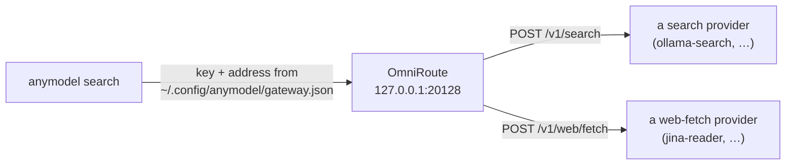

# Web Search

`anymodel search` searches the web, or reads one page's text, through the local gateway's
OmniRoute backend — the same program and the same key the gateway's cheap models use. It
is a command, not a service: nothing runs in the background, and Claude Code reaches it
through the Bash tool (the `search` skill, `plugin/skills/search/SKILL.md`).

```sh
anymodel search "bun runtime latest version"          # 5 results: title, URL, snippet
anymodel search "bun runtime latest version" --max 3  # fewer
anymodel search --fetch https://bun.sh/blog           # one page's text, in Markdown
anymodel search "bun runtime" --json                  # OmniRoute's whole answer, uncut
```



## How it works

- It **reads the gateway's own config file** (`src/gateway/config.ts`): the `omniroute`
  backend's `baseUrl` and `apiKey`. Same file, same mode-600 rule, same key as the
  router. No second key to set up, and no new file.
- It sends **`POST <baseUrl>/v1/search`** with `{"query", "max_results"}` and the key as
  `Authorization: Bearer …`. OmniRoute answers a normalized list: `provider`, `results[]`
  (`title`, `url`, `snippet`), `usage`, `metrics`, `cached`. With the default setup the
  provider is `ollama-search` — Ollama's web search (`https://ollama.com/api/web_search`).
- It sends **`POST <baseUrl>/v1/web/fetch`** with `{"url", "format": "markdown",
  "include_metadata": true}` for `--fetch`. OmniRoute routes that to a web-fetch provider
  of its own, not to Ollama.
- **The key is never printed.** It reaches the request's header and nothing else; a
  failed request's reason — OmniRoute's answer, or the error `fetch` threw — goes
  through the router's own `maskSecrets` (the function its log uses,
  `src/gateway/router.ts`) with the key in its known list, so a provider that echoes a
  key back cannot put it on the terminal. The address is shown through `shownValue`: a
  `baseUrl` with a user and a password in it is masked. A 200 answer is **not** masked:
  the generic "32 characters or more" rule would wreck real page text, and the answer is
  the local OmniRoute's own.
- **The key never goes through a proxy to an OmniRoute on this machine.** Bun's `fetch`
  sends a request through `HTTP_PROXY` / `HTTPS_PROXY` / `ALL_PROXY` unless `NO_PROXY`
  lists the host, and this request carries the key. So for a `baseUrl` on 127.0.0.0/8,
  `::1` or `localhost`, the request goes straight there (`directIfLoopback`,
  `src/gateway/hosts.ts`, the same rule the gateway uses for its own backend calls).
- **Web text never drives the terminal.** A title, a URL, a snippet, the provider's name
  and a page's text come from the web, and a terminal obeys control characters inside
  text: an escape sequence can write the clipboard or hide text, a bidi override shows
  text in another order, a line break can forge a result line. So every control and
  format character becomes a space (`src/gateway/plain-text.ts`); a page's text keeps
  only its line breaks and tabs. `--json` writes each of them as a JSON escape
  (`\u001b`, `\u202e`), so the JSON parses back to the same answer.
- **The plain output is cut** to about 2500 characters, and each snippet to 300, because
  Ollama's `content` per result is a whole page's text. A cut never leaves half of a
  character (an emoji is two units). `--json` prints everything: it is the way to get the
  full text of a result.

## The cost of a search

Measured on 2026-10-15, one query ("bun runtime latest version") through a local
OmniRoute, gateway 0.2.1:

| What | Result |
|---|---|
| Provider OmniRoute chose | `ollama-search` (cost 0 in OmniRoute's registry, free monthly quota 1000) |
| First call | HTTP 200 in 930 ms from the shell (OmniRoute's own `metrics.response_time_ms`: 847 ms) |
| Answer size | 298,340 bytes for 5 results — the snippets were whole pages (585 to 61,350 characters each) |
| Cost | `usage.search_cost_usd: 0` — **$0.00 a search** |
| The same query again | HTTP 200 in 42 ms, `cached: true`: OmniRoute keeps a query for 5 minutes (`cacheTTLMs`) |
| `anymodel search "…" --max 3`, the built command | 886 ms from the shell for 3 results, the header reading `in 796 ms` |
| `--fetch https://example.com` | HTTP 400: "No credentials configured for any web-fetch provider…" (see § Limits) |

Ollama's own pricing page (ollama.com/pricing, read 2026-10-15) prices models per token
and says nothing about web search; its blog post (ollama.com/blog/web-search) says search
is "included with a free Ollama account, with much higher rate limits available by
upgrading". So on a free Ollama account a search costs nothing; a paid OmniRoute search
provider would change that, and the command then prints `cost $0.00xx` in the header.

## Limits

- **It needs the gateway set up**: a `~/.config/anymodel/gateway.json` with an
  `omniroute` backend (`anymodel gateway setup --backend-key-stdin omniroute`), and
  OmniRoute answering. Without a config, with a config it cannot use, or without that
  backend, the command stops with what to do — exit code 1.
- **`--fetch` needs a web-fetch provider key inside OmniRoute** — firecrawl,
  jina-reader, tavily-search, tinyfish, anysearch-search, context7 or nimble-search,
  added in OmniRoute's own dashboard. Without one, OmniRoute answers 400 and that reason
  is what the command prints. Ollama's own fetch API is **not** among them (OmniRoute
  3.8.51).
- **One query, not a crawl.** OmniRoute's `/v1/search` takes one query string; there is
  no site walk, no pagination, and no second page of results (`--max` asks for more
  results, not for more pages).
- **Result count**: `--max` takes 1 to 50; more is refused before anything is sent.
  OmniRoute then clamps `max_results` to the provider's own maximum. For `ollama-search`
  that is 10, with 5 as the default; `--max 20` answers at most 10. `--max` is for a
  search only: with `--fetch` it is refused.
- **No news or date filter.** OmniRoute's API has `search_type: news` and `time_range`;
  this command sends neither, so it always searches the web as a whole.
- **The plain output is cut** at about 2500 characters (300 a snippet). A long page's
  text is only whole under `--json`.
- **The key stays local; the query does not.** The command talks to `baseUrl` from the
  config, which is `http://127.0.0.1:20128` in the default setup: the key goes there and
  nowhere else. But every query, and every `--fetch` URL, leaves this machine:
  OmniRoute sends it to a third party — Ollama's web search, or the fetch provider —
  under OmniRoute's own provider key. So a query or a URL must never hold a key, a
  private host name or private data.
- **`--fetch` refuses a local or private address**, before anything is sent: a loopback
  one (127.0.0.0/8, `::1`, `localhost`, `*.localhost`), an unspecified one (0.0.0.0/8,
  `::`), a link-local one (169.254.0.0/16, fe80::/10), a private one (10.0.0.0/8,
  172.16.0.0/12, 192.168.0.0/16, fc00::/7, and the IPv4-mapped IPv6 form of each), and a
  private name (one with no dot, or under `.local`, `.internal` or `.home.arpa`). The
  fetch provider is on the internet: it cannot reach such a page, and the address would
  leave this machine for nothing. There is no switch to allow one, for that reason. A
  public name that resolves to a private address is not caught: the name is resolved by
  the provider, not here.
- **A remote OmniRoute** (a `baseUrl` not on this machine) works too: the key then
  travels to that address, which is what `gateway.json` says. That request keeps the
  environment's proxy settings (`HTTP_PROXY`, `HTTPS_PROXY`, `ALL_PROXY`, `NO_PROXY`),
  so a proxy there sees where the key goes — and with an `http://` `baseUrl`, the key
  itself. Use `https://`, or list the host in `NO_PROXY`. Only a `baseUrl` on this
  machine skips the proxy (§ How it works).
- **A redirect is refused, not followed**: the key would travel to whatever address the
  answer names. So a proxy in front of OmniRoute must be the address in
  `backends.omniroute.baseUrl`, not a redirect to it.
- **The tests never reach a provider.** Every test uses a fake server on a free port
  (`src/search/client.test.ts`, `src/search/command.test.ts`; a fake proxy too, for the
  proxy rule); the numbers above come from the live calls listed in § The cost of a
  search.
